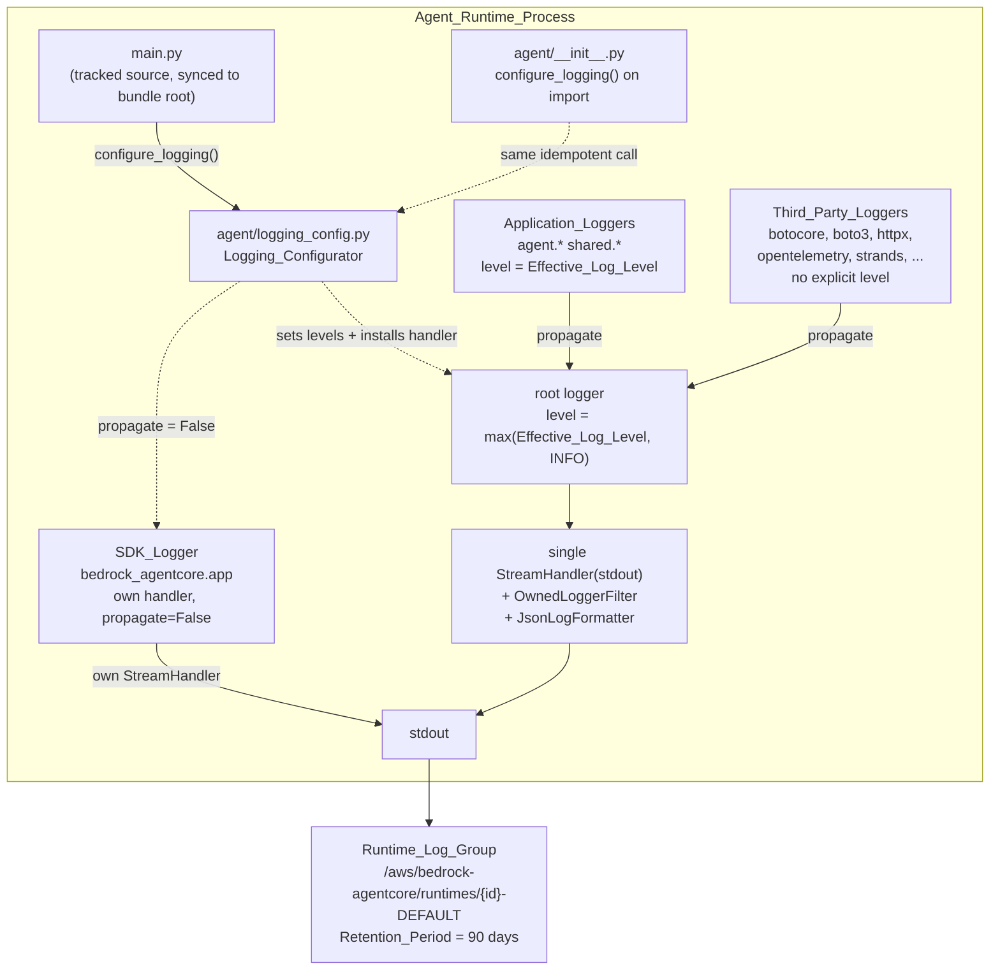

# Design Document: Agent Log Delivery

## Overview

The agent writes 15 log statements and delivers none of them. The fix is one stdlib-only module that installs a single root handler, plus the three edits needed to make installing that handler safe.

The handler is the small half. Log delivery in a redaction product is a *content* change: 15 statements that have never left the process start landing in CloudWatch the moment a handler exists, and two indirect channels can carry document text into them. This design spends most of its length there.

Four things the requirements phase left open or found while investigating:

1. **The deployed entrypoint is not under version control**, and it — not `agent/runtime.py` — is where the Configurator has to be invoked (Component 2).
2. **`botocore` at DEBUG would stream whole documents.** `ApplyGuardrail`'s request body *is* the document text; `DetectDocumentText`'s *is* the page image. Two mechanisms in Component 1, neither of which `LOG_LEVEL=DEBUG` can widen.
3. **The exception-message channel.** Four sites log a traceback, two interpolate a caught error. A formatter that renders frames without the exception string, plus one shared sanitizer at the two interpolating sites.
4. **Retention.** Investigated, not assumed: CDK *can* set it on the group the AgentCore service creates. Requirement 5.5's escape hatch is not needed (Component 5).

Two corrections to the record:

- **`orchestration.py` and `backend/shared/` contain no logging at all** — zero `logger.*` call sites in either tree. So `handle_job`'s graceful-degradation branches (the Guardrails `except Exception: guardrails_matches = []`, the `verify_structure` failure path, the top-level catch-all) are silent **by omission, not by delivery failure**. Installing a handler will not make them speak. Adding those statements is **out of scope for this spec**, and is named here only so nobody reads the finished feature and concludes the branches are still broken.
- **The deployed entrypoint swallows its own exceptions without logging.** `agent_bundle/package_clean/main.py`'s `except Exception as e: return {"status": "error", ...}` has no log statement. So a handler alone would still produce no record on an invocation-level failure — the statement that would have logged it (`runtime.py`'s `logger.exception("handle_job raised for jobId %s")`) lives in a module production never imports. Delivery and entrypoint version control are one problem, not two adjacent ones.

22 log call sites were audited (15 under `backend/agent/`, 7 under `backend/lambdas/`). **Three change.** Component 4 lists both sets.

## Architecture



Two things in that diagram carry the design.

**The root logger's level is a floor, not the configured level.** `root.setLevel(max(Effective_Log_Level, INFO))`. Every third-party logger in the bundle has no explicit level of its own, so all of them inherit that floor and `botocore.endpoint`'s `logger.debug("Request body: %s", body)` is never *constructed*. `LOG_LEVEL=DEBUG` lowers `agent` and `shared` to DEBUG and leaves the floor at INFO. This is the primary enforcement of Requirement 2.6, and the one an operator cannot widen through configuration.

**The handler carries an allow-list filter, not a deny-list.** A record is admitted if its logger's first dotted component is in `{"agent", "shared"}` **or** its level is at least INFO. That closes what the floor cannot reach: a dependency that sets its own level in code (`boto3.set_stream_logger()`, or a library calling `logger.setLevel(DEBUG)` at import). An allow-list is closed by construction; a deny-list of third-party logger names would need maintaining and would fail open the first time a dependency was added. That is why this design enumerates no third-party names anywhere.

The SDK logger is separate because it already has its own handler and formatter, and propagates to root by default. `propagate = False` on `bedrock_agentcore.app` gives Requirement 1.6's exactly-one-record; without it the four events that reach CloudWatch today would become eight.

## Components and Interfaces

### Component 1: `backend/agent/logging_config.py` (new — the Logging_Configurator)

Standard library only (Requirement 3.5): `json`, `logging`, `os`, `sys`, `traceback`, `datetime`. No AWS Lambda Powertools, and the formatter below is why that costs nothing — matching the SDK's field set is one `format` method.

```python
OWNED_LOGGER_ROOTS = frozenset({"agent", "shared"})

LOG_LEVEL_ENV_VAR = "LOG_LEVEL"
DEFAULT_LOG_LEVEL = logging.INFO

#: Explicit, not `logging.getLevelNamesMapping()`. An explicit mapping refuses
#: `NOTSET` and numeric strings ("10") — both misconfigurations rather than
#: intentions — and makes Requirement 4.4's "names no Python logging level" a
#: closed question.
_LEVEL_NAMES = {"CRITICAL": ..., "ERROR": ..., "WARNING": ..., "INFO": ..., "DEBUG": ...}

_HANDLER_MARKER = "_agent_log_delivery_handler"

def resolve_log_level(raw: Optional[str]) -> Tuple[int, Optional[str]]: ...
def describe_exception(error: BaseException) -> str: ...
def configure_logging() -> logging.Handler: ...

class OwnedLoggerFilter(logging.Filter): ...
class JsonLogFormatter(logging.Formatter): ...
```

**`resolve_log_level`** returns `(level, warning_or_None)`. Absent, whitespace-only, unknown, and wrong case are all covered by `raw.strip().upper()` against `_LEVEL_NAMES` (Requirements 4.1, 4.3, 4.5). An unrecognised value returns the default plus a warning string naming `LOG_LEVEL` and the level applied. That warning is *returned, not emitted* — no handler exists yet when the level is resolved, and emitting it after installation is the only ordering that makes Requirement 4.4 satisfiable.

**`configure_logging`**, in order:

1. Resolve the level.
2. Find or create a `StreamHandler(sys.stdout)` tagged with `_HANDLER_MARKER`; reuse it if root already carries one. Requirement 1.3's idempotence, attribute-based rather than a module-level `_configured` flag so a second call still re-applies levels (which a flag would skip) without adding a second handler.
3. `root.setLevel(max(level, logging.INFO))` — the floor.
4. `getLogger(name).setLevel(level)` for each of `OWNED_LOGGER_ROOTS`.
5. Sweep `logging.root.manager.loggerDict` and set the level on every already-created logger with an owned root component. Requirement 1.9: a child logger's explicit level beats an ancestor's, and `agent/runtime.py` sets one today. The sweep only reaches loggers created before configuration, so Component 3 also removes that line rather than relying on the sweep alone.
6. `getLogger("bedrock_agentcore.app").propagate = False` (Requirement 1.6).
7. Emit the deferred warning, if any.
8. Return the handler, so tests can drive filter and formatter directly.

**`OwnedLoggerFilter.filter`** is one expression:

```python
return record.name.split(".", 1)[0] in OWNED_LOGGER_ROOTS or record.levelno >= logging.INFO
```

Unconditional — it never consults `LOG_LEVEL`, so no configuration turns it off. `bedrock_agentcore` is deliberately not owned: its own handler serves it, and the INFO floor at root costs it nothing.

**`JsonLogFormatter.format`** emits one line of `json.dumps(entry, ensure_ascii=False, default=str)`, mirroring `bedrock_agentcore.runtime.app.RequestContextFormatter` field for field (Requirement 3.4 — these names were read out of the installed SDK, not guessed):

| Field | Source | Notes |
|---|---|---|
| `timestamp` | `datetime.now(timezone.utc)`, `%Y-%m-%dT%H:%M:%S.%f`[:-3] + `"Z"` | The SDK uses the deprecated `utcnow()`; this uses an aware clock and formats identically |
| `level` | `record.levelname` | |
| `message` | `record.getMessage()` | |
| `logger` | `record.name` | |
| `errorType` | `type(exc).__name__` | Only when `record.exc_info` |
| `errorMessage` | `describe_exception(exc)` | **Sanitized — below** |
| `stackTrace` | `traceback.format_tb(tb)` | **Frames only — below** |
| `location` | `f"{record.pathname}:{record.funcName}:{record.lineno}"` | |

`ensure_ascii=False` is load-bearing, not cosmetic: a future statement carrying a rule name in Chinese would otherwise become unreadable `\uXXXX` escapes. `default=str` satisfies Requirement 3.6. Two deliberate omissions: `requestId` and `sessionId`, which the SDK reads from `BedrockAgentCoreContext` — importing that would break Requirement 3.5. Their absence is also how a reader distinguishes an application record from an SDK record in a mixed stream. Threading `jobId` through a stdlib `contextvars.ContextVar` would restore per-job correlation for about ten lines; deliberately deferred, since no requirement asks for it and it belongs with whatever spec adds the out-of-scope `handle_job` statements.

One guard: `record.getMessage()` raises if the format string and args disagree, and `logging` swallows that and drops the record — the worst outcome for a feature about not dropping records. Message interpolation is wrapped; on failure the record is emitted with `message` set to `str(record.msg)` (a literal in all 22 sites) plus a `formatError` field carrying only an exception type name. Never `record.args`, which is where a Sensitive_Value would be.

#### How the exception-message channel is closed

Four sites hand exception information to `logging`: three `exc_info=True` warnings in `guardrails_pii_detect.py`, and `runtime.py`'s `logger.exception`. None names a value and none changes. The leak, if any, is in what `logging` renders on their behalf.

The standard rendering is `traceback.format_exception(*exc_info)`, whose last line is `f"{type}: {str(exc)}"` — and `str(exc)` on a `botocore` `ParamValidationError` can quote the offending parameter, which for `ApplyGuardrail` is the document text and for `DetectDocumentText` is the page image. The SDK's own formatter does exactly this. This one does not.

- **`stackTrace` uses `traceback.format_tb(exc_info[2])`.** Frames only: file, line number, function name, and the source line text. Source text is code, never a value. `format_tb` never renders the exception's `str()`, and never walks `__cause__` / `__context__`, so `raise OcrPathError(...) from botocore_error` cannot smuggle the botocore message in through the chain.
- **`errorMessage` uses `describe_exception`**, the only place `str(exc)` is ever consulted, and only for exceptions this project defines:

```python
def describe_exception(error: BaseException) -> str:
    module = type(error).__module__ or ""
    if module.split(".", 1)[0] in OWNED_LOGGER_ROOTS:
        return str(error)                       # audited message construction
    response = getattr(error, "response", None) # duck-typed botocore ClientError
    if isinstance(response, dict):
        code = (response.get("Error") or {}).get("Code")
        if code:
            return "AWS error code {}".format(code)
    return "<message omitted: unaudited exception type>"
```

The project branch covers `OcrPathError`, `OrchestrationError` and `InvalidInvocationPayloadError`, whose messages are literals interpolated with a page index, a jobId, a dpi value and a payload field name — all Safe_References. The `botocore` branch keeps the one diagnostically load-bearing part of an AWS error (`ThrottlingException` vs `ValidationException` vs `AccessDeniedException`) and discards the free text. Everything else is omitted, so the default for an exception type nobody has looked at is silence rather than a leak. `errorType` is always present, so an omitted message still leaves a name to search on.

One limitation, stated rather than glossed: `OcrPathError`'s messages interpolate an upstream error's `str()`. That is acceptable **only because `OcrPathError` is never logged** — `handle_job` converts it into a `failed` Job with `errorMessage` in DynamoDB. If a future change logs it, the message must be sanitized at construction first. The same caveat applies to `update_job_status(..., error_message=str(exc))`, which puts unsanitized exception text in DynamoDB today; that is the Job data model's field, not a Log_Record, and is out of scope here.

### Component 2: The entrypoint becomes version-controlled

Three files, because two different failure modes have to be closed.

**`backend/agent/main.py` (new, tracked) — the Agent_Entrypoint_Source.** An exact copy of what the bundle root must contain (Requirement 1.8):

```python
"""AgentCore Runtime entrypoint. Synced to the Agent_Bundle root by
scripts/sync_agent_entrypoint.py; the bundle copy is gitignored, this is the
source of record."""
import os
import sys

sys.path.insert(0, os.path.dirname(os.path.abspath(__file__)))

from agent.logging_config import configure_logging   # stdlib-only, cheap

configure_logging()

from bedrock_agentcore.runtime import BedrockAgentCoreApp

app = BedrockAgentCoreApp()


@app.entrypoint
async def invoke(payload, context=None):
    from agent.runtime import process_invocation      # lazy: pulls boto3, pdfminer.six/pikepdf/pypdfium2, docx
    return process_invocation(payload)


if __name__ == "__main__":
    app.run()
```

Two changes from the file on disk, both consequential:

- `configure_logging()` runs at import, before any invocation is dispatched (Requirement 1.7). Safe to do at import precisely because `agent.logging_config` imports only the standard library — the existing file's lazy-import discipline exists to stay inside AgentCore's 30-second initialisation limit, and this import costs nothing against it.
- The hand-rolled payload parsing and silent `except Exception` are replaced by `process_invocation`. Not tidying: `process_invocation` is the unit-tested version (it rejects a non-string `jobId`, returns typed error codes, and **logs**), where the current inline version returns `{"status": "error"}` with no record at all. Without this line, installing a handler still produces nothing when a job fails at the invocation level.

**`backend/scripts/sync_agent_entrypoint.py` (new, tracked).** Copies `backend/agent/main.py` to `backend/agent_bundle/package_clean/main.py`, failing loudly if the bundle directory is absent. About twenty lines. Without it, "produced from a version-controlled source file" is a convention in a docstring — and the bundle on disk right now already differs from what is about to be tracked.

**`backend/agent/__init__.py` (currently empty) calls `configure_logging()` on import.** This is what makes delivery true regardless of what the untracked bundle copy contains. Every path to `handle_job` goes through `import agent.orchestration`, which imports the `agent` package first.

**On the import-time side effect.** Configuring logging when a library module is imported is normally bad practice, so: why it is acceptable here.

- `backend/agent/` is not a library. It has one consumer, the Agent_Runtime_Process, and no external importer whose configuration could be clobbered.
- The call is idempotent by construction (Requirement 1.3), so import-then-explicit-call installs one handler, not two.
- It is additive: it installs a handler and sets levels, removes nothing.
- It is stdlib-only, so it cannot fail on a missing dependency.
- It does not disturb the test suite. `pytest` captures stdout/stderr and surfaces it only for failing tests, and `caplog` attaches its own handler to root, which ours neither replaces nor filters.

**Why the alternatives lose.**

- *Import-time configuration alone, no tracked entrypoint.* Fixes delivery, leaves the production process unversioned — unreviewable, undiffable, unrebuildable if the developer's machine dies. Requirement 1.8 exists to close that, and it is the more serious of the two defects.
- *Tracked entrypoint alone, no import-time call.* Makes delivery contingent on someone re-running the sync before the next `cdk deploy`. A stale bundle silently reverts the fix, and the symptom is indistinguishable from the bug. Idempotence makes belt-and-braces nearly free.
- *Bundle generated from a tracked template.* A rendering step for a file with nothing to substitute — every per-deployment value already arrives through environment variables.
- *Move the entrypoint into the package, `entrypoint=["agent/main.py"]`.* Genuinely attractive: the bundle build already copies `backend/agent/`, so the sync script would be unnecessary. Rejected because `entrypoint` is a container command list and the working-directory / `sys.path` semantics of a subdirectory path are undocumented for `AgentRuntimeArtifact.from_code_asset`. It is the one change here no unit test can verify, and a deployment-only failure mode is a bad trade for deleting twenty lines. `entrypoint=["main.py"]` stays.

### Component 3: `agent/runtime.py` — the dead code

Provably dead in production, because the deployed entrypoint never imports the module: `build_agentcore_app()`, `main()`, the `__main__` block, `build_redaction_agent()`. Live and unit-tested: `extract_job_id`, `process_invocation`, the status/error-code constants, `InvalidInvocationPayloadError`.

**Recommendation: delete all four, and rewrite the module docstring.** After Component 2, `backend/agent/main.py` *is* the entrypoint and does the `BedrockAgentCoreApp` wiring; `runtime.py` becomes what it has always actually been — the SDK-independent invocation-handling core. Keeping a second, divergent copy of the app construction in a module nothing imports is how the current situation arose. No test calls any of the four (`test_agent_runtime.py` mentions two in a docstring only), so the deletion is test-neutral.

Also delete `logger.setLevel(logging.INFO)` at line 67 — the level is the Configurator's to own (Requirement 1.9), and leaving it makes the loggerDict sweep load-bearing for no reason.

**On `strands-agents`: recommend, do not delete.** `build_redaction_agent()` is the only importer of `strands`, and `strands_agents-1.1.0` is vendored into the bundle with a visible transitive tail (`mcp`, `opentelemetry`, `pydantic`, `pydantic_settings`, `docstring_parser`, `sse_starlette`). Deleting the function makes the dependency removable, and removing it would meaningfully shrink the artifact. This spec does neither: it leaves the `strands-agents` line in `requirements.txt` with a comment recording that nothing imports it, and flags "remove `strands-agents`, rebuild and re-verify the bundle" as a follow-up. Dropping a dependency changes the bundle's whole dependency closure, which no unit test can verify and only a deploy can confirm — and a spec about installing a log handler is the wrong place to hide an artifact rebuild. The unpinned version in `requirements.txt` is a separate pre-existing issue, likewise left alone.

> **Correction, recorded after approval — the `strands-agents` follow-up above is superseded.** Future agent development on this project will use the Strands Agents SDK, so `strands-agents==1.50.2` stays in `backend/requirements.txt` as a deliberate forward-looking dependency. The "remove `strands-agents`, rebuild and re-verify the bundle" follow-up is withdrawn and does not appear in `tasks.md`; neither does the "nothing imports it" comment.
>
> Deleting `build_redaction_agent()` is still correct, and for a reason that is not "removing Strands support": the function registers the entire fixed-order pipeline as a *single* tool with no model-driven planning, which is a vestige of the deterministic-pipeline decision that made Strands unnecessary here. It is not a useful reference for real Strands work, which will have a genuinely different shape — actual tool sequences, actual planning. Keeping a divergent second copy of app construction in a module nothing imports is what produced the entrypoint problem this spec exists to fix.
>
> `tasks.md` additionally installs `strands-agents==1.50.2` and `bedrock-agentcore==1.20.0` into `backend/.venv`, converting two pins whose only evidence is wheel availability into import-verified ones.

### Component 4: Which call sites change

**Three of 22.**

| Site | Change | Why |
|---|---|---|
| `guardrails_pii_detect.py:277` | `..., error` → `..., describe_exception(error)` | Interpolates a caught `ApplyGuardrail` exception. That call's request body *is* the document text, so a `ParamValidationError` can echo it (Requirement 2.8) |
| `ocr_pdf.py:329` | `..., error` → `..., describe_exception(error)` | Interpolates a caught `DetectDocumentText` exception. Same channel; the request body there is the page image |
| `rule_operation_processor.py:209` | `"...: %s", record` → `"... (messageId %s, operationId %s)", record.get("messageId"), <operationId>` | Logs the entire SQS record, whose `body` carries the user-authored `pattern`. Requirement 2.5 makes Rule_Pattern sensitive, and **Lambda logs already work, so this is leaking in production today** (Requirements 2.9, 6.4). `operationId` is read defensively — `json.loads(record["body"])` may be what failed |

**Nineteen do not change**, stated positively so the audit is on the record:

- `guardrails_pii_detect.py` × 8: entity types, `unitRef` strings, occurrence counts, attempt numbers, environment variable names, span counts. The three `exc_info=True` warnings (290, 473, 581) keep their arguments and get their safety from `JsonLogFormatter`, not from an edit.
- `ocr_pdf.py` × 3: the `PDF_OCR_DPI` value (operator configuration, not PII), the dpi bounds, page index and byte counts.
- `runtime.py` × 2: the `InvalidInvocationPayloadError` warning (messages are literals plus the field name `jobId`) and `logger.exception("handle_job raised for jobId %s", job_id)` (a Safe_Reference, with a formatter-sanitized traceback).
- `lambdas/` × 6: `job_dispatcher` (jobId), `rules_init_handler` × 2 (rule name, CloudFormation `RequestType`), `rule_operation_processor:181` (operation type), `rule_operation_submit_handler:232` (HTTP method), `upload_handler` × 3 (jobId, or no arguments).

The Lambda handlers keep their `getLogger(__name__)` + `setLevel(INFO)` configuration and do not import the Configurator (Requirements 6.1–6.3). Their tracebacks are rendered by the AWS Lambda runtime's formatter, not `JsonLogFormatter`, so they stay unsanitized — consistent with Requirement 2.9, whose scope is criteria 2.1–2.5 and deliberately excludes the exception-message rule. Their exceptions are S3, DynamoDB and SQS client errors plus one multipart-parse failure; none echoes document content. Bringing them under the same sanitizer would mean installing a formatter in eight working handlers, which Requirement 6 exists to forbid.

### Component 5: CDK — `LOG_LEVEL` and retention

**`LOG_LEVEL`** joins the AgentCore Runtime's environment variables next to `GUARDRAIL_ID` and `PDF_OCR_DPI` (Requirement 4.6), set to `"INFO"` — the default made explicit, in the same style as the existing `"PDF_OCR_DPI": "200"`, so raising verbosity means editing a visible value rather than discovering an absent variable.

**Retention was investigated, and the answer is yes.** Requirement 5.4 is satisfiable from the stack; 5.5's "record the mechanism used instead" is not needed. Verified against the installed `aws-cdk-lib` 2.263.0 by synthesising a throwaway stack:

- `agentcore.Runtime` exposes `application_log_group`, a memoized imported reference to `/aws/bedrock-agentcore/runtimes/{AgentRuntimeId}-DEFAULT`.
- `logs.LogRetention` accepts that name and emits a `Custom::LogRetention` whose `LogGroupName` resolves to `Fn::Join["", ["/aws/bedrock-agentcore/runtimes/", Fn::GetAtt[Runtime, "AgentRuntimeId"], "-DEFAULT"]]` with `RetentionInDays: 90`. Its Lambda calls `CreateLogGroup` then `PutRetentionPolicy`, tolerating `ResourceAlreadyExistsException`, so it works whether the group exists or not.

```python
logs.LogRetention(
    self,
    "AgentRuntimeLogRetention",
    log_group_name=self.agent_runtime.application_log_group.log_group_name,
    retention=logs.RetentionDays.THREE_MONTHS,
)
```

The AgentCore service creates the group on first invocation, which matters for ordering only, and both orderings are safe: deploy-before pre-creates the group with retention set, deploy-after sets retention on the existing group. One caveat to record: the name embeds `AgentRuntimeId`, so replacing the runtime produces a new group and the resource follows the new name, leaving the old group at whatever retention it had. Acceptable for a POC, and a job for a future cleanup task rather than this spec.

`LogRetention`'s `removal_policy` is left at its `RETAIN` default: `cdk destroy` should not take the last quarter's operational record with it, unlike the source and output buckets which are `DESTROY` on purpose.

**Retention_Period = 90 days**, justified against the posture rather than picked:

- These records are PII-free by construction — that is the point of Requirement 2 — so retention here is not a data-subject deletion obligation. It is how far back an operator can look, and what the store costs.
- The audit record of what was redacted lives in DynamoDB (`RedactionJob.detectionSummary`) and is not governed by this window. Logs are the diagnostic layer, not the record of record.
- 90 days covers a quarterly compliance review cycle and comfortably covers the window in which anyone asks "why did this document come back over-redacted" — the question these warnings exist to answer.
- Indefinite retention is the thing being ruled out. A compliance product that cannot answer "how long do you keep logs about redaction jobs" with a number has a finding waiting for it, whatever the logs contain.
- `RetentionDays.ONE_MONTH` is the cheaper alternative and a one-token change. Given Requirements 5.1 and 5.2 hold volume to one record per warning rather than per detection or per unit, it should not be needed.

## Data Models

**No changes to `shared/models.py`.** Nothing here adds, removes or reshapes a dataclass — worth stating, because every previous detection-source feature in this project needed one.

The only new shape is the Log_Record, a serialization format rather than a Python type. Two examples, both real statements from the code as it will stand:

```json
{"timestamp":"2026-03-11T04:22:07.318Z","level":"WARNING","message":"Digit-boundary filter rejected all 3 occurrences of the CREDIT_DEBIT_CARD_CVV match in text:12; emitting all 3 as a fallback rather than risk leaving the value unredacted","logger":"agent.tools.guardrails_pii_detect"}
```

```json
{"timestamp":"2026-03-11T04:22:09.004Z","level":"WARNING","message":"Could not parse ApplyGuardrail response; skipping this text unit","logger":"agent.tools.guardrails_pii_detect","errorType":"KeyError","errorMessage":"<message omitted: unaudited exception type>","stackTrace":["  File \"/app/agent/tools/guardrails_pii_detect.py\", line 288, in _call_apply_guardrail\n    return _extract_pii_entities(response)\n"],"location":"/app/agent/tools/guardrails_pii_detect.py:_call_apply_guardrail:290"}
```

The second is the exception-message channel closed in practice: `errorType` and the frame survive, `str(exc)` does not.

## Correctness Properties

*A property is a characteristic or behavior that should hold true across all valid executions of a system — essentially, a formal statement about what the system should do. Properties serve as the bridge between human-readable specifications and machine-verifiable correctness guarantees.*

Forty-one acceptance criteria reduce to eight properties. The rest are static facts about the source, single constants, or CloudFormation synthesis — none of which improves when run a hundred times. Those become examples and two integration assertions in the Testing Strategy.

### Property 1: No Sensitive_Value reaches an emitted record

*For any* set of marker values planted as document text, matched values, S3 keys, file names and rule patterns, and *for any* combination of fake Bedrock and Textract behaviours — returning detections for those markers, or raising an exception whose own message contains a marker — no line the Logging_Configurator's handler emits for the resulting pipeline run contains any marker as a substring.

Three details make this worth more than five per-class checks. The assertion is over the **serialized output of the handler**, not `caplog.records` — a record's `args` are innocent until `getMessage()` and the formatter render them, and the leak lives in the rendering. The fakes' **raising mode is not optional**: half the draws must make `apply_guardrail` or `detect_document_text` raise with a marker in the exception message, because that is the channel `exc_info=True` and the two interpolating sites open, and the channel a test of deliberate message arguments would declare clean. And it is substring, not equality — a marker embedded in a longer string still counts.

**Validates: Requirements 2.1, 2.2, 2.3, 2.4, 2.5, 2.8**

### Property 2: Third_Party_Loggers stay at the INFO floor for every LOG_LEVEL

*For any* `LOG_LEVEL` value and *for any* dotted logger name whose first component is not `agent` or `shared`, after configuration that logger reports not enabled for DEBUG when it carries no explicit level; and *for any* record manufactured below INFO under such a name, the handler's filter rejects it even when that logger has been given an explicit DEBUG level.

Generating the logger name rather than testing `botocore` by name is the point: a test that names `botocore` passes against a deny-list, which fails open for the next dependency added. The second clause covers what the floor cannot reach, and holds unconditionally, so no value of `LOG_LEVEL` weakens it.

**Validates: Requirements 2.6**

### Property 3: Configuration is idempotent

*For any* number of consecutive `configure_logging()` calls within one process, and *for any* sequence of `LOG_LEVEL` values in effect across them, the set of handlers on the root logger equals the set installed by a single call.

`f(x) = f(f(x))` over the handler set — what makes the import-time invocation in `agent/__init__.py` safe alongside the entrypoint's explicit call.

**Validates: Requirements 1.3**

### Property 4: Owned loggers carry the Effective_Log_Level and deliver exactly once

*For any* set of dotted logger names under `agent.` or `shared.`, each pre-created with an arbitrary explicit level before configuration, and *for any* `LOG_LEVEL` value: after configuration every one reports the Effective_Log_Level, and emitting one record at or above that level from any of them produces exactly one line on the handler's stream.

Pre-creating with an arbitrary level is Requirement 1.9 — a child's explicit level beats an ancestor's, which is exactly how `runtime.py`'s `setLevel(logging.INFO)` would have pinned the module at INFO under `LOG_LEVEL=DEBUG`. The exactly-one-line clause is 1.4 and 1.5, and it is what a duplicate handler or an unwanted propagation path breaks.

**Validates: Requirements 1.4, 1.5, 1.9**

### Property 5: Every record serializes to exactly one parseable line

*For any* format string and *for any* argument tuple — including arguments carrying newlines, CJK characters, control characters, and objects that cannot be JSON-serialized — and *for any* exception information attached or absent, the formatter's output contains no embedded newline, parses as a single JSON object, and carries `timestamp`, `level`, `logger` and `message`; and when exception information is attached it additionally carries `errorType`, `errorMessage` and `stackTrace` as distinct fields with a non-empty `stackTrace`.

The round-trip is what makes the Logs Insights queries this format exists for possible. Newline-bearing arguments are the specific hazard: a record spanning two lines becomes two events, and a query counting events over-counts. Non-serializable arguments are Requirement 3.6, and the generator must include them, because the natural thing for a future statement to log is a dataclass.

**Validates: Requirements 3.1, 3.2, 3.3, 3.6, 2.7**

### Property 6: Level resolution is total and case-insensitive

*For any* string, `resolve_log_level` returns the corresponding level when the stripped, upper-cased form names one of `CRITICAL`, `ERROR`, `WARNING`, `INFO`, `DEBUG`, and `INFO` otherwise; and returns a warning exactly when the input is present, non-blank and unrecognised.

The generator should be biased toward the adversarial near-misses: `" info "`, `"Debug"`, `"warn"`, `"10"`, `"NOTSET"`, `""`, `"   "`. `"10"` and `"NOTSET"` are the two an implementation using `logging.getLevelName` gets wrong in opposite directions.

**Validates: Requirements 4.1, 4.3, 4.4, 4.5**

### Property 7: Record volume is independent of detection and unit counts

*For any* number of text units and *for any* number of PII detections per unit, with every fake on the path that produces no warning, the number of records emitted at `LOG_LEVEL=INFO` is the same.

The failure mode is a record count that grows with the document, which is how a log bill and a retention problem are created. Stating it as independence rather than an absolute bound keeps it working if a future change adds one per-*job* record.

**Validates: Requirements 5.1, 5.2**

### Property 8: A failed Rule Operation record excludes the Rule_Pattern

*For any* rule pattern, when `RuleOperationProcessor` fails to process an SQS record whose body carries that pattern, the emitted record's message excludes the pattern and includes the SQS `messageId`.

Kept separate from Property 1 because it exercises a different process — a Lambda relying on the AWS runtime's own root handler, with no Configurator involved — so folding it in would force one fixture to stand up two incompatible logging setups. It is also the only property here describing a leak happening in production right now.

**Validates: Requirements 2.9, 6.4**

## Error Handling

The Configurator sits underneath everything else, so its failure modes matter more than its features.

**A formatter that raises loses the record.** `logging` catches formatter exceptions, prints to stderr, and drops the event — the worst available outcome for a feature about not dropping events. So every step of `format` that can fail is guarded: message interpolation (falls back to the format string plus a `formatError` field carrying only a type name), JSON serialization (`default=str`, Requirement 3.6), and exception rendering (`describe_exception` touches `str(exc)` only for project types, and `format_tb` on a valid traceback cannot fail). The formatter never re-raises.

**Configuration failing would take the process with it**, since it runs at `agent` package import. It imports only the standard library, reads one environment variable, and every branch of `resolve_log_level` returns a level — no input, including a hostile `LOG_LEVEL`, makes it raise.

**A misconfigured `LOG_LEVEL` degrades to the default and says so** (Requirement 4.4) rather than failing the deploy or silently running at an unexpected verbosity. The warning is emitted after the handler exists, so it is the first record in the stream — visible exactly when an operator is looking, right after changing the variable.

**Double configuration is not an error** (Property 3), so the import-time call and the entrypoint's explicit call coexist and a future module can call it defensively without coordinating.

**Two failure modes are deliberately not handled.** If another component installs its own root handler (an ADOT auto-instrumentation wrapper, say), application records are emitted twice. Not defended against: removing handlers we did not install is worse, and duplication is a cost-and-noise problem rather than a leak — the *level floor* on the root logger, not the handler filter, is what stops `botocore` DEBUG records from existing, and a foreign handler cannot undo that. Separately, if the runtime is replaced, the old log group keeps its old retention (Component 5).

## Testing Strategy

**Library.** `hypothesis` 6.112.1, already in `requirements-dev.txt` and already used in this repo. No new dependency, nothing implemented from scratch.

**Property tests.** One per property above, eight total, each at 100+ iterations and each tagged with the design property it implements:

```python
# Feature: agent-log-delivery, Property 1: No Sensitive_Value reaches an emitted record
```

Two fixtures carry most of the weight, and getting them right is most of the work:

- **A capture fixture** that calls `configure_logging()` with the handler's stream redirected to an in-memory buffer, yields the buffer, and restores root's handlers and levels afterwards. Every output assertion goes through the buffer, not `caplog.records` — `caplog` attaches its own unfiltered, unformatted handler, so a `caplog`-based assertion would miss both the filter and the formatter, which are the two things under test. `caplog` stays the right tool for the existing tests that assert a *statement fired*, which is why the fixture leaves it working.
- **A fake-pipeline fixture** for Property 1 standing up fakes for `bedrock-runtime`, `textract`, S3 and DynamoDB, driving `handle_job` end to end on generated bytes. Its raising mode is not an extra case; it is half the property.

**Unit tests** for the example-classified criteria, kept few and specific:

- `configure_logging` installs exactly one marked `StreamHandler` on `sys.stdout` (1.2), and sets `propagate = False` on `bedrock_agentcore.app` such that a simulated SDK record yields exactly one line across both handlers (1.6).
- `agent/main.py` has a marked handler on root immediately after import, before any invocation (1.7), with `bedrock_agentcore.runtime` stubbed.
- `sync_agent_entrypoint.py` produces a byte-identical copy and fails loudly when the bundle directory is absent (1.8).
- The formatter's key set equals the SDK's, with and without exception info (3.4). This is where the SDK's field names are pinned — prose in a design document does not prevent a rename.
- `agent/logging_config.py` imports only names in `sys.stdlib_module_names`, asserted by parsing the module with `ast` (3.5).
- `DEFAULT_LOG_LEVEL is logging.INFO` (4.2).
- The digit-boundary narrowing record appears under `LOG_LEVEL=DEBUG` and not under `INFO`, while the reject-all fallback and the `OCCURRENCE_WARN_THRESHOLD` warning appear under both (4.7, 4.8). This pins the accepted consequence of defaulting to INFO, so a future edit cannot quietly demote the two warnings that have to survive.
- Every module under `backend/lambdas/` calls `getLogger` and `setLevel`, calls neither `addHandler` nor `basicConfig`, and does not import `agent.logging_config` — all eight parsed with `ast` (6.1, 6.2, 6.3). A negative-space test, worth having precisely because the instinct on reading this spec is to "fix" logging in eight handlers that work.
- No module under `backend/agent/` or `backend/shared/` calls `addHandler` or `basicConfig` (1.5's static half).

**Integration assertions** against one synthesized template (4.6, 5.3, 5.4): the AgentCore Runtime's environment variables include `LOG_LEVEL`, and a `Custom::LogRetention` resource exists with a finite `RetentionInDays` and a `LogGroupName` referencing the runtime's `AgentRuntimeId`. Deterministic, so one execution each.

**Regression surface.** The 26 existing test modules are expected to pass unchanged. `agent/__init__.py` gaining an import-time side effect is the change most likely to disturb them; the reasoning that it does not is in Component 2. The three `caplog` tests in `test_guardrails_pii_detect.py` are the ones to watch, since they set levels on `agent.tools.guardrails_pii_detect` directly — `caplog.at_level` restores what it changed, and our handler does not filter `agent.*`.

**Not tested.** That a record actually arrives in CloudWatch. That is one manual check after deploy — invoke a job, confirm the group holds application-logger events where it previously held four SDK events — and it is a deployment verification step, not a task a coding agent can complete.
