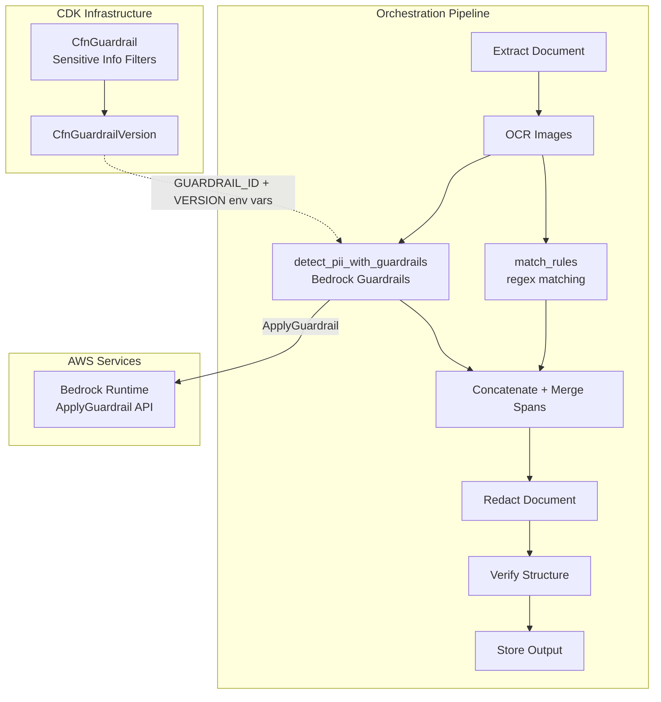
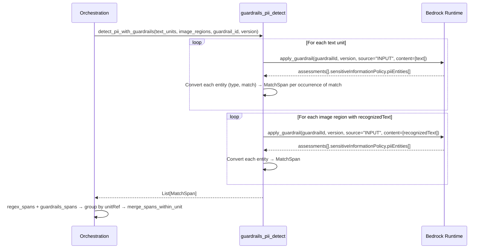

# Design Document: Bedrock Guardrails PII Detection Integration

## Overview

This feature integrates Amazon Bedrock Guardrails Sensitive Information Filters as a supplementary ML-based PII detection layer alongside the existing regex-based matching pipeline. The Guardrails detection runs after regex matching, their results are concatenated, and overlapping spans are merged using the existing `merge_spans_within_unit` function. The feature is always-on with no user-facing configuration — provisioned via CDK and activated automatically when environment variables are present.

The architecture follows the existing pipeline pattern: a new detection tool (`guardrails_pii_detect.py`) calls the `ApplyGuardrail` API for each text unit, converts detections into `MatchSpan` objects, and the orchestration layer combines both detection sources before proceeding to redaction.

## Architecture



## Sequence Diagram: Guardrails Detection Flow



## Components and Interfaces

### Component 1: CDK Guardrail Infrastructure

**Purpose**: Provision the Bedrock Guardrail resource, version, IAM permissions, and environment variable injection.

**Interface** (additions to `RedactionStack`):

> **Note on the PII entity type list**: the 31 types below were verified during
> implementation against the installed `aws_cdk.aws_bedrock` type definitions
> (`CfnGuardrail.PiiEntityConfigProperty.Type`). Three types that exist in
> Amazon Comprehend but are **not** valid Bedrock Guardrails entity types are
> deliberately excluded: `SSN` and `PASSPORT_NUMBER` (the canonical Guardrails
> names are `US_SOCIAL_SECURITY_NUMBER` and `US_PASSPORT_NUMBER`, both of which
> are in the list), and `DATE_TIME` (no Guardrails equivalent). Passing any of
> those three causes a CloudFormation validation failure at deploy time.

```python
# In redaction_stack.py — new resources added to __init__

from aws_cdk import aws_bedrock as bedrock

# 1. CfnGuardrail with all supported PII entity types (31 total)
pii_entity_types = [
    # General
    "NAME",
    "EMAIL",
    "PHONE",
    "ADDRESS",
    "AGE",
    "USERNAME",
    "PASSWORD",
    "DRIVER_ID",
    "LICENSE_PLATE",
    "VEHICLE_IDENTIFICATION_NUMBER",
    # Finance
    "CREDIT_DEBIT_CARD_NUMBER",
    "CREDIT_DEBIT_CARD_CVV",
    "CREDIT_DEBIT_CARD_EXPIRY",
    "PIN",
    "INTERNATIONAL_BANK_ACCOUNT_NUMBER",
    "SWIFT_CODE",
    # IT
    "IP_ADDRESS",
    "MAC_ADDRESS",
    "URL",
    "AWS_ACCESS_KEY",
    "AWS_SECRET_KEY",
    # USA specific
    "US_BANK_ACCOUNT_NUMBER",
    "US_BANK_ROUTING_NUMBER",
    "US_INDIVIDUAL_TAX_IDENTIFICATION_NUMBER",
    "US_PASSPORT_NUMBER",
    "US_SOCIAL_SECURITY_NUMBER",
    # Canada specific
    "CA_HEALTH_NUMBER",
    "CA_SOCIAL_INSURANCE_NUMBER",
    # UK specific
    "UK_NATIONAL_HEALTH_SERVICE_NUMBER",
    "UK_NATIONAL_INSURANCE_NUMBER",
    "UK_UNIQUE_TAXPAYER_REFERENCE_NUMBER",
]

self.pii_guardrail = bedrock.CfnGuardrail(
    self, "PiiGuardrail",
    name="pii-redaction-guardrail",
    sensitive_information_policy_config=bedrock.CfnGuardrail.SensitiveInformationPolicyConfigProperty(
        pii_entities_config=[
            bedrock.CfnGuardrail.PiiEntityConfigProperty(type=pii_type, action="BLOCK")
            for pii_type in pii_entity_types
        ]
    ),
    blocked_input_messaging="PII detected",
    blocked_outputs_messaging="PII detected",
)

# 2. Guardrail version for stable API reference
self.pii_guardrail_version = bedrock.CfnGuardrailVersion(
    self, "PiiGuardrailVersion",
    guardrail_identifier=self.pii_guardrail.attr_guardrail_id,
)

# 3. Grant ApplyGuardrail to Agent execution role
self.agent_execution_role.add_to_policy(
    iam.PolicyStatement(
        actions=["bedrock:ApplyGuardrail"],
        resources=[self.pii_guardrail.attr_guardrail_arn],
    )
)

# 4. Pass env vars to AgentCore Runtime
# Add to environment_variables dict of self.agent_runtime:
#   "GUARDRAIL_ID": self.pii_guardrail.attr_guardrail_id
#   "GUARDRAIL_VERSION": self.pii_guardrail_version.attr_version
```

### Component 2: Guardrails PII Detection Tool

**Purpose**: Call the Bedrock Guardrails `ApplyGuardrail` API for each text unit/image region and convert PII detections into `MatchSpan` objects.

**Interface**:

```python
# backend/agent/tools/guardrails_pii_detect.py

from typing import List, Optional
from shared.models import ExtractedTextUnit, ImageRegion, MatchSpan

GUARDRAIL_ID_ENV_VAR = "GUARDRAIL_ID"
GUARDRAIL_VERSION_ENV_VAR = "GUARDRAIL_VERSION"
MAX_RETRIES = 3

def detect_pii_with_guardrails(
    text_units: List[ExtractedTextUnit],
    image_regions: List[ImageRegion],
) -> List[MatchSpan]:
    """Detect PII entities using Bedrock Guardrails ApplyGuardrail API.

    Args:
        text_units: Extracted text units from the document.
        image_regions: Image regions with optional recognizedText.

    Returns:
        List of MatchSpan objects for detected PII. Returns empty list
        if env vars are missing or on unrecoverable API errors.
    """
    ...
```

**Responsibilities**:
- Read `GUARDRAIL_ID` and `GUARDRAIL_VERSION` from environment variables
- Skip processing entirely (return `[]`) if env vars are missing
- Call `apply_guardrail` for each non-empty text unit and image region with `recognizedText`
- Convert API response PII entities into `MatchSpan` objects, one per non-overlapping occurrence of the match text
- Retry with exponential backoff (up to 3 attempts) on throttling/transient errors
- Return empty list on unrecoverable errors (never raise exceptions to caller)

### Component 3: Orchestration Integration

**Purpose**: Wire Guardrails detection into the existing `handle_job` pipeline and merge results.

**Interface changes** (in `orchestration.py`):

```python
from agent.tools.guardrails_pii_detect import detect_pii_with_guardrails
from agent.tools.matching import merge_spans_within_unit

# Inside handle_job(), after match_rules():
regex_matches = match_rules(content.textUnits, content.imageRegions, enabled_rules)

# Guardrails detection — graceful degradation on any error
try:
    guardrails_matches = detect_pii_with_guardrails(
        content.textUnits, content.imageRegions
    )
except Exception:
    guardrails_matches = []

# Merge: concatenate both sources, re-group by unitRef, merge overlaps
all_spans = regex_matches + guardrails_matches
matches = _regroup_and_merge(all_spans)
```

## Data Models

### ApplyGuardrail API Response (relevant fields)

```python
# Response structure from bedrock-runtime apply_guardrail
{
    "action": "GUARDRAIL_INTERVENED",
    "assessments": [
        {
            "sensitiveInformationPolicy": {
                "piiEntities": [
                    {
                        "type": "NAME",      # PII entity type
                        "match": "张三",      # matched text
                        "action": "BLOCKED"
                    },
                    {
                        "type": "EMAIL",
                        "match": "user@example.com",
                        "action": "BLOCKED"
                    }
                ]
            }
        }
    ]
}
```

### MatchSpan Conversion

For each detected PII entity, conversion to `MatchSpan`:

```python
# source_text is the text unit's content that was sent to the API
# entity is one item from piiEntities[]
match_text = entity["match"]

occurrences = []                    # every non-overlapping (start, end)
position = 0
while True:
    start = source_text.find(match_text, position)
    if start == -1:
        break  # no (further) occurrence; nothing emitted if this was the first pass
    occurrences.append((start, start + len(match_text)))
    position = start + len(match_text)  # advance so occurrences never overlap

emitted = occurrences
if all(char in "0123456789" for char in match_text):   # digits-only scope
    kept = [
        (start, end) for start, end in occurrences
        # reject if flanked by an ASCII digit on EITHER side
        if not ((start > 0 and source_text[start - 1] in "0123456789")
                or (end < len(source_text) and source_text[end] in "0123456789"))
    ]
    emitted = kept or occurrences   # mandatory fallback: never emit nothing

for start, end in emitted:
    spans.append(MatchSpan(
        zone=zone,                              # from text unit or "image"
        unitRef=unit_ref,                       # "text:{index}" or "image:{index}"
        startOffset=start,
        endOffset=end,
        ruleName=f"guardrails:{entity['type']}",  # e.g. "guardrails:NAME"
    ))
```

**Validation Rules**:
- One span per **non-overlapping** occurrence of `entity["match"]` in `source_text` — not just the first (see "Offset Calculation: Handling Duplicate Substrings")
- When `entity["match"]` is **entirely ASCII digits**, occurrences flanked by an ASCII digit on either side are rejected as substrings of a longer number; if that rejects *all* of them, all are emitted anyway
- If the match text is not found at all, skip that entity (API returned match not in source)
- `ruleName` always prefixed with `"guardrails:"` to distinguish from regex rules

**Invariant: `mergedFromRuleNames` is both an input and an output of merging.**
Because the combined regex + guardrails spans are merged in a second pass over
spans that `match_rules` may have already merged, any pre-existing
`mergedFromRuleNames` on an input span must be folded into the merged result
rather than recomputed from `ruleName` alone. Otherwise provenance recorded by
the first merge pass is silently dropped when a span is merged again. Merging
must therefore be idempotent with respect to provenance: re-merging an already
merged span never loses rule names.

### Offset Calculation: Handling Duplicate Substrings

`ApplyGuardrail` reports matched text, not offsets, so offsets are recovered by scanning the text unit for **every non-overlapping occurrence** of the match text, then selecting which occurrences become spans with a **digit-boundary rule scoped to all-digit match text**.

**Why not just the first occurrence.** Resolving only the first occurrence (a single `str.find()`) is not safe. Observed failure in `chi.docx`: Guardrails detects the CVV `456`, but the bank card number `6222021234567890123` earlier in the same text unit contains `456` as a substring (index 9, digits 10-12). `find()` returned an offset *inside the card number*, so the span was drawn there — invisibly, because the card number is separately redacted by a regex rule — and the real CVV survived unredacted in the output. The same document's English counterpart (`eng.pdf`, CVV `321`) happened to redact correctly only because `321` is not a substring of any earlier number.

**Why not all occurrences unconditionally.** Emitting every occurrence fixed the CVV under-redaction but introduced a visible over-redaction in the same document: a detected AGE `34` blacked out every `34` in the unit, including the one inside the card number `6222021234567890123` (index 8, between `2` and `5`) and the one inside the licence plate `京A·12345` (index 5, preceded by `2`) — neither of which is the age.

**The rule.** When the detection's match text is **entirely ASCII digits**, reject any occurrence that is flanked by an ASCII digit on **either** side: the character immediately before it is a digit, **or** the character immediately after it is. Positions past either end of the string count as non-digits. Verified against the real documents:

| Occurrence | Preceded by | Followed by | Outcome |
| --- | --- | --- | --- |
| `456` in `CVV码456` (end of unit) | `码` | *(end of string)* | **accept** — the real CVV |
| `456` at index 9 of `6222021234567890123` | `3` | `7` | reject |
| `34` in `今年34 岁` | `年` | *(space)* | **accept** — the real age |
| `34` at index 8 of `6222021234567890123` | `2` | `5` | reject |
| `34` at index 5 of `京A·12345` | `2` | `5` | reject |

Both real cases resolve to exactly one correct span.

**Scope: all-digit match text only.** The false positive being defended against is "a short run of digits happens to sit inside a longer *number*". That cannot happen to emails, names, CJK text, or any value containing separators (`123-45-6789`, `2024-01-01`), so those keep the unfiltered all-occurrences behavior. "Digits" means **ASCII** digits, not `str.isdigit()`: that predicate is also True for non-positional forms (`²`) and for full-width / other-script digits (`１`, `٣`), none of which participate in the ASCII card/CVV/phone/ID numbers in scope. A full-width digit run therefore falls outside the rule and is emitted at every occurrence — erring toward over-redaction, the safe direction.

**Mandatory fallback: if the filter rejects every occurrence, emit all of them.** A genuine PII value can legitimately sit flush against digits, and dropping the detection entirely would recreate exactly the silent under-redaction this whole mechanism exists to eliminate. The tradeoff throughout is deliberate: a silent, invisible **under**-redaction (PII left in the released document) is converted into a visible **over**-redaction (a correct value also blacked out). Over-redaction is the safe direction for this product — a reviewer can see and reason about an unexpected black box, but cannot see PII that was never covered.

**Observability.** Nothing is ever capped; a cap would silently reintroduce the under-redaction. Instead:
- A filter that narrows the set logs at **debug** ("kept 1 of 3 occurrences").
- The all-rejected fallback logs at **warning**, with distinct wording ("rejected all 3 … emitting all 3 as a fallback"), so an operator can tell the two apart.
- A detection whose **emitted** span count exceeds `OCCURRENCE_WARN_THRESHOLD` (20) logs at warning, so broad realized over-redaction is observable. Boundary filtering should make counts this high rare, which is what makes them worth a warning.

`merge_spans_within_unit` already collapses overlapping/adjacent spans sharing a `unitRef` and is unchanged by any of this, so redundant or adjacent occurrences cost nothing downstream.

## Error Handling

### Error Scenario 1: Missing Environment Variables

**Condition**: `GUARDRAIL_ID` or `GUARDRAIL_VERSION` not set in the environment
**Response**: Log a warning, return empty list immediately
**Recovery**: System continues with regex-only matching; no retry needed

### Error Scenario 2: API Throttling (ThrottlingException)

**Condition**: Bedrock Runtime returns a throttling error
**Response**: Retry with exponential backoff (base 1s, max 3 attempts)
**Recovery**: After 3 failed attempts, log error and return empty list for that text unit

### Error Scenario 3: Service Error (5xx)

**Condition**: Bedrock Runtime returns a service error
**Response**: Retry with same backoff strategy as throttling
**Recovery**: After 3 failed attempts, log error and return empty list for that text unit

### Error Scenario 4: Unexpected Exception in Detection Tool

**Condition**: Any unhandled exception within `detect_pii_with_guardrails`
**Response**: Orchestration's try/except catches it, uses empty guardrails results
**Recovery**: Pipeline continues with regex-only matches

### Error Scenario 5: ApplyGuardrail Returns No PII

**Condition**: API returns successfully but `assessments` has no `piiEntities`
**Response**: Return empty list for that text unit (normal operation, not an error)
**Recovery**: N/A — no recovery needed

## Key Functions with Formal Specifications

### Function: detect_pii_with_guardrails()

```python
def detect_pii_with_guardrails(
    text_units: List[ExtractedTextUnit],
    image_regions: List[ImageRegion],
) -> List[MatchSpan]:
```

**Preconditions:**
- `text_units` is a valid list (may be empty)
- `image_regions` is a valid list (may be empty)
- Function reads `GUARDRAIL_ID` and `GUARDRAIL_VERSION` from `os.environ`

**Postconditions:**
- Returns a list of `MatchSpan` objects (may be empty)
- Each returned `MatchSpan` has `ruleName` starting with `"guardrails:"`
- Each returned `MatchSpan` has valid `startOffset < endOffset`
- `unitRef` values use the same scheme as `match_rules`: `"text:{index}"` or `"image:{index}"`
- Never raises an exception — all errors are caught internally and result in empty list

### Function: _call_apply_guardrail()

```python
def _call_apply_guardrail(
    client, guardrail_id: str, guardrail_version: str, text_content: str
) -> List[dict]:
```

**Preconditions:**
- `client` is a valid `bedrock-runtime` boto3 client
- `guardrail_id` and `guardrail_version` are non-empty strings
- `text_content` is a non-empty string

**Postconditions:**
- Returns a list of PII entity dicts (each with `"type"` and `"match"` keys)
- On API error after retries, returns empty list
- Retries up to `MAX_RETRIES` times with exponential backoff on transient errors

### Function: _regroup_and_merge()

```python
def _regroup_and_merge(all_spans: List[MatchSpan]) -> List[MatchSpan]:
```

**Preconditions:**
- `all_spans` is a list of `MatchSpan` objects from any source (regex + guardrails)

**Postconditions:**
- Returns merged spans with no overlaps within the same `unitRef`
- Preserves `mergedFromRuleNames` when spans from different rules are merged
- Output is equivalent to grouping by `unitRef` then calling `merge_spans_within_unit` per group
- Output order: groups appear in first-seen `unitRef` order

## Example Usage

```python
# In orchestration.py handle_job():

# Step 1: Regex matching (existing)
regex_matches = match_rules(content.textUnits, content.imageRegions, enabled_rules)

# Step 2: Guardrails detection (new, with graceful degradation)
try:
    guardrails_matches = detect_pii_with_guardrails(
        content.textUnits, content.imageRegions
    )
except Exception:
    guardrails_matches = []

# Step 3: Merge all spans
all_spans = regex_matches + guardrails_matches
matches = _regroup_and_merge(all_spans)

# Step 4: Proceed to redaction with merged matches
redacted = _redact_document(source_bytes, content.textUnits, matches, job.sourceExtension)
```

## Testing Strategy

### Unit Testing Approach

- Test `detect_pii_with_guardrails` with mocked boto3 client
- Test offset calculation logic with known text and match strings
- Test retry behavior with simulated throttling responses
- Test graceful degradation when env vars are missing
- Test `_regroup_and_merge` with mixed regex and guardrails spans

### Integration Testing Approach

- Deploy CDK stack to a test account and verify Guardrail resource creation
- Run end-to-end pipeline with a document containing known PII patterns
- Verify that Guardrails detections appear in the merged results alongside regex matches

## Correctness Properties

*A property is a characteristic or behavior that should hold true across all valid executions of a system — essentially, a formal statement about what the system should do. Properties serve as the bridge between human-readable specifications and machine-verifiable correctness guarantees.*

### Property 1: Guardrails spans use correct ruleName format

*For any* PII entity detected by the Guardrails API, the resulting `MatchSpan` SHALL have a `ruleName` field matching the pattern `"guardrails:{PII_TYPE}"` where `PII_TYPE` is the entity type string returned by the API.

**Validates: Requirement 2.3**

### Property 2: Offset validity for all guardrails spans

*For any* `MatchSpan` produced by `detect_pii_with_guardrails`, the span SHALL satisfy `0 <= startOffset < endOffset <= len(source_text)` where `source_text` is the text content of the corresponding text unit or image region.

**Validates: Requirement 2.2**

### Property 3: Merge backward compatibility

*For any* list of `MatchSpan` objects produced exclusively by `match_rules` (no guardrails spans), passing them through `_regroup_and_merge` SHALL produce an identical result to calling `match_rules` directly (the existing merge behavior is preserved).

**Validates: Requirement 3.5**

### Property 4: Merge produces non-overlapping spans per unitRef

*For any* combined list of regex and guardrails `MatchSpan` objects sharing the same `unitRef`, after merging, no two output spans SHALL overlap (i.e., for any two spans A and B in the output with the same `unitRef`, either `A.endOffset <= B.startOffset` or `B.endOffset <= A.startOffset`).

**Validates: Requirements 3.1, 3.2**

### Property 5: Graceful degradation preserves regex results

*For any* document processing run where `detect_pii_with_guardrails` raises an exception or returns an empty list, the final merged matches SHALL be identical to what `match_rules` alone would produce.

**Validates: Requirements 4.3, 5.1**

### Property 6: Empty text units produce no spans

*For any* text unit with empty content (`text == ""`), `detect_pii_with_guardrails` SHALL not call the ApplyGuardrail API for that unit and SHALL produce no `MatchSpan` for it.

**Validates: Requirement 2.5**

### Property 7: mergedFromRuleNames tracks all contributing sources

*For any* merged span that combines detections from both a regex rule and a guardrails detection within the same text region, the resulting `mergedFromRuleNames` field SHALL contain both the regex rule name and the guardrails rule name.

**Validates: Requirement 3.3**

## Dependencies

- **boto3** (existing): `bedrock-runtime` client for `apply_guardrail` API calls
- **aws-cdk-lib** (existing): `aws_bedrock.CfnGuardrail`, `aws_bedrock.CfnGuardrailVersion` for infrastructure
- **No new third-party dependencies** required
