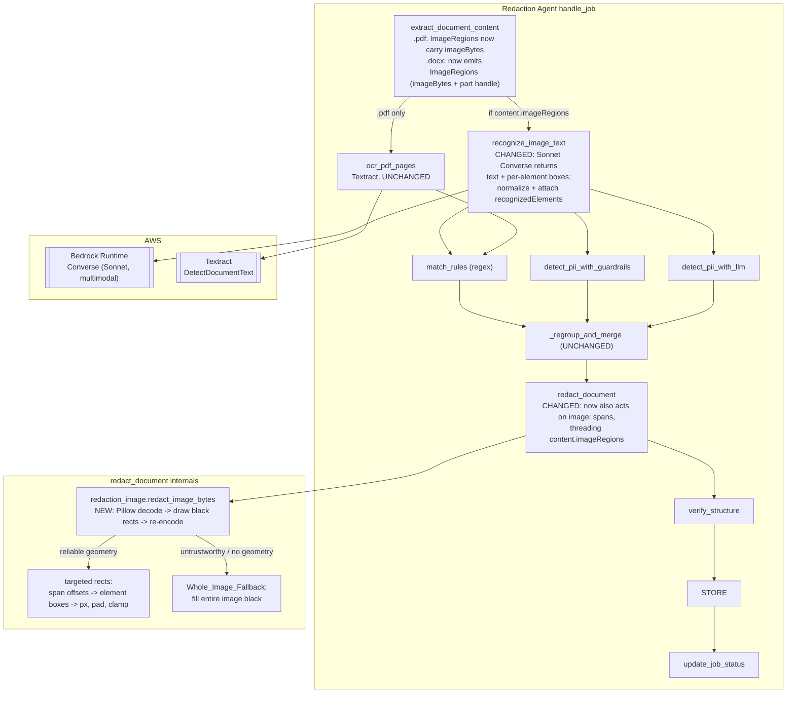

# Design Document: In-Image Redaction

## Overview

The shipped `llm-image-ocr` feature closed the *detection* half of the
embedded-image gap: `recognize_image_text` (`backend/agent/tools/ocr.py`) reads
the text — including CJK — out of an embedded image via a multimodal Bedrock
model and writes it to `ImageRegion.recognizedText`, and the downstream
detection sources (regex `match_rules`, Bedrock Guardrails, the LLM text
source) then flag PII in that text under the `"image:{index}"` Unit_Ref
namespace. But the *redaction* half is still open: both redactors deliberately
**skip** `image:`-namespaced spans. `redact_docx_document` handles only
`"text:"` spans; `redact_pdf_document_with_report` routes `"text:"` and
`"ocr:"` spans and drops everything else — `"image:"` in practice — with a bare
`continue`. So a name like `周杰` inside a driving-license image is *detected*
and left fully visible in the delivered document: a real, demonstrated leak.

This feature closes that gap. When PII is detected inside an embedded image,
the system blacks out the offending region(s) **on the image itself** and
re-embeds the modified image into the output `.docx`/`.pdf`, so the delivered
Redacted Document no longer shows the in-image PII.

The hard part is not drawing black boxes — it is knowing *where* on the image
to draw them. That requires per-element geometry (a bounding box for each
recognized text element), which the shipped OCR tool does not produce: it
returns text only. This feature therefore:

1. **Retargets the embedded-image OCR model to a Sonnet-class model** and
   extends its single `Converse` call to return, alongside the recognized
   text, a per-element bounding box for each recognized element. A feasibility
   experiment proved Sonnet returns compliance-grade boxes where Haiku's are
   unusable.
2. **Attaches that geometry to the `ImageRegion`** as a new list of
   `RecognizedElement`s — the in-image analogue of `ocr_pdf.py`'s `OcrWord`,
   each carrying a character offset range into `recognizedText` and a bounding
   box normalized to the image's own pixel dimensions.
3. **Teaches both redactors to act on `image:` spans**: map each span's offset
   range onto the overlapping elements' boxes (mirroring
   `redaction_pdf._rects_for_ocr_span`), pad, draw filled black rectangles on
   the decoded image with Pillow, re-encode, and re-embed the image back into
   the document.
4. **Fills the extraction prerequisite** so the redactor actually receives the
   image bytes: the `.pdf` extractor now populates `ImageRegion.imageBytes`,
   and the `.docx` extractor — which today emits no image regions at all —
   begins emitting one `ImageRegion` per embedded image part with a stable
   re-embedding handle.

### The overriding correctness rule

Because localization is probabilistic and this is a compliance system, the
governing rule of the whole feature (Requirement 6) is: **detected in-image PII
must never remain visible in the output.** Every failure mode of localization —
the model is dormant, the response is unparseable, no usable boxes come back, a
box is implausible, a request fails after retries — funnels into a
**Whole_Image_Fallback**: black out the *entire* image. Over-redaction is the
safe direction; a missed in-image PII value is not an acceptable outcome. This
rule is the spine the rest of the design hangs off.

### Settled scope (not open for redesign)

The four open decisions in the requirements are RESOLVED and fixed here:

1. **A1 — Sonnet-only, single call.** Embedded-image OCR switches entirely to a
   Sonnet-class model. **One** `Converse` call returns both the recognized text
   and the per-element boxes. No two-pass, no second model, no new environment
   variable — the existing `IMAGE_OCR_MODEL_ID` is retargeted to a Sonnet-class
   id (`us.anthropic.claude-sonnet-4-5-20250929-v1:0`).
2. **B1 — both `.docx` and `.pdf`** are in scope.
3. **C2 — Pillow is added as a real backend dependency** for image
   decode/draw/re-encode.
4. **D — the extraction prerequisite is in this spec.** Populating `.pdf`
   `imageBytes` and emitting `.docx` `ImageRegion`s are part of this feature,
   since they are the root cause that today leaves in-image PII undetected and
   unredacted.

### Findings carried in from the feasibility experiment (inputs, not decisions)

- A multimodal LLM returns **accurate text**; the open question was **accurate
  boxes**. **Haiku boxes are unusable**; **Sonnet boxes are tight and
  compliance-grade** on the tested Chinese driving-license image.
- Sonnet returned **pixel** coordinates (e.g. `[117, 99, 160, 124]` on a
  700×450 image) *even when the prompt asked for normalized `[0, 1]`
  fractions*. The system must therefore robustly detect pixel-vs-fractional and
  normalize against the image's **actual** pixel dimensions, derived from the
  image bytes — never from any model-reported dimension.

### Relationship to the shipped pipeline (invariants preserved)

- **Redaction is a PRIMARY step.** The redactors raise `RedactionError` on an
  unrecoverable failure, which propagates to `handle_job`'s top-level handler
  and drives the Job to `failed` with nothing stored. In-image redaction
  inherits that, with the one carve-out that a *localization* failure is
  handled by the Whole_Image_Fallback rather than by failing the Job (a
  localization failure has a safe redaction outcome; only an unrecoverable
  *image decode/draw/encode/re-embed* failure fails the Job).
- **Downstream detection is unchanged.** This feature adds geometry to the OCR
  output and teaches the redactor to act on `image:` spans. The regex,
  Guardrails, and LLM detection over `recognizedText`, and `_regroup_and_merge`,
  are untouched (Requirement 9.1).
- **The full-page PDF OCR path (`ocr_pdf.py`) is untouched** (Requirement 10).
- **SDK/import constraints.** New code imports no Strands symbol and stays
  importable for unit testing without `boto3`, `strands`, or
  `bedrock_agentcore` installed (lazy client construction). Pillow and
  `fitz`/PyMuPDF are imported lazily inside the functions that use them, so the
  bulk of unit tests need neither installed.

## Architecture



Compared to `llm-image-ocr`, the changed nodes are: `extract_document_content`
(image bytes / regions now supplied), `recognize_image_text` (returns and
attaches geometry), and `redact_document` (acts on `image:` spans via the new
`redaction_image` module). Every other edge, node, and namespace is exactly as
today.

### Sequence: one embedded image, from OCR to redaction

```mermaid
sequenceDiagram
    participant O as handle_job
    participant R as recognize_image_text
    participant FM as Bedrock Converse (Sonnet)
    participant N as Image_Coordinate_Normalizer
    participant RED as redact_document
    participant RI as redaction_image

    O->>R: recognize_image_text(image_regions)
    R->>FM: Converse(image, prompt asks JSON [{text, box}], temp=0)
    FM-->>R: assistant text (JSON array)
    R->>R: parse JSON defensively; assemble recognizedText from element texts
    loop each parsed element
        R->>N: normalize(box, image WxH from bytes)
        N-->>R: normalized [0,1] BoundingBox, or None (implausible)
    end
    alt all boxes plausible and >=1 element
        R->>R: region.recognizedElements = [RecognizedElement...]
    else any implausible / unparseable / empty
        R->>R: region.recognizedElements = None (untrustworthy)
    end
    R->>R: region.recognizedText = joined element text (or "")
    R-->>O: same instances, geometry attached, never raises

    Note over O: regex / Guardrails / LLM produce image:{i} spans over recognizedText
    O->>RED: redact_document(bytes, text_units, matches, ext, ocr_units, image_regions)
    loop each ImageRegion with >=1 image: span
        alt recognizedElements reliable AND every span resolves to >=1 rect
            RED->>RI: redact_image_bytes(targeted rects)
        else untrustworthy geometry OR a span resolves to 0 rects
            RED->>RI: redact_image_bytes(whole-image fallback)
        end
        RI-->>RED: redacted image bytes (same format)
        RED->>RED: re-embed (.pdf page.replace_image / .docx image part blob)
    end
```

### Error-handling posture: localization degrades, redaction fails loud

| Failure | Where | Handling | Job outcome |
|---|---|---|---|
| Localization model dormant / unpinned | `recognize_image_text` | no request; no `recognizedText`; no `image:` spans | `completed` (nothing to redact) |
| Converse fails after retries | `recognize_image_text` | `recognizedText` left placeholder; no spans | `completed` (best-effort OCR miss) |
| Response unparseable / no elements | `recognize_image_text` | `recognizedText=""`, `recognizedElements=None`; no spans | `completed` |
| Text parsed but a box implausible / geometry untrustworthy | normalizer → `recognize_image_text` | `recognizedText` set, `recognizedElements=None` | `completed`; redactor **whole-images** the image |
| Image has spans but geometry untrustworthy | `redact_document` | **Whole_Image_Fallback** | `completed`, PII covered |
| Image decode / draw / encode / re-embed fails | `redaction_image` / redactor | **`RedactionError`** (primary step) | **`failed`**, nothing stored |

Two rows are the crux. A *localization* failure never fails the Job — it
degrades to over-redaction (Requirement 7.4). An *image manipulation* failure
on an image that carries PII spans is unrecoverable and fails the Job
(Requirement 7.3), because the alternative — emitting a document with visible
in-image PII — violates the correctness spine.

## Components and Interfaces

### Component 1: `backend/agent/tools/ocr.py` — extended (not rewritten)

The shipped module already ships every pattern this needs: pinned/versioned
model-id predicate (`_is_pinned_model_id`), env-driven off switch
(`_read_model_config`), lazy `bedrock-runtime` client, `Converse`-with-retry
(`_converse_with_retry`, `temperature=0`, `topP` omitted, shared
`_is_retryable`), defensive response read (`_assistant_text`), magic-byte
format detection (`_detect_image_format`), size guard, never-raise loop, and a
PII-safe SHA-256 audit record. This feature **extends** that module; it does
not duplicate it.

What changes:

**Prompt now asks for text *and* boxes.** `OCR_PROMPT` is rewritten to instruct
the model to return, for each visible **line** of text, a JSON object with the
line's transcribed characters and its bounding box, and nothing else:

```
Return ONLY a JSON array. Each element: {"text": "<characters on one line>",
"box": [x0, y0, x1, y1]} where the box is the tight rectangle around that
line's glyphs. Transcribe CJK exactly; do NOT translate/transliterate; no
commentary, no markdown fences.
```

`OCR_PROMPT_VERSION` bumps to `"in-image-redaction/v1"` (Requirement 3.7). The
prompt requests **line-level** entries deliberately: a line box keeps a whole
PII value (an 18-digit ID, a name) contiguous within one element's offset
range, and covers it fully. Line granularity means redacting a line that mixes
a label and a value blacks out the label too — over-redaction, the safe
direction, mirroring `ocr_pdf.py`'s word-granular stance.

**One call returns text + geometry (Requirements 3.1, 3.2).** The `Converse`
request is structurally identical to today's — same image content block, same
`inferenceConfig={"temperature": 0.0, "maxTokens": ...}` with `topP` omitted
(Requirements 8.1, 8.2) — only the `system` prompt and the response *parsing*
change. `IMAGE_OCR_MODEL_ID` is read exactly as today (Requirement 3.2); the
pinned-id predicate is unchanged and family-independent, so a Sonnet id passes
just as a Haiku id did (Requirements 3.4, 3.5).

**New: defensive JSON parser.** A module function
`_parse_localization_response(assistant_text) -> Optional[list[tuple[str, list]]]`
extracts the JSON array (tolerating stray prose or markdown fences by locating
the first `[` and last `]`), `json.loads`es it, and returns a list of
`(text, raw_box)` pairs, skipping any entry that is not a `{"text": str,
"box": [4 numbers]}` shape. It never raises: unparseable input returns `None`.

**New: recognized-text assembly from elements.** `recognizedText` is now the
join of the parsed entry texts with `"\n"` between them (mirroring
`ocr_pdf._build_page_unit`, which builds page text from word text so every
character belongs to a geometry-carrying element). This is what makes an
`image:` span's offset range and a `RecognizedElement`'s offset range directly
comparable (Requirements 2.1, 2.2). `recognizedText` remains a plain string, so
downstream detection is untouched (Requirement 9.1). Offsets are tracked during
assembly, exactly as `ocr_pdf` tracks word offsets.

**New: the `Image_Coordinate_Normalizer` (pure function).**

```python
def _normalize_box(raw_box, image_width_px, image_height_px) -> Optional[BoundingBox]:
    """Normalize a model box to [0,1] fractions of the image's actual pixel
    dimensions, or None if it is implausible."""
```

Algorithm (Requirement 4):
- **Numeric guard.** Any of the four coordinates non-numeric → `None`
  (implausible, Requirement 4.4).
- **Pixel-vs-fractional detection (deterministic, Requirements 4.1, 4.5).** If
  **any** coordinate `> 1.0`, the box is in **pixels** and is divided by
  `image_width_px` (x) / `image_height_px` (y); otherwise it is treated as
  already-fractional `[0,1]`. This resolves the experiment's finding (Sonnet
  emits pixels) and is a total, deterministic rule for a given input.
- **Corner → (left, top, width, height).** With `left = min(x0, x1)` etc. An
  **inverted** box (`x1 <= x0` or `y1 <= y0` after scaling) → `None`
  (implausible, Requirement 4.4).
- **Clamp to bounds (Requirement 4.3).** Clamp all edges into `[0, 1]`.
- **Positive-area guard (Requirement 4.4).** If clamping collapses the box to
  zero (or negative) area — e.g. a box entirely outside the image — → `None`.
- Otherwise return the normalized `BoundingBox`.

Image pixel dimensions come from the **bytes**, via a lazy Pillow helper
(`_image_pixel_dimensions(image_bytes)` → `Image.open(BytesIO(...)).size`,
`import PIL` inside the function), never from any model-reported dimension
(Requirement 4.2). Pillow is imported lazily so property tests can exercise the
pure normalizer with explicit dimensions without Pillow installed.

**New: per-region localization outcome.** `_recognize_one_region` becomes
`_recognize_and_localize_one_region`, which after a completed request:
1. parses the JSON; on `None`/empty → `recognizedText = ""`,
   `recognizedElements = None`; emit audit; return.
2. assembles `recognizedText` from entry texts (tracking offsets), and
   normalizes each entry's box.
3. if **every** entry produced a plausible box and there is ≥1 element →
   `region.recognizedElements = [RecognizedElement(text, start, end, box), ...]`
   (localization **reliable**).
4. if **any** entry's box is implausible → `region.recognizedElements = None`
   (localization **untrustworthy**), while `recognizedText` stays set so
   downstream detection still produces spans and the redactor whole-images the
   region (Requirement 6.1).

The single sentinel `recognizedElements is None` means "no trustworthy
per-element geometry for this region." The redactor reads it as "if this image
has spans, whole-image fallback." A dormant model or an ineligible/undetectable
image never produces `recognizedText`, hence never produces `image:` spans, so
the redactor never inspects those regions (Requirement 6.5).

**Audit record (Requirements 8.3, 8.4, 8.5).** The existing per-completed-request
`logger.info` audit line is extended to add the number of rectangles that will
be redacted for the image and whether the Whole_Image_Fallback will apply. It
already carries `sourceLocation`, model id, `OCR_PROMPT_VERSION`, the image
SHA-256 digest, and byte length. It continues to record **neither** the image
bytes, the recognized text, **nor** any box coordinates or content
(Requirement 8.4). The `agent.tools.ocr` module logger reaches CloudWatch via
the agent log configuration (Requirement 8.5).

**Contract preserved (Requirement 9.2).** `recognize_image_text` keeps its
signature `list[ImageRegion] -> list[ImageRegion]`, returns the same instances
in the same order, and now mutates `recognizedText` **and**
`recognizedElements` (additive) — nothing else.

### Component 2: `backend/agent/tools/redaction_image.py` — new module

Shared by both redactors; holds all Pillow interaction so the `.docx` and `.pdf`
redactors only decide *which* image bytes to pass and *how* to re-embed the
result.

```python
class ImageRedactionError(Exception):
    """Unrecoverable failure to decode, draw on, or re-encode an image
    (Requirement 7.3). Redactors convert this into RedactionError."""

DEFAULT_BOX_PADDING_PX = 4
BOX_PADDING_ENV_VAR = "IMAGE_REDACTION_BOX_PADDING_PX"   # Requirement 5.3

def redact_image_bytes(
    image_bytes: bytes,
    region: ImageRegion,
    spans_for_region: list[MatchSpan],
) -> bytes:
    """Return image_bytes with the detected PII covered by solid black
    rectangles (targeted) or the whole image blacked out (fallback),
    re-encoded in the same format. Raises ImageRedactionError on any
    decode/draw/encode failure."""
```

Behavior:
- **Decode** `image_bytes` with Pillow (`Image.open`), remember the original
  format, get actual `(W, H)`. A decode failure → `ImageRedactionError`.
- **Decide targeted vs fallback:**
  - **Targeted** iff `region.recognizedElements is not None` **and** every span
    in `spans_for_region` resolves to ≥1 rectangle. For each span, the
    rectangles are `_rects_for_image_span(region.recognizedElements, span, W,
    H)` — every element whose `[startOffset, endOffset)` overlaps the span's
    range contributes its box, scaled from normalized `[0,1]` to pixels
    (mirroring `redaction_pdf._rects_for_ocr_span` +
    `_normalized_bbox_to_page_rect`). Each rect is expanded by Box_Padding and
    clamped to `[0, W] × [0, H]` (Requirement 5).
  - **Whole_Image_Fallback** otherwise (untrustworthy geometry, or any span
    that maps to zero rectangles): the rectangle set is a single full-image
    rectangle `(0, 0, W, H)` (Requirement 6.2). The "a span mapped to zero
    rects" trigger is belt-and-braces for the correctness spine: a real PII
    span always overlaps a line element, so this only fires on a pathological
    mismatch, and when it does we cover everything rather than risk a leak.
- **Draw** filled opaque black rectangles with `ImageDraw.Draw(img).rectangle`
  (Requirement 1.1 / Solid_Redaction_Block). Convert palettized/`P`-mode images
  to `RGB` first so black is exact.
- **Re-encode** to the **same format** the image came in as (so the container's
  content-type/xref stream stays valid) and return the bytes. An encode failure
  → `ImageRedactionError`.

`_rects_for_image_span` and `_normalize`/scale helpers are pure and unit-tested
directly. Pillow is imported lazily inside `redact_image_bytes`.

### Component 3: `backend/agent/tools/redaction_pdf.py` — act on `image:` spans

Today `redact_pdf_document_with_report` drops non-`text:`/`ocr:` spans with a
bare `continue`. That branch is replaced with an `image:` handler, and the
function gains an `image_regions` parameter (threaded from orchestration) so it
can resolve `image:{index}` → `ImageRegion`:

```python
def redact_pdf_document_with_report(
    file_bytes, text_units, match_spans, ocr_text_units=None,
    image_regions=None,          # NEW
) -> PdfRedactionResult: ...
```

- Group `image:` spans by their region index. For each referenced
  `ImageRegion`:
  - `image_bytes = region.imageBytes` (populated by the extractor). If absent →
    the image was never OCR'd, so it can carry no spans; defensively raise
    `RedactionError` if a span references a region with no bytes (a wiring bug,
    same posture as the existing out-of-range guards).
  - `new_bytes = redaction_image.redact_image_bytes(image_bytes, region,
    spans)`, wrapping `ImageRedactionError` into `RedactionError`
    (Requirement 7.3).
  - **Re-embed** with `page.replace_image(xref, stream=new_bytes)`. The `xref`
    and `pageIndex` come from `sourceLocation` (`"page:{pageIndex}:xref:{xref}"`).
    `Page.replace_image` (available since PyMuPDF 1.21.1, and in the pinned
    1.28.0 — [PyMuPDF changelog](https://ghostscript.com/~julian/sphinx-docs-PyMuPDF/html/changes.html))
    swaps the image XObject's stream in place, so the redacted image appears at
    the original placement and size with no page-geometry math. This is chosen
    over overlaying opaque rectangles on the page rectangle because it edits the
    image itself (the thing that carries the PII) rather than painting over its
    on-page projection, so it is correct regardless of scaling, rotation, or the
    image being referenced from more than one page.
- The text/`ocr:` redaction path is byte-for-byte unchanged (Requirements 1.4,
  10.2). The `PdfRedactionReport` counts (`textLayerRegions`, `ocrRegions`,
  `agreedRegions`) are unchanged; image rectangles are not folded into them
  (the report is a text-vs-OCR dual-path diagnostic — see its docstring), and
  per-image rectangle counts are captured in the OCR audit log instead
  (Requirement 8.3). Image replacement runs after `apply_redactions`; then
  `document.tobytes()` serializes once as today.

The `bytes`-returning wrapper `redact_pdf_document` gains the same optional
`image_regions` parameter, defaulting to `None`.

### Component 4: `backend/agent/tools/redaction_docx.py` — act on `image:` spans

`redact_docx_document` gains an `image_regions` parameter and, after its
existing text-run redaction on the reopened `Document`, redacts each referenced
image part **on the same `Document`** before the single `document.save()`:

```python
def redact_docx_document(
    file_bytes, text_units, match_spans,
    image_regions=None,          # NEW
) -> bytes: ...
```

- Group `image:` spans by region index. For each referenced `ImageRegion`:
  - `new_bytes = redaction_image.redact_image_bytes(region.imageBytes, region,
    spans)`.
  - **Re-embed** by locating the image part by the handle in `sourceLocation`
    (`"docx:part:{partname}"`, e.g. `docx:part:/word/media/image1.png`) among
    `document.part.package.iter_parts()` and replacing its blob:
    `image_part._blob = new_bytes` (accessing the private `_blob` mirrors this
    module's existing use of python-docx internals like `run._r` /
    `run._parent`). Replacing the media part's bytes updates every `<a:blip>`
    that references it — safe over-redaction if an image is reused.
- `python-docx` re-serializes the media part unchanged apart from its bytes, so
  page/table structure is preserved (`verify_structure` is unaffected). The
  existing text-run redaction and the "runs with no match are untouched"
  guarantee are unchanged (Requirement 1.4).

### Component 5: `backend/agent/tools/extraction_pdf.py` — populate `imageBytes`

`_extract_image_regions` today sets `sourceLocation` and `boundingBox` but
leaves `imageBytes=None`. It now also populates the bytes:

```python
extracted = document.extract_image(xref)   # {"image": bytes, "ext": "...", ...}
image_bytes = extracted["image"] if extracted else None
```

`Document.extract_image(xref)` returns the raw embedded stream and its extension
([PyMuPDF docs](https://pymupdf.readthedocs.io/en/latest/document.html)). The
`sourceLocation` format (`"page:{pageIndex}:xref:{xref}"`) is unchanged and
remains the re-embed handle. If `extract_image` fails or returns an
unsupported/undecodable stream (e.g. a mask-only or exotic colorspace), the
region keeps `imageBytes=None`; OCR then skips it, it carries no spans, and the
redactor never touches it — the same best-effort posture as any un-OCR'd image.
The extractor takes `document` (or a bound closure) so it can call the
document-level `extract_image`.

### Component 6: `backend/agent/tools/extraction_docx.py` — emit `ImageRegion`s

Today `extract_docx_content` returns an **empty** `imageRegions` list, because
python-docx exposes no reliable inline-image *reading-position* map. For
**redaction** we do not need a paragraph anchor — we need a stable handle to the
image *part*, whose bytes we replace. So the extractor enumerates the package's
image parts directly:

```python
for part in document.part.package.iter_parts():
    if part.partname.startswith("/word/media/") or part.content_type.startswith("image/"):
        image_regions.append(ImageRegion(
            zone="image",
            sourceLocation=f"docx:part:{part.partname}",
            imageBytes=part.blob,
            boundingBox=None,          # .docx has no page-geometry for the image
        ))
```

Each distinct media part becomes one `ImageRegion`; `boundingBox` stays `None`
(image redaction uses the image's own pixel dimensions, not document geometry,
so no page anchor is needed). `sourceLocation` (`docx:part:{partname}`) is the
stable re-embed handle the redactor uses. A media part reused by several `blip`
references is enumerated once and, when redacted, is replaced once — covering
every occurrence.

### Component 7: `backend/agent/orchestration.py` — thread `image_regions`

The pipeline order is unchanged. `recognize_image_text` is still the
belt-and-braces-wrapped supplementary call; the geometry it attaches rides on
the same `ImageRegion` instances already flowing through the pipeline. The only
change is threading those instances into the redactor:

```python
result = _redact_document(
    source_bytes, content.textUnits, matches,
    job.sourceExtension, ocr_text_units,
    content.imageRegions,          # NEW
)
```

`_redact_document` passes `image_regions` to `redact_pdf_document_with_report`
(`.pdf`) and `redact_docx_document` (`.docx`). No detection-order change, no new
supplementary source, no change to the never-raise posture of the three
detection sources.

### Component 8: `backend/shared/models.py` (+ synced `lambdas/shared/models.py`)

Two additive changes, backward-compatible (both optional/defaulted):

**New `RecognizedElement` dataclass** — the in-image analogue of `OcrWord`:

```python
@dataclass
class RecognizedElement:
    """One recognized text element of an embedded image, from the Sonnet
    localization call. startOffset/endOffset index into ImageRegion.recognizedText
    (half-open); boundingBox is NORMALIZED to [0,1] of the image's own pixel
    dimensions (like OcrWord's box is normalized to its rasterized page)."""
    text: str
    startOffset: int
    endOffset: int
    boundingBox: BoundingBox
```

A distinct type from `OcrWord` (rather than reuse) because the docstring
contract differs — its box is normalized to the **embedded image's** pixel
dimensions, it is line-granular, and the whole list is dropped to `None` when
localization is untrustworthy — and keeping the two features' geometry types
independent avoids coupling their evolution.

**New `ImageRegion.recognizedElements` field:**

```python
    recognizedElements: Optional[List[RecognizedElement]] = None
```

`None` (the default and the placeholder) means "no trustworthy per-element
geometry": either localization was not performed, or it was and is untrustworthy
— the redactor whole-images any such region that carries `image:` spans. A
non-empty list means reliable geometry for targeted redaction. The existing
`imageBytes`, `boundingBox`, `zone`, `sourceLocation`, `recognizedText` fields
are unchanged. `ImageRegion`'s docstring is updated to note that
`recognize_image_text` now also attaches `recognizedElements`, and that the
Sonnet model returns geometry; the synced `lambdas/shared/models.py` copy gets
the identical edit, as with every prior model change.

### Component 9: `backend/infra/redaction_stack.py` — retarget to Sonnet

```python
# was Haiku:
IMAGE_OCR_MODEL_ID = "us.anthropic.claude-sonnet-4-5-20250929-v1:0"
IMAGE_OCR_FOUNDATION_MODEL = "anthropic.claude-sonnet-4-5-20250929-v1:0"
```

The `IMAGE_OCR_MODEL_ID` environment variable and the scoped
`bedrock:InvokeModel` grant already reference these two constants, so retargeting
the constants moves both the runtime env var (Requirement 11.2) and the IAM
grant (Requirements 11.1, 11.3) to Sonnet in one edit — the prior Haiku
image-OCR grant is thereby replaced (Requirement 11.3). The separate
`LLM_PII_MODEL_ID` (Haiku) grant is untouched. Clearing `IMAGE_OCR_MODEL_ID`
remains the documented off switch (Requirement 11.4): the tool goes dormant, no
`image:` spans are produced, and Jobs still complete. No new environment
variable is introduced (resolved decision A1).

### Component 10: Pillow dependency and the agent bundle (resolved decision C2)

- Add `Pillow==<pinned>` to **both** `backend/requirements.txt` and
  `backend/agent-runtime-requirements.txt`. Pin to a version publishing
  `cp312` aarch64 manylinux wheels (e.g. `Pillow==11.0.0`, which ships
  `manylinux_2_28_aarch64` and `manylinux2014_aarch64` cp312 wheels — matching
  the platforms `build_agent_bundle.py` already downloads for PyMuPDF).
- **The agent bundle must be rebuilt** (`scripts/build_agent_bundle.py`) so the
  aarch64 Pillow wheel is vendored into `agent_bundle/package_clean/`. This is
  the same cross-platform pattern already used for PyMuPDF: the builder
  downloads the aarch64 cp312 wheel via pip's `--platform`/`--python-version`
  flags and unpacks it into the bundle. **Flag:** the build must run on a Linux
  host (per the script's KNOWN LIMITATION), and the summary's key-package list
  should be extended to include `PIL`/`pillow` so a missing Pillow wheel is
  caught. The runtime imports Pillow as `PIL`.

## Data Models

Summary of the additive shape changes (details in Component 8):

- **New** `RecognizedElement` dataclass (`text`, `startOffset`, `endOffset`,
  `boundingBox` normalized to `[0,1]` of the image's pixel dimensions).
- **New** `ImageRegion.recognizedElements: Optional[List[RecognizedElement]] =
  None`.

No persisted model changes: `RecognizedElement`/`recognizedElements` are
in-memory-only, passed between the OCR tool and the redactor during a single
Job, never serialized to DynamoDB or an API. `RedactionJob.detectionSummary` is
unchanged — image redaction adds no new summary key (image observability lives
in the OCR audit log). Both new shapes are optional/defaulted, so every existing
caller and persisted record is unaffected.

## Correctness Properties

*A property is a characteristic or behavior that should hold true across all
valid executions of a system — essentially, a formal statement about what the
system should do. Properties serve as the bridge between human-readable
specifications and machine-verifiable correctness guarantees.*

Property-based testing applies here — but, as in `llm-image-ocr`, **only to the
deterministic surfaces around the model**: coordinate normalization, offset→box
mapping, the fallback decision, padding, recognized-text assembly, the
inference-config pinning, the audit-record construction, and the
image-manipulation drawing logic (with Pillow decode/encode exercised on
generated images, and the model itself faked). There is no property asserting
OCR or localization *quality* — a multimodal model is not a reproducible
function of its input; that is the env-guarded recall integration test below.

### Acceptance-criteria prework (classification)

Each testable criterion is classified PROPERTY (universal, input-varying, YOUR
code), EXAMPLE (call-shape/constant), EDGE_CASE (threshold), SMOKE (config), or
INTEGRATION (external service / real model).

- 1.1 / 1.2 → PROPERTY (image spans map to covering rectangles; offset→box) → P2, P3
- 1.3 → PROPERTY (no-span image left byte-identical) → P4
- 1.4 → PROPERTY (text:/ocr: redaction unchanged) → P11
- 1.5 → EXAMPLE (non-image content/reading position unchanged; structural)
- 2.1 / 2.2 → PROPERTY (recognizedText assembled from elements; offsets comparable) → P1
- 2.3 / 2.4 → PROPERTY (overlap ⇒ box included; non-overlap ⇒ excluded) → P3
- 2.5 → EXAMPLE (geometry attached to the same ImageRegion instances)
- 3.1 → PROPERTY (one Converse call yields text + boxes) → folded into P8/EXAMPLE
- 3.2, 3.4, 3.5 → PROPERTY (request iff pinned id; dormant otherwise) → P8
- 3.3 → SMOKE (stack id is Sonnet-class and pinned)
- 3.6, 3.7 → EXAMPLE (prompt asks text+box, no translation; prompt version constant)
- 4.1, 4.2, 4.3, 4.4, 4.5 → PROPERTY (normalizer total/robust; pixel-vs-fractional; clamp; implausible→None; deterministic) → P5, P6
- 5.1, 5.2, 5.3 → PROPERTY (padding expands then clamps within bounds) → P7
- 6.1, 6.2, 6.3 → PROPERTY (every untrustworthy mode ⇒ whole image; PII never visible) → P9 (spine)
- 6.4 → EXAMPLE (fallback audit record emitted, no PII)
- 6.5 → PROPERTY (no-span image never fallback, unchanged) → P4
- 7.1 → PROPERTY (localization retried up to 3, reusing `_is_retryable`) → inherited P (llm-image-ocr P6); EXAMPLE here
- 7.2, 7.4 → PROPERTY (localization failure ⇒ fallback, never fails Job) → P9, P10
- 7.3 → PROPERTY (decode/draw/encode/re-embed failure ⇒ RedactionError ⇒ Job failed) → P10
- 7.5 → EXAMPLE (pipeline order / posture unchanged)
- 8.1, 8.2 → PROPERTY (every request pins temperature 0, omits topP) → P12
- 8.3, 8.4 → PROPERTY (audit identifies run without image/text/box PII) → P13
- 8.5 → EXAMPLE (module logger)
- 9.1 → EXAMPLE (downstream detection / merge untouched)
- 9.2 → PROPERTY (same instances/order; only recognizedText + recognizedElements touched) → P14
- 9.3, 9.4 → EXAMPLE (import-without-deps; lazy client)
- 10.1, 10.2, 10.3 → EXAMPLE (ocr_pdf.py unchanged; text:/ocr: fatal-path unchanged)
- 11.1, 11.2, 11.3, 11.4 → SMOKE (CDK template assertions)

Property reflection: P2 ("each span is covered") and P9 ("every failure mode
covers the whole image") together give the spine P (PII never visible); P9 is
kept distinct because it is about the *fallback trigger set*, while P2 is about
*targeted mapping under reliable geometry*. P5 (normalizer totality) and P6
(pixel/fractional correctness) are distinct: one is "never raises / never a bad
box", the other is "the right box for a good input". P3 (offset→box overlap) is
distinct from P1 (text assembly). No property below is implied by another.

### Property 1: Recognized text is assembled from the elements, so offsets are comparable

*For any* parsed list of localization entries, the assembled `recognizedText`
contains each element's text at exactly `recognizedText[startOffset:endOffset]`,
and the elements' offset ranges are non-overlapping and in reading order — so an
`image:` span's offsets and a `RecognizedElement`'s offsets index the same
string.

**Validates: Requirements 2.1, 2.2**

### Property 2: Every detected in-image PII span is covered by a rectangle

*For any* `ImageRegion` with reliable geometry and any `image:` span, the
targeted rectangle set produced for that span covers the union of the boxes of
every element the span overlaps — and if any span overlaps no element, the
region is covered by the Whole_Image_Fallback instead, so the span's PII is
never left uncovered.

**Validates: Requirements 1.1, 1.2, 6.3**

### Property 3: Offset overlap decides box inclusion, exactly

*For any* elements and any span, `_rects_for_image_span` includes an element's
box if and only if `element.startOffset < span.endOffset and span.startOffset <
element.endOffset` (half-open overlap), and never includes a non-overlapping
element's box.

**Validates: Requirements 2.3, 2.4**

### Property 4: An image with no spans is left byte-identical

*For any* set of match spans and image regions, an `ImageRegion` referenced by
no `image:` span is neither decoded, drawn on, nor re-embedded, and its bytes in
the output document equal its source bytes.

**Validates: Requirements 1.3, 6.5**

### Property 5: Coordinate normalization is total and never yields a bad box

*For any* four coordinate values (numeric or not) and any positive image
dimensions, `_normalize_box` returns either a `BoundingBox` with positive area
whose edges lie within `[0, 1]`, or `None` — it never raises and never returns a
degenerate, inverted, or out-of-bounds box.

**Validates: Requirements 4.1, 4.3, 4.4**

### Property 6: Pixel-vs-fractional interpretation is correct and deterministic

*For any* box, if every coordinate is `<= 1.0` it is interpreted as fractional
and returned (clamped) unchanged, and if any coordinate is `> 1.0` it is
interpreted as pixels and divided by the actual image dimensions; the same input
always yields the same interpretation.

**Validates: Requirements 4.1, 4.2, 4.5**

### Property 7: Padding expands the rectangle and then clamps within bounds

*For any* pixel rectangle, image dimensions, and non-negative Box_Padding, the
padded rectangle contains the original rectangle and lies entirely within
`[0, W] × [0, H]`.

**Validates: Requirements 5.1, 5.2**

### Property 8: Requests are issued only for a pinned model identifier

*For any* value of `IMAGE_OCR_MODEL_ID`, `recognize_image_text` issues a
`Converse` request (returning text and geometry) if and only if the value is a
pinned, versioned identifier of any family, and otherwise issues zero requests
and attaches no geometry.

**Validates: Requirements 3.2, 3.4, 3.5**

### Property 9: Every untrustworthy-localization mode covers the whole image

*For any* `ImageRegion` with at least one `image:` span for which localization
is unavailable, unparseable, empty, or produced any implausible box (i.e.
`recognizedElements is None`), the redactor covers the entire image, so no
detected in-image PII remains visible.

**Validates: Requirements 6.1, 6.2, 6.3, 7.2**

### Property 10: Localization failures degrade; manipulation failures fail the Job

*For any* localization failure (dormant, retries exhausted, unparseable,
implausible), the Job whose other steps succeed still reaches `completed` with
the image safely over-redacted; and *for any* image-decode/draw/encode/re-embed
failure on an image carrying spans, the redactor raises `RedactionError` and the
Job reaches `failed` with nothing stored.

**Validates: Requirements 7.2, 7.3, 7.4**

### Property 11: `text:` and `ocr:` spans are redacted unchanged

*For any* set of `text:`/`ocr:` spans and no `image:` spans, the `.pdf`/`.docx`
redaction output is identical to the pre-feature output.

**Validates: Requirements 1.4, 10.2**

### Property 12: Every localization request pins the inference configuration

*For any* eligible region, every `Converse` request carries `temperature == 0`
and omits `topP`.

**Validates: Requirements 8.1, 8.2**

### Property 13: The audit record identifies the run without recording PII

*For any* eligible region and any model response, the audit record contains the
`sourceLocation`, model id, prompt version, the image's SHA-256 digest and byte
length, and the rectangle count — and contains neither the image bytes, the
recognized text, nor any box coordinates.

**Validates: Requirements 8.3, 8.4**

### Property 14: The same instances are returned, with only text and geometry touched

*For any* list of image regions, `recognize_image_text` returns the same
`ImageRegion` instances in the same order, mutates only `recognizedText` and
`recognizedElements` and only on eligible regions, and leaves `boundingBox`,
`zone`, `sourceLocation`, and `imageBytes` unchanged.

**Validates: Requirement 9.2**

## Error Handling

| Failure | Detection point | Handling | Job outcome |
|---|---|---|---|
| `IMAGE_OCR_MODEL_ID` absent / blank / floating alias | `_read_model_config` | warning, zero requests, no geometry | `completed` on other sources |
| Sonnet client cannot be constructed | `_get_bedrock_runtime_client` | warning, regions unchanged | `completed` |
| Region `imageBytes` absent/empty | OCR loop | skipped, no request, no spans | `completed` |
| Unsupported/undeterminable image format, or oversized | format/size guards | region skipped, no spans | `completed` |
| Converse throttling / 5xx | `_converse_with_retry` | exponential backoff, 3 attempts (Requirement 7.1) | `completed` (text+geometry if a retry succeeds) |
| Converse fails after retries | `_converse_with_retry` → OCR | `recognizedText` placeholder, no spans | `completed` (OCR miss) |
| JSON response unparseable / no elements | `_parse_localization_response` | `recognizedText=""`, `recognizedElements=None`; no spans | `completed` |
| Any returned box implausible | `_normalize_box` → OCR | `recognizedText` set, `recognizedElements=None` | `completed`; **whole-image fallback** at redaction |
| Image (with spans) geometry untrustworthy | redactor | **Whole_Image_Fallback** (Requirement 6.1) | `completed`, PII covered |
| A span (reliable geometry) resolves to zero rectangles | redactor | **Whole_Image_Fallback** (belt-and-braces) | `completed`, PII covered |
| Image decode/draw/encode fails | `redaction_image` | `ImageRedactionError` → `RedactionError` | **`failed`**, nothing stored |
| Image re-embed fails (bad xref / missing part) | redactor | `RedactionError` | **`failed`**, nothing stored |
| `text:`/`ocr:`/full-page-OCR failure | unchanged | unchanged | as before |

Emphasis: **"localization was untrustworthy" is non-fatal** (it has a safe
outcome — cover everything), while **"the image could not be manipulated" is
fatal** (the only alternative is emitting visible PII). This asymmetry is the
error-handling expression of the correctness spine.

## Testing Strategy

**Dual approach.** Property-based tests cover the deterministic surfaces (the
fourteen properties); example/edge/smoke tests cover call shapes, thresholds,
constants, and CDK configuration.

**Libraries.** Hypothesis (already a dependency — `backend/.hypothesis/`). Each
property test runs ≥ **100 iterations** and is tagged in its docstring:

```
Feature: in-image-redaction, Property {number}: {property title}
```

**Bedrock is mocked with `unittest.mock`, not moto**, reusing the
`FakeConverseClient`/`SequencedConverseClient`/`BehaviorConverseClient` fakes
already in `tests/test_ocr.py`; the fake `converse` now returns a **JSON**
assistant text (`[{"text": ..., "box": [...]}, ...]`) so the parser and
normalizer are exercised. No property test makes a real Bedrock call.

**Pillow in tests.** Property tests for the normalizer and offset→box mapping
call the pure functions with explicit dimensions and boxes, needing no Pillow.
Tests for `redaction_image.redact_image_bytes` and the re-embed paths generate
small in-memory PNGs with Pillow and assert on decoded pixels (e.g. the target
region is black; a no-span image is byte-identical); these need Pillow, which is
now a real dependency in the dev venv.

**What changes in existing tests:**
- `tests/test_ocr.py`: the fake responses become JSON; **Property 2**
  (recognizedText from returned text) is reworked into P1 (assembled from
  element texts); **Property 3** (only `recognizedText` touched) broadens to
  allow `recognizedElements` (P14); new property tests for the normalizer (P5,
  P6), the JSON parser, and the localization-outcome logic. Properties 8, 10-ish
  retry, 12 (temperature), 13 (audit) are retained with JSON-shaped responses.
- `tests/test_redaction_pdf.py`: add `image:` span cases — targeted redaction
  via a stubbed `Page.replace_image`, and the whole-image fallback; assert the
  existing `text:`/`ocr:` behavior is unchanged (P11) and that a decode failure
  raises `RedactionError`.
- `tests/test_redaction_docx.py`: add `image:` span cases — image part blob
  replacement by `sourceLocation` handle, targeted and fallback; existing text
  redaction unchanged.
- `tests/test_extraction_pdf.py`: assert `imageBytes` is now populated from
  `extract_image`, `sourceLocation` unchanged.
- `tests/test_extraction_docx.py`: assert one `ImageRegion` per media part with
  `imageBytes` and a `docx:part:` handle (was: empty list).
- `tests/test_redaction_stack.py`: assert `IMAGE_OCR_MODEL_ID` is now the
  Sonnet-class id, is pinned per the tool's `_is_pinned_model_id`, and the
  scoped `bedrock:InvokeModel` grant names the Sonnet profile + foundation model
  (Requirements 3.3, 11.1-11.3).
- `tests/test_orchestration.py`: assert `image_regions` is threaded into the
  redactor; posture/order unchanged.

**New test modules:**
- `tests/test_redaction_image.py`: the drawing/decision core — P2, P3, P4, P7,
  P9 (fallback triggers), and decode/encode failure → `ImageRedactionError`.
- Normalizer/parser property tests may live in `tests/test_ocr.py` (P5, P6, P1)
  alongside the OCR tool.

**Env-guarded real-Sonnet integration test** (optional, `*`), mirroring
`tests/test_image_ocr_recall.py`: against the actual driving-license image, run
`recognize_image_text` (real Sonnet Converse) **and** the redactor end to end,
asserting (a) the recall floor — `recognizedText` contains the Chinese resident
id and name — and (b) that the redacted output image's PII region pixels are
black (a coarse "is this area covered" check), or that the Whole_Image_Fallback
fired. Guarded by an env var (`RUN_IN_IMAGE_REDACTION`), skipping (never failing)
when credentials, model access, region, Pillow, or a CJK font are missing, so
`pytest tests` stays offline and free.

**Regression baselines.** The suite continues to run as two processes (the
`MagicMock` `sys.modules` `fitz`/`docx` stubs in the first command must not
contaminate the real-`fitz`/`docx` tests in the second — image redaction tests
that decode real PNGs and open real PDFs/docx belong in the second process).
`tests/test_guardrails_pii_detect.py` and `tests/test_ocr_pdf.py`-equivalent
paths must keep passing unmodified — this feature imports `_is_retryable` from
`guardrails_pii_detect` and does not touch `ocr_pdf.py` (Requirement 10.1).
