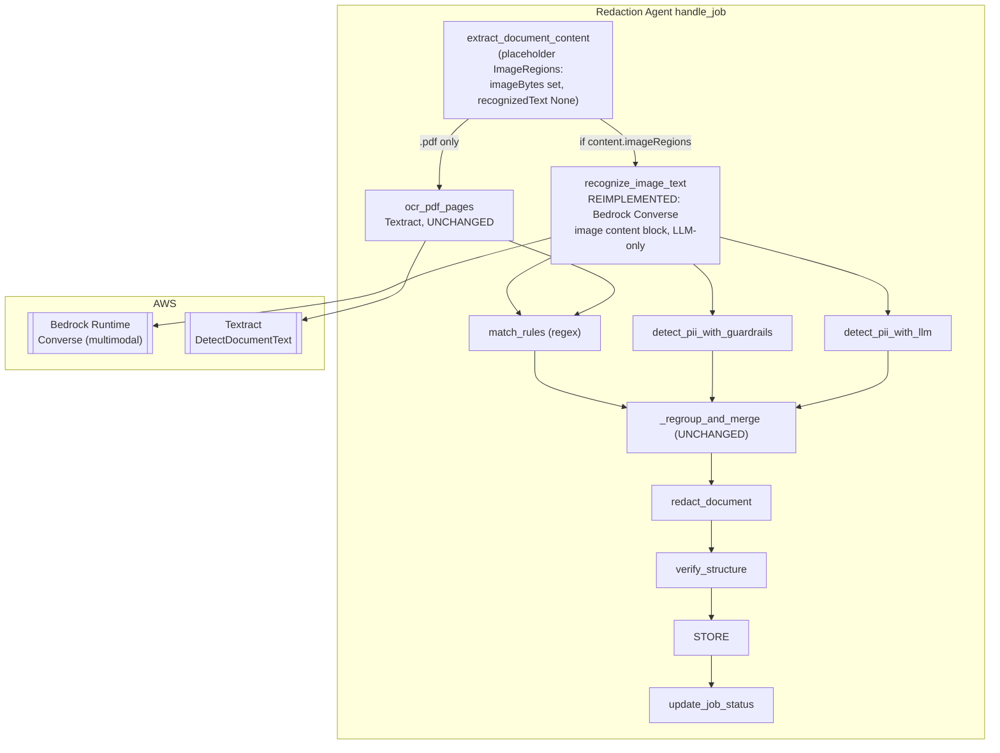
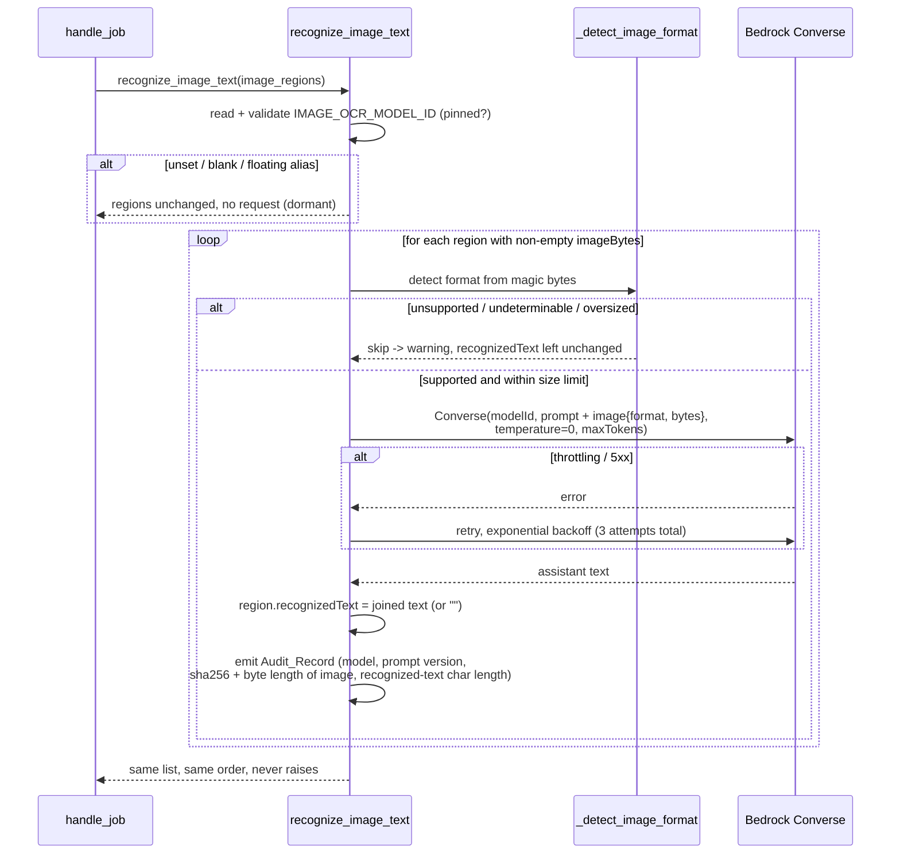

# Design Document: Multimodal LLM Embedded-Image OCR

## Overview

Embedded-image text reaches the redactor through exactly one tool today —
`recognize_image_text(list[ImageRegion]) -> list[ImageRegion]` in
`backend/agent/tools/ocr.py`, which fills each region's `recognizedText` by
calling Amazon Textract's `DetectDocumentText`. Textract's synchronous
detection is scoped to the Standard English alphabet and ASCII symbols;
measured against this repository's Chinese fixtures, every CJK run came back
as Latin garbage and zero Chinese characters survived. So when a Supported
Document carries text only inside an embedded image, and that text is Chinese
(or Japanese/Korean), the string handed to every downstream detection source
(regex `match_rules`, Bedrock Guardrails, and the LLM text source) is empty
or corrupt, and the PII in that image is never redacted — a silent leak.

This feature **replaces the OCR engine on the embedded-image path only** with
a multimodal Amazon Bedrock foundation model, addressed through the
`bedrock-runtime` `Converse` API's image content block. A multimodal model
reads the image bytes directly and returns the recognized characters as text,
with strong CJK support. The model is selected by a pinned, versioned
`IMAGE_OCR_MODEL_ID` read from a new environment variable, exactly as
`backend/agent/tools/llm_pii_detect.py` selects its own model — so the engine
can be retargeted (Haiku → Sonnet → a Nova-family model) by configuration
alone, with no code change.

The reimplemented tool keeps its **exact signature and contract**:
`list[ImageRegion] -> list[ImageRegion]`, mutating and returning the same
instances with `recognizedText` populated on the eligible ones. Nothing
downstream changes, because nothing downstream can tell where
`recognizedText` came from.

### Settled scope (not open for redesign)

Three decisions are fixed by the approved requirements and the user's
resolution of the three open questions:

1. **LLM-only on the embedded-image path — no Textract fallback.** Textract
   is fully removed from `recognize_image_text`. There is no
   "try-Textract-then-LLM" or "LLM-only-for-CJK" branching. The rationale is
   accepted: a Latin-only image cannot be cheaply pre-classified; Textract
   emits Latin *garbage* (not an empty result) for CJK, so any fallback
   trigger keyed on "Textract returned nothing" would be unreliable; embedded
   images are rare, so absolute LLM cost is low; and cost is tuned by swapping
   `IMAGE_OCR_MODEL_ID`, not by keeping Textract around.

2. **The full-page rasterization path stays on Textract.**
   `backend/agent/tools/ocr_pdf.py` (`ocr_pdf_pages`) is untouched. That path
   needs word-level bounding-box geometry to place page-level PDF redactions,
   and a multimodal LLM returns no coordinates. The embedded-image path needs
   no geometry — embedded-image redaction blacks out or replaces the whole
   region — which is exactly why the LLM is viable here and not there.

3. **Best-effort, non-fatal.** Embedded-image OCR becomes a supplementary,
   best-effort detection input: an OCR failure lets the Redaction Job
   continue (that image simply contributes no text), mirroring the
   supplementary posture of `detect_pii_with_guardrails` and
   `detect_pii_with_llm`, rather than propagating and driving the Job to
   `failed` as the current Textract implementation does. The accepted
   tradeoff: for a document whose PII lives *only* inside an embedded image, a
   silent OCR failure means that PII is not redacted while the Job still
   reports `completed`.

### Why this is mostly a re-skin of an existing tool

Almost none of this is new machinery. `llm_pii_detect.py` already established,
and ships in production, every pattern this tool needs: a pinned/versioned
model-id predicate, an environment-driven off switch, a lazy `bedrock-runtime`
client, a `Converse`-with-retry helper (`temperature=0`, `topP` omitted, 3
attempts with exponential backoff), a never-raise/partial-results posture, and
a PII-safe `sha256`-digest Audit_Record. This tool reuses those patterns
almost verbatim. What is genuinely new is small: one `Converse` request
carrying an **image** content block instead of a text block, magic-byte format
detection, and reading the recognized text straight out of the response
instead of parsing a JSON array of detections.

### Why text-out is trivial here (unlike the LLM PII source)

`llm_pii_detect.py` receives PII spans *as text* and then has to locate them
by an exact-substring Occurrence_Scan, because the model never returns
offsets. This tool has no such problem: the model returns the recognized
characters, and those characters *are* `recognizedText` — there is nothing to
locate. `pii_offsets.py` is not involved. Offset recovery happens later, in
the downstream detection sources, over the `recognizedText` this tool writes,
under the existing `"image:{index}"` Unit_Ref namespace — unchanged.

## Architecture



The only node that changes is `recognize_image_text`: its downstream edge to
Textract is severed and replaced with an edge to Bedrock `Converse`. Every
other edge, node, and namespace is exactly as it is today.

### Sequence: one image region



### Error-handling posture: aligned with the other two supplementary sources

| Source | Posture on failure | Job outcome |
|---|---|---|
| `ocr_pdf_pages` (full-page PDF OCR) | **Fails the Job** (`OcrPathError` propagates) — one of two primary PDF paths, unchanged by this feature | `failed` |
| `detect_pii_with_guardrails` | Swallows everything, returns partial/empty | `completed` |
| `detect_pii_with_llm` | Swallows everything, returns partial/empty | `completed` |
| `recognize_image_text` (**this feature, changed**) | Was fatal (Textract exceptions propagated). Now swallows everything, leaves `recognizedText` unpopulated | `completed` |

`recognize_image_text` joins the never-raise club. This is the single
behavioural change visible outside `ocr.py`: an embedded-image OCR failure no
longer drives the Job to `failed` (Requirement 4.7).

## Components and Interfaces

### Component 1: `backend/agent/tools/ocr.py` — reimplemented

The module is rewritten; the public function keeps its signature and contract.

```python
IMAGE_OCR_MODEL_ID_ENV_VAR = "IMAGE_OCR_MODEL_ID"      # Req 6.1, 6.4
OCR_PROMPT_VERSION = "llm-image-ocr/v1"                 # Req 1.7, 5.4
MAX_RETRIES = 3                                         # Req 4.1
RETRY_BASE_DELAY_SECONDS = 1.0
MAX_OUTPUT_TOKENS = 4096
IMAGE_SIZE_LIMIT_BYTES = int(3.75 * 1024 * 1024)       # 3,932,160 — Req 3.2

def recognize_image_text(image_regions: List[ImageRegion]) -> List[ImageRegion]:
    """Populate recognizedText on each eligible ImageRegion via a multimodal
    Bedrock model. Returns the same instances in the same order. Never raises."""
```

**Signature and contract are unchanged (Requirements 2.1-2.4).** One
`list[ImageRegion]` in, the same `list[ImageRegion]` out, same instances, same
order, `boundingBox`/`zone`/`sourceLocation`/`imageBytes` untouched. An empty
input returns unchanged and issues zero requests — a check kept at the very
top, before the model id is even read, exactly as the current implementation
short-circuits before building a Textract client.

**Configuration by environment, mirroring `llm_pii_detect._read_model_config`
+ `_is_pinned_model_id`.** The model id and pinned-alias predicate are the
same shape as the LLM PII tool, reading a *different* variable
(`IMAGE_OCR_MODEL_ID`, not `LLM_PII_MODEL_ID` — Requirement 6.4) so the two
models are configured independently:

```python
_PINNED_MODEL_ID_SUFFIX = re.compile(r"-v\d+:\d+$")

def _is_pinned_model_id(model_id: Optional[str]) -> bool:
    """True for a pinned, versioned id (ends in -v<N>:<N>): covers
    anthropic.claude-haiku-4-5-20251001-v1:0, its us. geo profile, and
    amazon.nova-lite-v1:0. Rejects blank, unversioned, and *-latest aliases
    (Requirements 5.3, 6.2)."""

def _read_model_config() -> Optional[str]:
    """The pinned IMAGE_OCR_MODEL_ID, or None (with a warning) when absent,
    blank, or a floating alias — the dormant/off-switch path
    (Requirements 4.3, 5.3, 9.4)."""
```

Returning `None` makes the tool dormant: no request is issued and the regions
are returned unchanged, so clearing `IMAGE_OCR_MODEL_ID` is the documented off
switch (Requirement 9.4). The predicate is `family-independent` (Requirement
6.2): it validates the *shape* of the id, not the vendor, so Haiku, Sonnet,
and Nova ids all pass.

**Lazy Bedrock client (Requirement 2.5).** The same lazy module-global getter
pattern used across the backend, but constructing `bedrock-runtime` instead of
`textract`:

```python
_bedrock_runtime_client = None
def _get_bedrock_runtime_client():
    global _bedrock_runtime_client
    if _bedrock_runtime_client is None:
        import boto3                       # lazy import — Requirement 2.6
        _bedrock_runtime_client = boto3.client("bedrock-runtime")
    return _bedrock_runtime_client
```

`boto3` is imported *inside* the getter, so the module imports with no
`boto3`, `strands`, or `bedrock_agentcore` installed and stays unit-testable
with a plain fake client (Requirement 2.6). The module imports no Strands
symbol. (The current `ocr.py` imports `boto3` at module top; this change moves
it into the getter to match `guardrails_pii_detect`/`llm_pii_detect` and to
satisfy Requirement 2.6's importability guarantee.)

**Image format detection from magic bytes (Requirements 3.3, 3.4).** The
`Converse` `ImageBlock` requires a `format` field declaring the encoding
([`ImageBlock` API reference](https://docs.aws.amazon.com/bedrock/latest/APIReference/API_runtime_ImageBlock.html)
— valid values `png | jpeg | gif | webp`). The format is detected from the
bytes' leading magic number rather than trusting any caller-supplied hint
(there is none — `ImageRegion` carries only `imageBytes`):

```python
def _detect_image_format(image_bytes: bytes) -> Optional[str]:
    """Return the Converse image format ("png"|"jpeg"|"gif"|"webp") matching
    the bytes' magic number, or None when it is none of the four supported
    formats or too short to tell (Requirements 3.1, 3.3, 3.4)."""
```

| Format | `Converse` value | Leading magic bytes |
|---|---|---|
| PNG | `png` | `89 50 4E 47 0D 0A 1A 0A` |
| JPEG | `jpeg` | `FF D8 FF` |
| GIF | `gif` | `47 49 46 38` (`GIF8`) |
| WEBP | `webp` | `52 49 46 46` (`RIFF`) at 0 **and** `57 45 42 50` (`WEBP`) at 8 |

A value that matches none of these (e.g. a BMP or TIFF embedded image, or
bytes too short to classify) yields `None` → the region is skipped with a
warning, `recognizedText` left unchanged (Requirements 3.1, 3.4). Detecting
the format from the actual bytes is what keeps the declared `format` honest —
declaring `png` for JPEG bytes is a `ValidationException` at invocation time.

**Size guard (Requirement 3.2).** The `Converse` `Message` content restricts
each image to **no more than 3.75 MB**
([Bedrock Runtime `Message` reference](https://docs.aws.amazon.com/bedrock/latest/APIReference/API_runtime_Message.html):
"You can include up to 20 images. Each image's size, height, and width must be
no more than 3.75 MB, 8000 px, and 8000 px, respectively"). A region whose
`imageBytes` exceeds `IMAGE_SIZE_LIMIT_BYTES` is skipped with a warning,
`recognizedText` left unchanged, rather than sent to be rejected. Pixel
dimensions (8000 px) are not pre-checked: decoding every image to read its
dimensions would add a Pillow/native dependency this module deliberately
avoids, and an over-dimension image simply falls into the per-request
error path (skipped, logged, non-fatal) like any other `ValidationException`.
The byte-size guard is cheap (`len(image_bytes)`) and catches the common case.

**The `Converse` request (Requirements 1.4, 5.1, 5.2).** Structurally
identical to `llm_pii_detect._converse_with_retry`, except the user content
block is an image, not text:

```python
client.converse(
    modelId=model_id,
    system=[{"text": OCR_PROMPT}],
    messages=[{
        "role": "user",
        "content": [{"image": {"format": image_format,
                               "source": {"bytes": image_bytes}}}],
    }],
    inferenceConfig={"temperature": 0.0, "maxTokens": MAX_OUTPUT_TOKENS},
)
```

Raw bytes go straight into `source.bytes`; the AWS SDK base64-encodes them, so
the tool does not ([Converse inference guide](https://docs.aws.amazon.com/bedrock/latest/userguide/conversation-inference.html):
"If you use an AWS SDK, you don't need to encode the bytes in base64"). The
`inferenceConfig` sends `temperature=0.0` and **omits** `topP`, for the same
reason `llm_pii_detect` documents: Claude Haiku 4.5 rejects a `Converse`
request specifying both `temperature` and `topP` with a `ValidationException`.
`temperature=0.0` alone is the mandated deterministic setting (Requirement
5.1), and omitting `topP` satisfies Requirement 5.2's conditional
nucleus-sampling pin ("WHERE the model's inference configuration rejects
specifying a nucleus-sampling parameter together with temperature").

**Converse-with-retry, reusing the shared retryable-error predicate.** The
retry loop is the same shape as `llm_pii_detect._converse_with_retry`: up to
`MAX_RETRIES` total attempts (1 + 2 retries) with exponential backoff
(`RETRY_BASE_DELAY_SECONDS * 2 ** attempt` — 1s, 2s), retrying only transient
failures. The retry *decision* is imported from `guardrails_pii_detect`:

```python
from agent.tools.guardrails_pii_detect import _is_retryable
```

so all three Bedrock/Textract callers agree on what "transient" means and none
drifts. On the terminal failure (retries exhausted, or a non-retryable error
such as `ValidationException`/`AccessDeniedException`), the helper logs a
warning via `describe_exception(error)` — never `str(error)`, never
`exc_info=True` — and returns `None`. This matters for the same reason it does
in the sibling tools: the `Converse` request body *is* the image bytes, so a
`botocore` `ParamValidationError` echoes the image through `str(exc)`;
`describe_exception` (from `agent.logging_config`) keeps only the AWS error
code and discards the free text. A `None` response means "no recognized text
for this region": `recognizedText` is left unchanged and processing continues
(Requirement 4.2).

**Reading the recognized text (Requirements 1.2, 1.3, 1.6).** The response is
read with the same defensive walk `llm_pii_detect._assistant_text` uses —
concatenate the `text` of every block in `output.message.content`, tolerating
any level being absent or the wrong type, yielding `""` for a malformed
response. There is no JSON to parse: the prompt asks for the visible
characters only, so the assistant text *is* the recognized text. The result
(after `.strip()`) is written to `region.recognizedText`; when the model
returns no readable text, that is the empty string (Requirement 1.3), which
downstream sources already skip (`if not region.recognizedText`).

**The OCR_Prompt (Requirements 1.5, 1.6, 1.7).** A module-level constant
carrying `OCR_PROMPT_VERSION`, sent as the `system` block. In outline:

- Role: you are an OCR engine; transcribe the characters visible in the image.
- CJK-aware: the image text is often Chinese and may be Japanese or Korean, and
  may mix in Latin script; recognize CJK characters as well as Latin-script
  text (Requirement 1.5).
- Output contract: return **only** the characters visible in the image, in
  natural reading order, with **no** translation, **no** transliteration/pinyin,
  **no** summarization, and **no** commentary or surrounding prose
  (Requirement 1.6). If the image contains no legible text, return nothing.
- No markdown, no code fence, no labels — just the transcribed text.

The "no translation / no transliteration / no commentary" instruction is
load-bearing: the recognized text is fed verbatim to the PII detectors, so a
model that helpfully translates `身份证号` to "ID number" would defeat the
entire point. Stating it in the prompt is the only control available, since
the tool cannot detect a translation after the fact.

**Audit record (Requirements 5.4, 5.5, 5.6).** One `logger.info` per
*completed* request — emitted even when the recognized text is empty, and
never when the request did not complete (a skipped or failed request logs its
own warning instead). It carries the SHA-256 digest and **byte length** of the
exact image sent, plus the **character length** of the recognized text:

```
LLM image OCR audit: sourceLocation=para[2].image[0]
  modelId=us.anthropic.claude-haiku-4-5-20251001-v1:0
  promptVersion=llm-image-ocr/v1 imageSha256=<64 hex> imageBytes=48213
  recognizedChars=27
```

It records **neither the image bytes nor the recognized text** (Requirement
5.5): both are document-derived and may contain PII, and this module's logger
now reaches CloudWatch (the agent-log-delivery Logging_Configurator delivers
`agent.*` records — Requirement 5.6). The digest lets an auditor confirm which
exact image a log line describes without the log holding the image or its
transcribed PII. This is the direct analogue of
`llm_pii_detect`'s per-unit audit record, adapted from "text sent" to "image
sent" and from "detection offsets" to "recognized character count".

**The processing loop (Requirements 1.1, 1.8, 4.5, 4.6).** One request per
region whose `imageBytes` is present and non-empty; regions with
absent/empty `imageBytes` are skipped (no request, `recognizedText` left as
its placeholder). Exactly one request per eligible region — never batched
(Requirement 1.8), because `Converse` takes one message per call and there is
no batch mode. The whole loop is wrapped so any unexpected error on one region
is caught and the remaining regions still process (Requirement 4.5), and the
function returns the (mutated) list for every input, raising nothing
(Requirement 4.6) — the same outer-try structure as
`detect_pii_with_llm`/`detect_pii_with_guardrails`.

### Component 2: `backend/agent/orchestration.py` — best-effort call site

The pipeline structure and call *position* are unchanged: the tool is still
invoked from the `if content.imageRegions:` block, for both `.docx` and
`.pdf`, before matching (Requirement 8.1). The recognized text still flows to
`match_rules`, `detect_pii_with_guardrails`, and `detect_pii_with_llm` exactly
as today (Requirement 8.2), under the `"image:{index}"` namespace (Requirement
8.4). No frontend interaction or user configuration is involved (Requirement
8.3).

One small change is required by the new best-effort posture. Today the call is
**not** wrapped, because the Textract implementation was allowed to fail the
Job:

```python
        if content.imageRegions:
            content.imageRegions = recognize_image_text(content.imageRegions)
```

The reimplemented tool never raises, so this line already satisfies
Requirement 4.7 functionally. But to make the guarantee belt-and-braces —
identical to how `handle_job` already wraps the Guardrails and LLM
supplementary sources, so a *bug* in the new tool cannot reach the top-level
handler and flip the Job to `failed` — the call is wrapped to fall back to the
un-OCR'd regions:

```python
        if content.imageRegions:
            try:
                content.imageRegions = recognize_image_text(content.imageRegions)
            except Exception:  # noqa: BLE001 - supplementary source, best-effort
                logger.warning(
                    "Embedded-image OCR raised unexpectedly; continuing without it",
                    exc_info=False,
                )
                # regions keep their placeholder recognizedText
```

This is the honest way to hold Requirement 4.7: it puts embedded-image OCR in
the same fail-open bracket as the other two supplementary sources. It changes
no pipeline ordering and touches only this one block. The `except` **logs a
warning rather than swallowing silently** (`pass`): the reimplemented tool
already promises never to raise, so reaching this handler means a *bug* broke
that promise (an error in the tool's own error path, a `BaseException`-derived
error, or a future unguarded edit). Failing the whole Job over such a bug would
violate Requirement 4.7, so it is caught here; but emitting a CloudWatch
warning keeps the defect observable instead of truly invisible — defense in
depth with visibility, matching how `handle_job` already brackets
`detect_pii_with_guardrails` and `detect_pii_with_llm`.

### Component 3: `backend/agent/tools/ocr_pdf.py` — untouched

The full-page OCR path is not modified in any way (Requirement 7.4). It
continues to use Textract and to return word-level bounding-box geometry
(Requirement 7.1); `handle_job` continues to invoke it for every `.pdf`
(Requirement 7.2); and an `OcrPathError` from it continues to be a
primary-path failure that drives the Job to `failed` (Requirement 7.3). This
component appears in the design only to state, explicitly, that it does not
change — the two OCR paths are deliberately asymmetric now (best-effort
embedded images, fatal full-page).

### Component 4: `backend/infra/redaction_stack.py` — provisioning

Mirrors the existing `LLM_PII_MODEL_ID` wiring. A pinned, versioned image-OCR
model id is declared as a module-level constant beside the LLM PII constants,
injected into the AgentCore Runtime environment, and granted a scoped
`bedrock:InvokeModel`:

```python
# Beside LLM_PII_MODEL_ID / LLM_PII_FOUNDATION_MODEL:
IMAGE_OCR_MODEL_ID = "us.anthropic.claude-haiku-4-5-20251001-v1:0"
IMAGE_OCR_FOUNDATION_MODEL = "anthropic.claude-haiku-4-5-20251001-v1:0"
```

```python
# In environment_variables, beside GUARDRAIL_ID / GUARDRAIL_VERSION /
# PDF_OCR_DPI / LLM_PII_MODEL_ID (Requirements 9.2, 9.3):
"IMAGE_OCR_MODEL_ID": IMAGE_OCR_MODEL_ID,
```

```python
# IAM: scoped bedrock:InvokeModel for the image-OCR model (Requirement 9.1).
# A Converse call through a cross-Region inference profile authorizes against
# BOTH the profile AND the underlying foundation model, so both ARNs are
# required; the foundation-model ARN is wildcarded on Region but NOT on model.
iam.PolicyStatement(
    actions=["bedrock:InvokeModel"],
    resources=[
        f"arn:aws:bedrock:{self.region}:{self.account}"
        f":inference-profile/{IMAGE_OCR_MODEL_ID}",
        f"arn:aws:bedrock:*::foundation-model/{IMAGE_OCR_FOUNDATION_MODEL}",
    ],
),
```

No `bedrock:InvokeModel` on `*` (Requirement 9.1). When the image-OCR model
happens to equal the LLM PII model (as in the default above), the two grants
name the same resources; the statements may be kept separate for clarity or
merged — either is scoped, neither is broadening. Clearing the
`IMAGE_OCR_MODEL_ID` variable is the documented off switch: the tool goes
dormant and the Redaction Agent completes Jobs on the remaining detection
sources (Requirement 9.4).

**Model choice.** `us.anthropic.claude-haiku-4-5-20251001-v1:0` — the same
model the LLM PII source uses, available in `us-west-2` (this project's
Region), multimodal, strong at CJK transcription. Because the tool goes
through `Converse` and reads the id from the environment (Requirement 6.3),
retargeting to a stronger model (Sonnet) or a cheaper one (Nova Lite,
`us.amazon.nova-lite-v1:0`) is a stack-variable change, not a code change.

### Component 5: `job_status_update.py`, `job_status_handler.py`, frontend — no change

This feature changes only how `recognizedText` is produced. It adds no new
`detectionSummary` key, no new API field, and no new frontend control. Nothing
in the status/download/persistence path or the frontend changes.

## Data Models

**No dataclass changes are required.** `ImageRegion`
(`backend/shared/models.py`) already carries `imageBytes` (raw encoded image,
set by `extract_document_content`) and `recognizedText` (the placeholder this
tool fills). `zone`, `sourceLocation`, and `boundingBox` are read-only inputs
here and are left untouched.

The only documentation (not shape) change: `ImageRegion`'s docstring currently
says `recognize_image_text` uses Amazon Textract's `DetectDocumentText`. That
sentence should be updated to say it uses a multimodal Bedrock model via the
`Converse` API. `imageBytes`' docstring, which likewise references Textract's
need for raw bytes, should note the bytes now feed a `Converse` image content
block. `backend/lambdas/shared/models.py` is the synced copy and gets the same
docstring edit, as with every previous model change. These are comment edits;
no field is added, removed, or retyped, so every existing caller and persisted
record is unaffected.

There are no new persisted or serialized types. The tool's internal helpers
(`_detect_image_format`, the retry helper) return only `str`/`Optional[str]`
and `dict`/`None`, never anything that crosses a process or storage boundary.

## Correctness Properties

*A property is a characteristic or behavior that should hold true across all
valid executions of a system — essentially, a formal statement about what the
system should do. Properties serve as the bridge between human-readable
specifications and machine-verifiable correctness guarantees.*

Property-based testing applies here, but — exactly as in `llm-cjk-pii-recall`
— **only to the deterministic surfaces around the model**: the request
loop, format detection, the model-id predicate, the retry accounting, the
never-raise/partial-results posture, the instance-preservation contract, the
inference-config pinning, and the audit-record construction. The model itself
is faked in every property test; there is no property asserting OCR *quality*
(a multimodal model is not a reproducible function of its input — that is an
integration test with a recall floor, below).

### Acceptance-criteria prework (classification)

Each testable acceptance criterion was classified as PROPERTY (universal,
input-varying, YOUR code), EXAMPLE (call-shape/constant assertion),
EDGE_CASE (threshold/boundary), SMOKE (one-time config), or INTEGRATION
(external service). The properties below fold together the criteria that a
single universal statement covers; the EXAMPLE/EDGE/SMOKE criteria are
enumerated in the Testing Strategy table rather than turned into properties.

- 1.1 / 1.8 → PROPERTY (one request per eligible region, none otherwise, never batched) → P1
- 1.2 / 1.3 → PROPERTY (recognizedText set to returned text; "" when none) → P2
- 1.4, 1.5, 1.6, 1.7 → EXAMPLE (request-block shape; prompt constant content)
- 2.1, 2.4 → PROPERTY (signature; empty input unchanged, zero requests) → P3
- 2.2, 2.3 → PROPERTY (same instances/order; other fields untouched) → P3
- 2.5, 2.6 → EXAMPLE (lazy-client call shape; import-without-deps structural)
- 3.1, 3.2, 3.4 → PROPERTY (unsupported/oversized/undeterminable skipped, unchanged, continue) → P5
- 3.3 → PROPERTY (declared format matches the bytes' magic number) → P4
- 4.1 → PROPERTY (retry accounting) → P6
- 4.2, 4.5, 4.6 → PROPERTY (never raises; partial results retained) → P7
- 4.3 / 5.3 / 6.1 / 6.2 → PROPERTY (request iff pinned id; dormant otherwise) → P8
- 4.4 → EXAMPLE (client-construction failure → unchanged)
- 4.7 / 9.4 → PROPERTY (OCR failure never fails the Job; dormant still completes) → P9
- 5.1, 5.2 → PROPERTY (every request pins temperature 0, omits topP) → P10
- 5.4, 5.5 → PROPERTY (audit record identifies run without recording image/text) → P11
- 5.6, 6.3, 6.4 → EXAMPLE (module logger; Converse addressing; distinct env var)
- 7.1-7.4 → EXAMPLE (ocr_pdf.py unchanged; primary-path failure still fatal)
- 8.1-8.4 → EXAMPLE (call position; recognizedText flows on; image:{index} namespace)
- 9.1, 9.2, 9.3 → SMOKE (CDK template assertions)

Property reflection: P1 (request count) and P3 (instance preservation) are
kept distinct — one is about *how many model calls happen*, the other about
*what the returned objects are* — because a bug could break either without the
other. P5 (skip ineligible-format regions) and P8 (dormant when unconfigured)
are distinct: one is per-region, the other is whole-collection. No property
below is implied by another.

### Property 1: One request per eligible region, none for ineligible

*For any* list of image regions, `recognize_image_text` (when configured with
a pinned model id) issues exactly one model request per region whose
`imageBytes` is present, non-empty, in a supported format, and within the size
limit, and zero requests for any region whose `imageBytes` is absent or empty
— and it never combines two regions into one request.

**Validates: Requirements 1.1, 1.8**

### Property 2: Recognized text is the model's returned text, empty when none

*For any* eligible region and any model response, `recognize_image_text` sets
that region's `recognizedText` to the text the model returned, and to the
empty string when the model returned no readable text.

**Validates: Requirements 1.2, 1.3**

### Property 3: The same instances are returned, in order, with only recognizedText touched

*For any* list of image regions, `recognize_image_text` returns the same
`ImageRegion` instances in the same order, mutates only `recognizedText` and
only on eligible regions, leaves every region's `boundingBox`, `zone`,
`sourceLocation`, and `imageBytes` unchanged, and — for an empty input list —
returns it unchanged having issued zero requests.

**Validates: Requirements 2.1, 2.2, 2.3, 2.4**

### Property 4: The declared image format matches the bytes

*For any* image bytes, the format `recognize_image_text` declares in the
`Converse` image block is `png`, `jpeg`, `gif`, or `webp` according to the
bytes' leading magic number, and a request is issued only when the bytes carry
one of those four magic numbers.

**Validates: Requirement 3.3**

### Property 5: Unsupported, undeterminable, and oversized images are skipped without side effects

*For any* region whose bytes are not in a supported format, cannot be
classified, or exceed the size limit, `recognize_image_text` issues no request
for it, leaves its `recognizedText` unchanged, logs a warning, and continues
processing the remaining regions.

**Validates: Requirements 3.1, 3.2, 3.4**

### Property 6: Transient failures are retried up to three attempts

*For any* number of leading transient (throttling or server-side) failures on
a region's request, the tool makes exactly `min(failures + 1, MAX_RETRIES)`
attempts for that region and obtains recognized text for it if and only if
fewer than `MAX_RETRIES` attempts were needed; a non-retryable error stops
after a single attempt.

**Validates: Requirement 4.1**

### Property 7: The tool never raises and never discards work already done

*For any* per-region pattern of client behaviour — raising, returning a
malformed response, or returning valid text — `recognize_image_text` returns a
list, raises nothing, and every region processed before a failing one keeps
the `recognizedText` it was given.

**Validates: Requirements 4.2, 4.5, 4.6**

### Property 8: Requests are issued only for a pinned model identifier

*For any* value of `IMAGE_OCR_MODEL_ID`, the tool issues model requests if and
only if that value is a pinned, versioned identifier (of any model family),
and otherwise issues zero requests and returns the regions unchanged with
`recognizedText` unpopulated.

**Validates: Requirements 4.3, 5.3, 6.1, 6.2**

### Property 9: An embedded-image OCR failure never fails the Job

*For any* failure mode of `recognize_image_text` — including a dormant
configuration and (with the belt-and-braces wrap) an unexpected exception — a
Redaction Job whose other pipeline steps succeed reaches status `completed`
with a redacted document stored.

**Validates: Requirements 4.7, 9.4**

### Property 10: Every request pins the inference configuration

*For any* list of eligible regions, every model request the tool issues
carries `temperature == 0` and omits the nucleus-sampling (`topP`) parameter.

**Validates: Requirements 5.1, 5.2**

### Property 11: The audit record identifies the run without recording image bytes or text

*For any* eligible region and any model response, the audit record emitted for
that region contains the region's `sourceLocation`, the model id, the prompt
version, the SHA-256 digest and byte length of exactly the image sent, and the
character length of the recognized text — and contains neither the image bytes
nor the recognized text.

**Validates: Requirements 5.4, 5.5**

## Error Handling

| Failure | Detection point | Handling | Job outcome |
|---|---|---|---|
| `IMAGE_OCR_MODEL_ID` absent or blank | `_read_model_config` | warning, zero requests, regions unchanged | `completed` on the other sources |
| `IMAGE_OCR_MODEL_ID` unversioned or `*-latest` alias | `_is_pinned_model_id` | warning, zero requests, regions unchanged | `completed` |
| Bedrock client cannot be constructed | `_get_bedrock_runtime_client` | warning, regions unchanged | `completed` |
| Region `imageBytes` absent or empty | processing loop | skipped, no request, `recognizedText` left as placeholder | `completed` |
| Unsupported / undeterminable image format | `_detect_image_format` | warning, region skipped, `recognizedText` unchanged | `completed` |
| Image exceeds 3.75 MB size limit | size guard | warning, region skipped, `recognizedText` unchanged | `completed` |
| Model access not granted for account/Region | per-region `converse` | `AccessDeniedException` non-retryable → warning, region skipped | `completed` — correct, but silent |
| Throttling / 5xx on a region | retry helper | exponential backoff, 3 attempts total | `completed`, with that region's text if a retry succeeds |
| Transient failures exhausted on a region | retry helper | warning, region skipped, remaining regions continue | `completed` on partial results |
| Image dimensions exceed 8000 px, or other validation error | per-region `converse` | `ValidationException` non-retryable → warning, region skipped | `completed` |
| Malformed / empty response shape | `_assistant_text` | yields `""` → `recognizedText = ""` | `completed` |
| Unexpected exception while processing one region | tool's outer handler | warning, region skipped, regions collected so far returned | `completed` |
| Unexpected exception escaping the tool entirely | `handle_job`'s belt-and-braces wrap | regions keep placeholder `recognizedText` | `completed` |
| Full-page PDF OCR failure (`ocr_pdf.py`) | unchanged | unchanged — primary path | `failed`, as before |

Two rows deserve emphasis. **"The model was consulted and found no text" and
"the model could not be consulted" are both non-fatal here** — the inverse of
the full-page OCR path, where that distinction is the difference between
`completed` and `failed`. That is correct precisely because embedded-image OCR
is now supplementary: losing it leaves regex, Guardrails, the LLM text source,
and (for PDF) full-page Textract OCR all intact. And **the tool's worst output
is a missing transcription, never a corrupt one attributed to the wrong
place** — a failed or skipped region simply keeps its empty placeholder, which
downstream sources ignore.

**Model access failure is silent, and that is a known cost.** An
`AccessDeniedException` (model not enabled for the account/Region) is
non-retryable: it logs a warning, skips the region, and the Job still
completes. For a document whose PII lives only in an embedded image, this is a
silent leak — accepted as the settled best-effort tradeoff. The warning does
reach CloudWatch (log delivery is in place), so the misconfiguration is
observable to an operator even though it is invisible in the Job result.

## Testing Strategy

**Dual approach.** Property-based tests cover the deterministic surfaces
(the eleven properties above); example, edge-case, and smoke tests cover the
call-shape assertions, thresholds, and one-time configuration that property
testing should not.

**Libraries.** Hypothesis (already a project dependency — see
`backend/.hypothesis/`). No property-based framework is written from scratch.
Each property is a single property-based test configured for a minimum of
**100 iterations**, tagged in its docstring as:

```
Feature: llm-image-ocr, Property {number}: {property title}
```

**Bedrock is mocked with `unittest.mock`, not moto**, following
`tests/test_llm_pii_detect.py` and `tests/test_guardrails_pii_detect.py`. A
fake `converse` client returns configurable responses and raises configurable
errors carrying duck-typed `ClientError`-shaped `response` dicts (so the
imported `_is_retryable` treats them as it does in production). No property
test makes a real Bedrock call — 100 iterations against a real model would be
slow, costly, and would test Anthropic rather than this code. This is a
deliberate departure from the *current* `tests/test_ocr.py`, which mocks
Textract's `detect_document_text`; those Textract-shaped tests are replaced.

**What changes in the existing tests.** `tests/test_ocr.py` today asserts
Textract call shape and `"LINE"`-block joining. All of it is rewritten:

- `test_empty_image_regions_returns_unchanged_without_calling_textract` → keep
  the intent (empty input, no client built), retargeted at the Bedrock client
  getter (covers P3's empty-input clause).
- `test_non_empty_image_regions_calls_textract_once_per_region_and_populates_text`
  → rewritten to assert one `converse` call per eligible region carrying an
  image content block, and `recognizedText` set from the response (P1, P2).
- `test_line_blocks_are_joined_and_non_line_blocks_are_ignored` → **removed**;
  there is no Textract block structure any more.
- `test_bounding_box_is_left_untouched` → kept and broadened into P3
  (bounding box, zone, sourceLocation, imageBytes all untouched).

**Generators worth calling out.** The format-detection generator
(P4/P5) must produce valid PNG/JPEG/GIF/WEBP magic-byte prefixes with random
trailing bytes, plus near-misses (a truncated WEBP that is `RIFF...` but not
`...WEBP`, a BMP `BM` prefix, bytes shorter than the shortest magic number)
so the "declared format matches / skip unclassifiable" branches are actually
reached rather than hoped for. The size generator must straddle
`IMAGE_SIZE_LIMIT_BYTES` on both sides.

**Unit, edge-case, and smoke tests** cover the non-property criteria:

| Concern | Test type | Why not a property |
|---|---|---|
| Signature is `list[ImageRegion] -> list[ImageRegion]` (Req 2.1) | example | signature-shape guarantee |
| Request block is `image={format, source={bytes}}` with raw bytes (Req 1.4) | example | one request-shape assertion |
| Prompt instructs CJK recognition and only-visible-characters, no translation/commentary (Reqs 1.5, 1.6) | example | assertions about one constant |
| `OCR_PROMPT` is module-level and carries `OCR_PROMPT_VERSION` (Req 1.7) | example | constant assertion |
| Lazy client constructed once and reused across two invocations (Req 2.5) | example | call-count assertion |
| Module imports with no `boto3`/`strands`/`bedrock_agentcore`, imports no Strands symbol (Req 2.6) | example | structural/import claim |
| Client-construction failure yields regions unchanged (Req 4.4) | example | one injected failure, no variation |
| Audit record reaches the module-level `agent.tools.ocr` logger (Req 5.6) | example | `caplog` assertion |
| Model addressed via `Converse` (Req 6.3) | example | call-shape assertion |
| `IMAGE_OCR_MODEL_ID` distinct from `LLM_PII_MODEL_ID` (Req 6.4) | example | two-constant assertion |
| `ocr_pdf.py` unchanged; primary-path failure still fatal (Reqs 7.1-7.4) | example | verifies an unchanged contract |
| Tool invoked from `if content.imageRegions:` for `.docx` and `.pdf`, recognizedText flows to sources, `image:{index}` unchanged (Reqs 8.1, 8.2, 8.4) | example | call-position / wiring assertions |
| No new frontend control or user config (Reqs 8.3) | example | unchanged upload/status contract |
| IAM `bedrock:InvokeModel` scoped to the model, no wildcard (Req 9.1) | smoke | CDK template assertion |
| `IMAGE_OCR_MODEL_ID` injected into the Runtime environment (Req 9.2) | smoke | template assertion |
| The stack's image-OCR id satisfies the tool's pinned-id predicate (Req 9.3) | smoke | one literal checked against the runtime's own rule |

**The recall test that justifies the feature.** A dedicated integration test
(optional, `*`) runs `recognize_image_text` against a fixture image containing
Chinese PII with a **real** model call and asserts a **recall floor**, not an
equality: the recognized text contains the Chinese resident identity number
and a Chinese name that Textract's `DetectDocumentText` returns as Latin
garbage. It is marked optional because it costs a real model invocation, and
its assertion is one-sided — it certifies that the path works end to end on
the document shape that exposed the gap, not that the model is perfect. Without
this test the feature's premise is unverified.

**Regression baselines.** The existing backend test commands continue to run
as two separate processes (the MagicMock `sys.modules` PDF-library/`docx` stubs in
the first command must not contaminate the real-PDF-library tests in the
second). `tests/test_ocr.py` is rewritten in place; the rest of the suite is
unaffected, since the tool's signature and downstream contract are unchanged.
`tests/test_guardrails_pii_detect.py` must keep passing unmodified — this
feature imports `_is_retryable` from that module but does not touch it.
