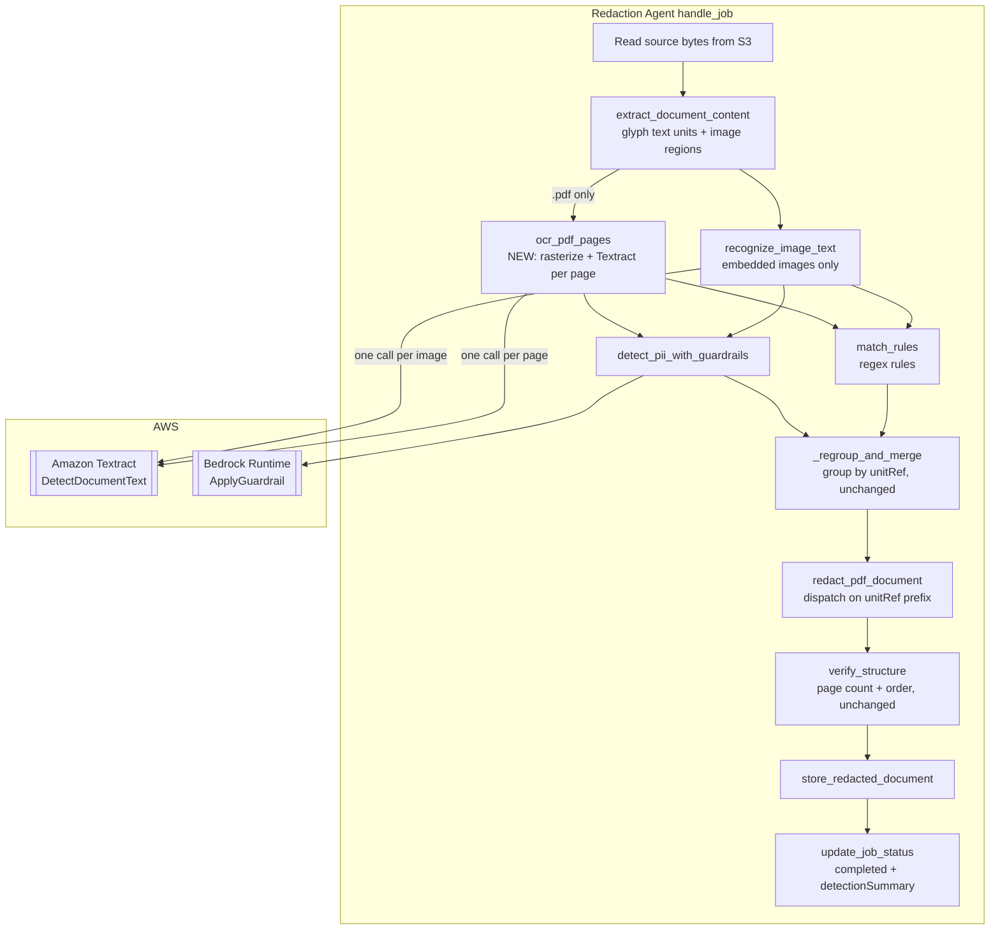
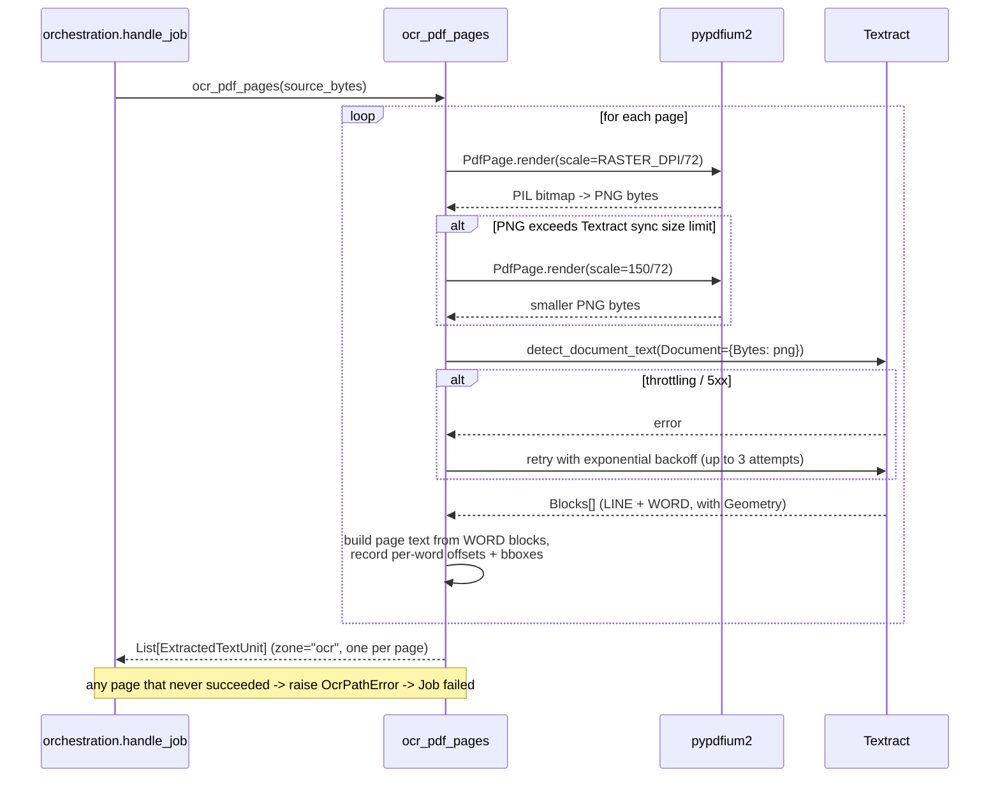

# Design Document: PDF Dual-Path PII Detection

## Overview

For `.pdf` documents, PII detection becomes **two independent paths whose results are unioned**:

1. **Text_Layer_Path** (existing, unchanged): `pdf_glyphs.collect_page_glyphs` → one `ExtractedTextUnit` per page → regex rules + Bedrock Guardrails → spans resolved to per-character rectangles.
2. **OCR_Path** (new): rasterize each page with pypdfium2 → Amazon Textract `DetectDocumentText` → one OCR_Text_Unit per page carrying the recognized text plus per-word geometry → the same regex rules + Guardrails → spans resolved through Textract word bounding boxes.

Both paths feed the same `MatchSpan` collection, and the same PDF redactor blacks out every rectangle either path produced.

### Why two paths rather than one

The two paths fail in complementary ways:

| Failure mode | Text_Layer_Path | OCR_Path |
|---|---|---|
| Broken ToUnicode CMap (the observed defect: `Patti` → `Pa#`) | fails | unaffected |
| OCR misread (`1`→`l`, `0`→`O`, poor scan quality) | unaffected | fails |
| Scanned page with no text layer | no text at all | only source |
| Ligature collapsed into one glyph | mangled | unaffected |

To leak a PII value, both paths must fail on that same value. That is a materially different risk profile from today, where a single font-level defect silently zeroes out detection while the job reports `completed`.

### Alternatives considered and rejected

**OCR only, replacing the text layer.** Dominated by dual-path. Textract is the dominant cost in either design, and the text-layer pass is local CPU work, so discarding it saves almost nothing while giving up a free, independent signal. It also merely trades ToUnicode misses for OCR-misread misses — the text layer of a well-formed PDF is exact where OCR is probabilistic.

**Health check on the text layer, with OCR as a conditional fallback.** The heuristic is the weak point. The signal available (glyph entries versus rendered glyph count — 19 versus 23 on `Patti.pdf`) does catch ligature collapse, but it misses other CMap defects such as a uniform codepoint shift, where counts match perfectly and every character is wrong. A heuristic false negative is silent and catastrophic, which is exactly the failure mode this feature exists to eliminate. The health signal is therefore still computed and **recorded as a diagnostic**, but never used to route (Requirement 5.5).

### What this feature deliberately does not do

- **It does not "un-mangle" the text layer.** Rewriting extracted characters (ligature expansion, CMap repair) would break the 1:1 offset↔character-rectangle invariant that `extraction_pdf.py` and `redaction_pdf.py` now jointly depend on, and would replace a known-bad decoding with a guessed one (Requirement 4.3).
- **It does not add OCR to `.docx`.** `word/document.xml` stores real characters; the ToUnicode class of defect cannot occur there. `.docx` stays single-path (Requirement 1.10).
- **It does not change redaction geometry for the text layer.** That was fixed in commit `c010490`.

### Key architectural insight: the `unitRef` namespace already supports this

`MatchSpan.unitRef` is a namespaced string (`matching.py`: `"text:{index}"` / `"image:{index}"`), and `_regroup_and_merge` in `orchestration.py` groups strictly by `unitRef` equality before calling `merge_spans_within_unit`. Verified against the current code:

- `merge_spans_within_unit` only ever receives spans a caller has already grouped, and merges purely on `startOffset`/`endOffset`.
- `_regroup_and_merge` builds `spans_by_unit_ref` keyed on the raw `unitRef` string, preserving first-seen order.

Therefore, giving OCR-derived units a **third namespace** `"ocr:{pageIndex}"` requires **no change to `merge_spans_within_unit` and no change to `_regroup_and_merge`**. Spans from the two paths never merge with each other — which is correct, because their offsets live in different coordinate spaces and merging them would be meaningless — while spans within one path still merge exactly as before. `_regroup_and_merge`'s output for a `text:`-only input is bit-identical to today (Requirement 4.2).

The single place that must learn about the new namespace is the redactor, which dispatches on the `unitRef` prefix to decide *how* to turn offsets into rectangles:

| `unitRef` prefix | Offset space | Rectangle source |
|---|---|---|
| `text:` | page's `collect_page_glyphs` glyph traversal | per-glyph `bbox`, grouped per line |
| `ocr:` | OCR page text | Textract `WORD` `Geometry.BoundingBox`, scaled to the page rectangle (Page_Coordinates) |
| `image:` | `ImageRegion.recognizedText` | out of scope for PDF text-layer redaction (skipped today, unchanged) |

The same PII value will often be redacted twice, once per path, with slightly different rectangles. Overlapping black boxes are harmless (Requirement 2.6).

## Architecture



### Sequence: the OCR path for one page



### Error-handling posture: OCR is a primary path, Guardrails is supplementary

This is a deliberate asymmetry and the reason the requirements spell it out.

`detect_pii_with_guardrails` swallows every failure and returns partial results, because it *supplements* the regex rules — losing it degrades recall but the regex rules still ran, and failing the job would trade a real capability for a partial one.

The OCR_Path is different. For a PDF it is one of exactly two primary detection sources, and it is the *only* source that works when the text layer is corrupt — which is the entire premise of this feature. If OCR silently fails and the job still reports `completed`, we have rebuilt the defect we set out to remove, one layer up. So: **an unrecoverable OCR failure on any page fails the Redaction Job** (Requirements 3.3–3.6), with the page index and reason in `errorMessage`, and no Redacted Document is stored. A loud failure is recoverable by re-uploading; a silent one is not detectable at all.

## Components and Interfaces

### Component 1: `backend/agent/tools/ocr_pdf.py` (new)

Produces the OCR_Path's text units. Reuses `ocr.py`'s lazy-client pattern and Textract call style; it does **not** reuse `recognize_image_text`, because that function deliberately reads only `LINE` text and discards geometry, while this path needs `WORD` geometry to place rectangles.

```python
RASTER_DPI_ENV_VAR = "PDF_OCR_DPI"
DEFAULT_RASTER_DPI = 200          # Requirement 4.7
FALLBACK_RASTER_DPI = 150         # Requirement 3.2
MIN_RASTER_DPI, MAX_RASTER_DPI = 72, 400
TEXTRACT_MAX_SYNC_BYTES = 10 * 1024 * 1024
MAX_ATTEMPTS = 3                  # Requirement 3.1
RETRY_BASE_DELAY_SECONDS = 1.0

class OcrPathError(Exception):
    """Unrecoverable OCR_Path failure for a specific page. Propagates to
    handle_job's top-level handler -> Job `failed` (Requirements 3.3-3.5)."""

def ocr_pdf_pages(file_bytes: bytes) -> List[ExtractedTextUnit]:
    """One ExtractedTextUnit per page, in page order, zone="ocr",
    position.pageIndex set, boundingBox = page rectangle, ocrWords populated.

    Raises OcrPathError if any page cannot be rasterized or recognized.
    """
```

Internal helpers:

- `_read_raster_dpi() -> int` — reads `PDF_OCR_DPI`, clamps to `[72, 400]`, defaults to 200 on absent/blank/non-numeric/out-of-range (Requirement 4.7).
- `_render_page_png(page, dpi) -> bytes` — `pypdfium2.PdfPage.render(scale=dpi/72).to_pil()` encoded as PNG.
- `_detect_with_retry(client, png_bytes) -> dict` — retries throttling/5xx with exponential backoff, `MAX_ATTEMPTS` total (mirrors `guardrails_pii_detect._is_retryable`'s duck-typed error inspection so the module stays testable with a plain fake client).
- `_build_page_unit(page, page_index, response) -> ExtractedTextUnit` — see below.

**Page text assembly (Requirements 1.4, 1.5).** Textract returns `LINE` blocks whose `Relationships[CHILD]` reference `WORD` blocks. The unit text is built from `WORD` blocks so that every character of the unit text belongs to a word with known geometry:

```
for each LINE block, in Textract's returned order:
    for each child WORD block, in Textract's returned order:
        if not first word on this line: append " "
        record OcrWord(text, startOffset=len(buffer), endOffset=len(buffer)+len(word), boundingBox=word.Geometry.BoundingBox)
        append word text
    append "\n" after each line except the last
```

The separator characters (`" "`, `"\n"`) belong to no word. A span that covers only separators resolves to zero rectangles; a span that touches any word's offset range resolves to that whole word (Requirement 2.5).

**Accepted trade-off — word granularity.** Textract's smallest geometric unit is a word, so OCR-derived redaction is word-granular: matching `Patti` inside `Patti's` blacks out `Patti's`. Over-redaction is the safe direction, and the Text_Layer_Path still contributes character-exact rectangles whenever the text layer is sound.

**Accepted trade-off — word separators.** Because OCR text carries a space between words and a newline between lines, a PII value that Textract splits across words is matched only if the pattern tolerates that separator. A phone number rendered `+86 138 0000 0000` reads back with its spaces intact and matches a pattern written for it; a value Textract splits mid-token does not. This is the mirror image of the Text_Layer_Path, which inserts no separators at all and therefore joins line-wrapped values — a further reason to keep both paths (see `extraction_pdf.py`'s "Text source" docstring).

**Always one unit per page (Requirement 1.1).** A page whose OCR yields no words still produces a unit with `text=""`. This makes `ocr:{index}` index identical to the page index, so nothing downstream has to maintain a unit-index→page-index map. Both detection tools already skip empty text (`detect_pii_with_guardrails` checks `if not unit.text`; `re.finditer` over `""` yields nothing).

Contrast with the Text_Layer_Path, which *drops* whitespace-only pages, so `text:{index}` is **not** a page index — which is why `ExtractedTextUnit.position.pageIndex` exists and is what the redactor reads.

### Component 2: `matching.py` — accept OCR units

Additive third collection, so `text:` indices stay untouched:

```python
def _ocr_unit_ref(index: int) -> str:
    return f"ocr:{index}"

def match_rules(
    text_units: List[ExtractedTextUnit],
    image_regions: List[ImageRegion],
    enabled_rules: List[RedactionRule],
    ocr_text_units: Optional[List[ExtractedTextUnit]] = None,
) -> List[MatchSpan]:
```

OCR units are iterated after text units and image regions, emitting `unitRef=_ocr_unit_ref(index)` and `zone=unit.zone` (i.e. `"ocr"`). Grouping and merging are untouched: the existing group-by-`unitRef` loop already handles a third namespace (Requirements 1.7, 4.1, 4.2).

### Component 3: `guardrails_pii_detect.py` — accept OCR units

Same additive shape:

```python
def detect_pii_with_guardrails(
    text_units: List[ExtractedTextUnit],
    image_regions: List[ImageRegion],
    ocr_text_units: Optional[List[ExtractedTextUnit]] = None,
) -> List[MatchSpan]:
```

One `ApplyGuardrail` call per non-empty OCR unit, `ruleName=f"guardrails:{TYPE}"` as today, offsets recovered by scanning for every non-overlapping occurrence of the match text and selecting them with the digit-boundary rule, as today (see bedrock-guardrails-pii-integration design.md, "Offset Calculation: Handling Duplicate Substrings"). The never-raise posture is unchanged (Requirements 1.8, 3.7).

### Component 4: `redaction_pdf.py` — dispatch on `unitRef` prefix

`redact_pdf_document` keeps its current signature and return type (bytes) so existing callers and tests are unaffected; a new reporting variant carries the counts the Detection_Summary needs.

```python
@dataclass
class PdfRedactionReport:
    textLayerRegions: int      # rectangles resolved from text: spans
    ocrRegions: int            # rectangles resolved from ocr: spans
    agreedRegions: int         # ocr: rectangles intersecting >=1 text: rectangle on the same page

@dataclass
class PdfRedactionResult:
    documentBytes: bytes
    report: PdfRedactionReport

def redact_pdf_document_with_report(
    file_bytes: bytes,
    text_units: List[ExtractedTextUnit],
    match_spans: List[MatchSpan],
    ocr_text_units: Optional[List[ExtractedTextUnit]] = None,
) -> PdfRedactionResult: ...

def redact_pdf_document(...) -> bytes:
    return redact_pdf_document_with_report(...).documentBytes
```

Rectangle collection becomes provenance-tagged. Existing text-layer resolution (`_resolve_unit_page_and_rect`, `_collect_page_chars`, `_get_char_rects_for_offset_range`, `_sub_rectangle_for_match`) is unchanged; a sibling resolver handles `ocr:`:

```python
def _rects_for_ocr_span(page, unit: ExtractedTextUnit, span: MatchSpan) -> List[Rect]:
    """Every Word_Block whose [startOffset, endOffset) intersects the span's
    range, mapped from normalized coordinates onto the page rectangle."""
    rects = []
    for word in unit.ocrWords or []:
        if word.startOffset < span.endOffset and span.startOffset < word.endOffset:
            rects.append(_normalized_bbox_to_page_rect(page_rect, word.boundingBox))
    return rects
```

**Coordinate mapping (Requirement 2.3).** Textract's `BoundingBox` is normalized to the *input image*, and the input image is a raster of the entire page rectangle, so the mapping is a pure scale by the page dimensions and is **independent of the Raster_Resolution**:

```python
def _normalized_bbox_to_page_rect(page_rect: Rect, box: BoundingBox) -> Rect:
    x0 = page_rect.x0 + box.left * page_rect.width
    y0 = page_rect.y0 + box.top  * page_rect.height
    return Rect(x0, y0,
                     x0 + box.width  * page_rect.width,
                     y0 + box.height * page_rect.height)
```

DPI affects recognition quality and payload size only, never placement. `PdfPage.render` rasterizes the page rectangle, which is already rotation-aware, and `pdf_content_edit` consumes coordinates in that same Page_Coordinates space, so rotated pages stay consistent — verified by a dedicated unit test on a `/Rotate 90` page rather than by assumption.

Span → page resolution for `ocr:` spans uses `ocr_text_units[index].position.pageIndex` (which, per Component 1, equals `index`). An out-of-range index or a missing `pageIndex`/`ocrWords` raises `RedactionError`, matching how the text-layer resolver already treats a violated precondition.

**Agreement metric.** `agreedRegions` counts `ocr:`-derived rectangles that intersect at least one `text:`-derived rectangle on the same page. That is computable from data the redactor already holds, is bounded by the OCR rectangle count, and answers the reviewer's question ("did the other path see this too?") without pretending to compare offsets across coordinate spaces. On the `Patti.pdf` evidence it would read `textLayerRegions=1, ocrRegions=3, agreedRegions=1` — the 2 unagreed OCR regions being precisely the PII the text layer lost.

### Component 5: `orchestration.py` — wire the second path

```python
content = _extract_document_content(source_bytes, job.sourceExtension)
if content.imageRegions:
    content.imageRegions = recognize_image_text(content.imageRegions)

ocr_text_units: List[ExtractedTextUnit] = []
if job.sourceExtension == EXTENSION_PDF:
    ocr_text_units = ocr_pdf_pages(source_bytes)      # raises -> Job failed

enabled_rules = _load_enabled_rules()
regex_matches = match_rules(content.textUnits, content.imageRegions,
                            enabled_rules, ocr_text_units)
try:
    guardrails_matches = detect_pii_with_guardrails(content.textUnits,
                                                    content.imageRegions,
                                                    ocr_text_units)
except Exception:
    guardrails_matches = []

matches = _regroup_and_merge(regex_matches + guardrails_matches)   # unchanged

result = _redact_document(source_bytes, content.textUnits, matches,
                          job.sourceExtension, ocr_text_units)
verification = verify_structure(source_bytes, result.documentBytes, job.sourceExtension)
if not verification.ok:
    update_job_status(job_id, STATUS_FAILED, error_message=verification.reason)
    return

redacted_key = store_redacted_document(result.documentBytes, job_id, job.fileName)
update_job_status(job_id, STATUS_COMPLETED, redacted_key=redacted_key,
                  detection_summary=_build_detection_summary(result.report,
                                                             content.textUnits,
                                                             ocr_text_units))
```

`ocr_pdf_pages` is called *outside* any local `try`, so an `OcrPathError` reaches the existing top-level handler and drives the Job to `failed` with the page index in `errorMessage` (Requirements 3.3–3.6). This is the concrete point of contrast with the Guardrails call directly below it, which stays wrapped.

`_redact_document` gains the `ocr_text_units` parameter and returns the PDF result object; the `.docx` branch returns `PdfRedactionResult(documentBytes=..., report=PdfRedactionReport(0, 0, 0))` so the caller has one shape (`.docx` region counts come from the docx redactor if it ever reports them; for now the summary is `null` for `.docx`, see Component 7).

`_build_detection_summary` pairs the redactor's counts with the per-page health signal:

```python
def _build_detection_summary(report, text_units, ocr_text_units) -> dict:
    return {
        "textLayerRegions": report.textLayerRegions,
        "ocrRegions": report.ocrRegions,
        "agreedRegions": report.agreedRegions,
        "pageHealth": [
            {
                "pageIndex": index,
                "textLayerChars": _non_whitespace_count_for_page(text_units, index),
                "ocrChars": _non_whitespace_count(unit.text),
            }
            for index, unit in enumerate(ocr_text_units)
        ],
    }
```

`_non_whitespace_count_for_page` sums non-whitespace characters across text units whose `position.pageIndex == index`, yielding `0` for a page the Text_Layer_Path dropped. On `Patti.pdf` this reproduces the observed asymmetry directly: `{"pageIndex": 0, "textLayerChars": 19, "ocrChars": 23}`.

The signal is written and never read by the pipeline (Requirement 5.5) — routing is unconditional by design.

### Component 6: `job_status_update.py` — persist the summary

`update_job_status` gains `detection_summary: Optional[dict] = None`. When present on a `completed` transition, the `UpdateExpression` additionally sets `detectionSummary`. Attributes not named in the expression stay intact, so Requirement 5.10 holds by construction of `update_item`.

Numbers must be DynamoDB-safe: the summary contains only `int`s, `str`s, lists, and maps, all of which the `boto3.resource` serializer accepts.

### Component 7: `job_status_handler.py` — expose the summary

```python
return _json_response(200, {
    "jobId": job_item["jobId"],
    "status": job_item["status"],
    "errorMessage": job_item.get("errorMessage"),
    "detectionSummary": _to_jsonable(job_item.get("detectionSummary")),
})
```

`_to_jsonable` recursively converts DynamoDB `Decimal` values to `int` (or `float` when not integral). This is required, not cosmetic: `json.dumps` raises `TypeError` on `Decimal`, and every number the resource-level client reads back is a `Decimal`. Absent summary → `None` → `null` (Requirements 5.6, 5.7).

### Component 8: frontend

`frontend/src/api/types.ts`:

```ts
export interface PageHealth { pageIndex: number; textLayerChars: number; ocrChars: number }

export interface DetectionSummary {
  textLayerRegions: number
  ocrRegions: number
  agreedRegions: number
  pageHealth: PageHealth[]
}

export interface JobStatusResponse {
  jobId: string
  status: JobStatus
  errorMessage: string | null
  detectionSummary: DetectionSummary | null   // additive, optional in practice
}
```

`JobStatusView` takes an optional `detectionSummary` prop and, when `status === 'completed'` and the summary is present, renders one extra line above the download action:

> 已遮蔽 4 处敏感信息（文本层 1 处，OCR 3 处，两路一致 1 处）

`totalRegions = textLayerRegions + ocrRegions`. When the summary is absent the component renders exactly as before (Requirement 5.9), which keeps every existing Property 19 test passing. The component stays a pure function of its props — the parent that owns `pollJobStatus` passes the summary down, consistent with the existing design note in that file.

### Component 9: CDK

The agent execution role already holds `textract:DetectDocumentText` on `*` (`redaction_stack.py`, the `agent_execution_role` policy statements) — verified, no IAM change needed (Requirement 4.6). The only stack change is adding `PDF_OCR_DPI` to the AgentCore Runtime's environment variables, alongside the existing `GUARDRAIL_ID` / `GUARDRAIL_VERSION`.

## Data Models

New and modified shapes in `backend/shared/models.py` (mirrored in `backend/lambdas/shared/models.py`, which is a copy of the same module):

```python
# Additive zone value: OCR-derived page text is neither body/table/header/footer
# nor an embedded image region.
TextUnitZone = Literal["body", "table", "header", "footer", "ocr"]
MatchZone    = Literal["body", "table", "header", "footer", "image", "ocr"]


@dataclass
class OcrWord:
    """One Textract WORD block, located both in the OCR text and on the page.

    `startOffset`/`endOffset` are offsets into the owning ExtractedTextUnit's
    `text`. `boundingBox` holds Textract's NORMALIZED (0-1) coordinates
    relative to the rasterized page image — unlike every other BoundingBox in
    this module, which is in source-document coordinate space. The redactor
    scales it onto the page rectangle at redaction time.
    """
    text: str
    startOffset: int
    endOffset: int
    boundingBox: BoundingBox


@dataclass
class ExtractedTextUnit:
    zone: TextUnitZone
    text: str
    position: TextPosition
    boundingBox: Optional[BoundingBox] = None
    ocrWords: Optional[List[OcrWord]] = None   # populated only by ocr_pdf_pages


@dataclass
class RedactionJob:
    ...
    redactedKey: Optional[str] = None
    errorMessage: Optional[str] = None
    detectionSummary: Optional[dict] = None    # additive, see shape below
```

`detectionSummary` persisted / API shape:

```json
{
  "textLayerRegions": 1,
  "ocrRegions": 3,
  "agreedRegions": 1,
  "pageHealth": [
    { "pageIndex": 0, "textLayerChars": 19, "ocrChars": 23 }
  ]
}
```

Both new model members are optional with defaults, so every existing constructor call site keeps working — the same additive discipline `pageIndex`, `boundingBox`, and `mergedFromRuleNames` already follow.

### Cost and latency

| Item | Per page | Note |
|---|---|---|
| Textract `DetectDocumentText` | ~$0.0015 | $1.50 / 1000 pages; the dominant cost |
| Bedrock Guardrails `ApplyGuardrail` | ~$0.0015 | $0.75 / 1000 text units × 2 units per page (text layer + OCR) |
| pypdfium2 rasterization | CPU only | local, no service call |

Dual-path doubles the Guardrails calls per page relative to today, which is small next to Textract — and Textract is a cost an OCR-only design would pay identically. Latency roughly doubles per page, with OCR the bottleneck; synchronous `DetectDocumentText` keeps that latency predictable, with no polling loop to reason about.

Synchronous `DetectDocumentText` was chosen over `StartDocumentTextDetection` because it keeps the control flow a plain loop, matches the existing sync pattern in `ocr.py`, and avoids introducing a polling/completion state machine into an otherwise straight-line pipeline. The trade-off is page-serial latency for multi-page documents; acceptable for a POC, and revisitable without touching anything else in this design.

## Correctness Properties

*A property is a characteristic or behavior that should hold true across all valid executions of a system — essentially, a formal statement about what the system should do. Properties serve as the bridge between human-readable specifications and machine-verifiable correctness guarantees.*

### Property 1: The OCR path produces one unit and one Textract call per page

*For any* PDF document, `ocr_pdf_pages` returns exactly as many `ExtractedTextUnit`s as the document has pages, in page order with `position.pageIndex` equal to the unit's list index, and issues exactly one successful `DetectDocumentText` call per page.

**Validates: Requirements 1.1, 1.3**

### Property 2: Every recorded word slices back to its own text

*For any* Textract response, every `OcrWord` recorded on the resulting OCR_Text_Unit satisfies `unit.text[word.startOffset:word.endOffset] == word.text`, with `0 <= startOffset < endOffset <= len(unit.text)`, and the words' offset ranges are ascending and non-overlapping.

**Validates: Requirements 1.4, 1.5**

### Property 3: OCR spans carry the `ocr:{pageIndex}` namespace

*For any* set of OCR_Text_Units and any set of enabled Redaction Rules, every `MatchSpan` produced from an OCR_Text_Unit has `unitRef == f"ocr:{i}"` where `i` is that unit's index, and no span produced from a text-layer unit or image region uses the `ocr:` prefix.

**Validates: Requirement 1.6**

### Property 4: Rule matching is independent of which path supplied the text

*For any* text and any set of enabled Redaction Rules, the offset ranges `match_rules` produces for that text presented as an OCR_Text_Unit are identical to the offset ranges it produces for the same text presented as a text-layer unit.

**Validates: Requirement 1.7**

### Property 5: Guardrails is invoked once per non-empty OCR unit

*For any* list of OCR_Text_Units, `detect_pii_with_guardrails` issues exactly one `ApplyGuardrail` call per unit whose text contains at least one character, and none for units with empty text.

**Validates: Requirement 1.8**

### Property 6: Merging preserves the union of both paths' detections

*For any* collection of `text:`-referenced and `ocr:`-referenced `MatchSpan`s, the set of offsets covered by `_regroup_and_merge`'s output for each `unitRef` equals the set of offsets covered by the input spans for that same `unitRef`.

**Validates: Requirement 1.9**

### Property 7: An OCR span resolves to exactly the words its offsets touch

*For any* OCR_Text_Unit and any offset range, the rectangles the redactor resolves correspond exactly to the `OcrWord`s whose `[startOffset, endOffset)` intersects that range — a word touched at any position contributes its whole bounding box, and a word merely adjacent to the range's boundary contributes nothing.

**Validates: Requirements 2.2, 2.5**

### Property 8: Normalized bounding boxes map onto the page rectangle

*For any* page rectangle and any normalized bounding box within `[0,1]²`, the mapped rectangle lies inside the page rectangle, the box `(0, 0, 1, 1)` maps to the page rectangle exactly, and normalizing the mapped rectangle by the same page dimensions recovers the original box within floating-point tolerance.

**Validates: Requirement 2.3**

### Property 9: Every resolved rectangle receives a solid redaction block

*For any* collection of `text:`- and `ocr:`-referenced `MatchSpan`s over a PDF, the redactor applies one black-filled redaction annotation per resolved rectangle, and the number applied equals `textLayerRegions + ocrRegions` in the returned report.

**Validates: Requirements 2.4, 2.6**

### Property 10: An empty match set leaves visible content unchanged

*For any* PDF document, redacting it with an empty `MatchSpan` collection — with OCR_Text_Units supplied — yields a document whose extracted page text, page count, and page order are identical to the source's.

**Validates: Requirement 2.7**

### Property 11: Transient Textract failures are retried up to three attempts

*For any* sequence of transient (throttling or server-side) failures followed by a success, the OCR path's per-page call succeeds when fewer than three attempts are needed and reports failure otherwise, making exactly `min(failures + 1, 3)` attempts.

**Validates: Requirements 3.1, 3.2**

### Property 12: Any unrecoverable page failure fails the job and stores nothing

*For any* PDF page count and any page index, when that page's rasterization or Textract recognition fails unrecoverably, the Redaction Job ends with status `failed`, its `errorMessage` contains the failing page index, and no Redacted Document is stored.

**Validates: Requirements 3.3, 3.4, 3.5, 3.6**

### Property 13: Spans never merge across `unitRef` namespaces

*For any* mixed collection of `text:`-, `ocr:`-, and `image:`-referenced `MatchSpan`s — including spans whose offsets collide across namespaces — every output span of `_regroup_and_merge` derives only from input spans sharing its own `unitRef`.

**Validates: Requirement 4.1**

### Property 14: Text-layer-only merging is unchanged

*For any* collection of `MatchSpan`s containing no `ocr:`-referenced spans, `_regroup_and_merge`'s output equals the result of grouping by `unitRef` and applying `merge_spans_within_unit` per group, in first-seen `unitRef` order.

**Validates: Requirement 4.2**

### Property 15: The text layer is recorded verbatim

*For any* PDF page, the text of that page's Text_Layer_Path unit equals the exact concatenation of the `c` values reported by `pdf_glyphs.collect_page_glyphs` in traversal order, with no substitution, expansion, or separator insertion.

**Validates: Requirement 4.3**

### Property 16: Dual-path redaction preserves document structure

*For any* PDF document and any collection of `text:`- and `ocr:`-referenced `MatchSpan`s, `verify_structure` reports `ok` for the resulting Redacted Document, and that document's page count and page order equal the source's.

**Validates: Requirement 4.4**

### Property 17: The raster resolution always resolves to a usable value

*For any* value of the `PDF_OCR_DPI` environment variable, the resolved Raster_Resolution lies within `[72, 400]`, equals the parsed value when that value is an integer inside the range, and equals 200 otherwise.

**Validates: Requirement 4.7**

### Property 18: Per-path region counts match the rectangles applied

*For any* collection of `MatchSpan`s over a PDF, the report's `textLayerRegions` equals the number of rectangles resolved from `text:`-referenced spans and `ocrRegions` equals the number resolved from `ocr:`-referenced spans.

**Validates: Requirement 5.2**

### Property 19: The agreement count is bounded and matches its definition

*For any* per-page sets of text-layer and OCR rectangles, `agreedRegions` equals the number of OCR rectangles intersecting at least one text-layer rectangle on the same page, and satisfies `0 <= agreedRegions <= ocrRegions`, reaching 0 whenever either path produced no rectangles.

**Validates: Requirement 5.3**

### Property 20: The health signal covers every page exactly once

*For any* PDF document, the Detection_Summary's `pageHealth` contains exactly one entry per page, with `pageIndex` values forming the contiguous ascending sequence `0..pageCount-1` and both character counts non-negative.

**Validates: Requirement 5.4**

### Property 21: The health signal never influences detection

*For any* two PDF documents that differ only in text-layer quality, the OCR path runs for every page of both and issues the same number of Textract calls, so no Text_Layer_Health_Signal value changes which detection paths execute.

**Validates: Requirement 5.5**

### Property 22: The detection summary survives the persistence round trip

*For any* Detection_Summary, writing it through `update_job_status` and reading it back through `GET /jobs/{jobId}` yields a JSON-serializable body whose `detectionSummary` holds the same counts and page-health entries as the original, with DynamoDB numeric values normalized to JSON numbers.

**Validates: Requirement 5.6**

### Property 23: Recording the summary leaves identity attributes untouched

*For any* existing `RedactionJobs` record, recording a Detection_Summary leaves that record's `jobId`, `sourceKey`, `sourceExtension`, `fileName`, and `createdAt` values unchanged.

**Validates: Requirement 5.10**

### Property 24: The job status view renders detection counts exactly when they exist

*For any* Redaction Job status and any optional Detection_Summary, the Job_Status_View renders the detection-count line if and only if the status is `completed` and the summary is present; when rendered, the line contains the sum of the per-path counts and each individual per-path count; when absent, the status indicator and download-action visibility are identical to the summary-less rendering.

**Validates: Requirements 5.8, 5.9**

## Error Handling

| Failure | Detection point | Handling | Job outcome |
|---|---|---|---|
| Source PDF unreadable / encrypted | `extract_pdf_content` | `ExtractionError` propagates | `failed` (unchanged) |
| Page rasterization fails | `ocr_pdf_pages` | `OcrPathError` with page index | `failed`, nothing stored |
| Rasterized PNG exceeds Textract's sync input limit | `ocr_pdf_pages` | re-rasterize once at 150 dpi, then call again | `completed` if the retry succeeds |
| Textract throttling / 5xx | `_detect_with_retry` | exponential backoff, 3 attempts total | `completed` if a retry succeeds |
| Textract fails after retries | `ocr_pdf_pages` | `OcrPathError` with page index and reason | `failed`, nothing stored |
| Textract returns no blocks for a page | `_build_page_unit` | empty-text unit, treated as "nothing recognized" | `completed` — an empty page is normal, not an error |
| Guardrails unavailable / throttled / misconfigured | `detect_pii_with_guardrails` | swallowed internally, partial or empty spans | `completed` on the remaining detections |
| `ocr:` span references a missing unit, page index, or word list | `redact_pdf_document_with_report` | `RedactionError` (violated precondition) | `failed` |
| Structure verification mismatch | `verify_structure` | `ok=False` with reason | `failed`, nothing stored |
| `detectionSummary` write fails | `update_job_status` | exception reaches the top-level handler | `failed` — the summary is part of the completion contract |

The distinction in rows 2/5 versus row 6 is deliberate: "Textract could not be consulted" is a failure, "Textract was consulted and found nothing" is a result. Only the former is a blind spot.

## Testing Strategy

Property-based testing applies to most of this feature: offset↔rectangle resolution, word offset bookkeeping, coordinate mapping, span merging, retry accounting, and summary construction are all pure functions over large input spaces, and every AWS dependency can be faked cheaply.

**Libraries.** Hypothesis for Python (already a project dependency — see `backend/.hypothesis/`), fast-check for the TypeScript view property. No property-based framework is written from scratch.

**Configuration.** Each property is implemented as a *single* property-based test configured for a minimum of 100 iterations, tagged in its docstring or comment as:

```
Feature: pdf-dual-path-pii-detection, Property {number}: {property title}
```

**External dependencies are always faked in property tests.** Textract and Bedrock Runtime are replaced with in-process fakes (following `backend/tests/test_ocr.py`'s `unittest.mock.patch` approach rather than moto, since moto's Textract stub cannot return configurable `Blocks`); DynamoDB uses a fake table or moto; S3 uses moto. No property test makes a real AWS call — 100 iterations × real Textract would be both slow and expensive, and would test AWS rather than this code.

**PDF fixtures.** Built in-memory with pypdf via `backend/tests/pdf_fixtures.py` so page counts, content, and rotation are Hypothesis-controlled. The two real repository PDFs with the broken ToUnicode CMap serve as regression *examples*, not as property inputs — they pin the specific observed numbers (`Patti` 0% → covered, `pageHealth` reading 19 versus 23).

**Unit and integration tests** cover what property testing should not:

| Concern | Test type | Why not a property |
|---|---|---|
| `.docx` makes no page-rasterization calls (Req 1.10) | example | behavior does not vary with input |
| Textract called with the resolved dpi (Req 1.2) | example | call-shape assertion |
| Oversized-image 150 dpi fallback (Req 3.2) | edge case | one threshold, two sides |
| Guardrails failure still completes (Req 3.7) | example | pre-existing guarantee, re-checked after the signature change |
| Embedded-image OCR still uses `image:` refs (Req 4.5) | example | wiring regression |
| `textract:DetectDocumentText` grant (Req 4.6) | smoke | CDK template assertion, one execution |
| Absent summary returns `null` (Req 5.7) | example | single concrete case |
| Summary recorded on completion (Req 5.1) | example | implied by Properties 18–20 |
| Rotated (`/Rotate 90`) page geometry | example | verifies the page-rectangle rotation assumption explicitly |
| End-to-end `Patti.pdf` coverage | integration | one real document, real Textract, run deliberately |

**The regression that matters most.** A dedicated integration test asserts that redacting `Patti.pdf` through the dual path yields rectangles covering `Patti`, `Martin`, and `Christina` — the three values the single-path pipeline covered at 0%, 0%, and 56.6%. Without this test the feature's premise is unverified.
