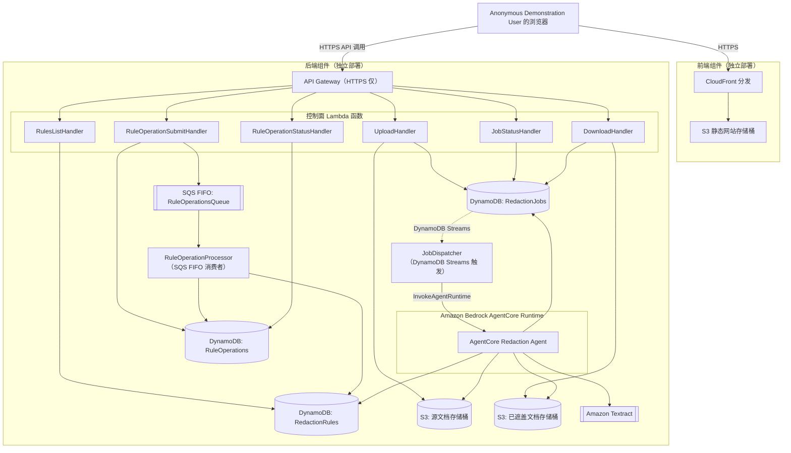
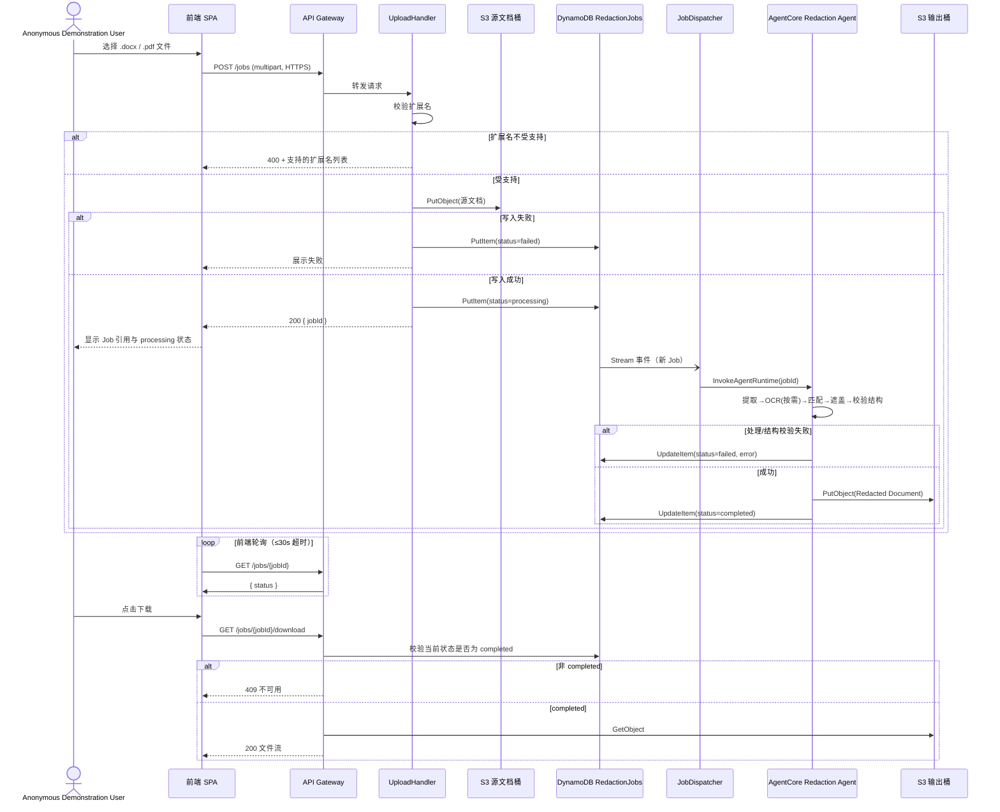

# Design Document

## Overview

PII Document Redaction POC 由两个可独立部署的组件构成：

- **前端组件（Frontend）**：托管在 S3 + CloudFront 上的单页应用（SPA），供 Anonymous Demonstration User 上传文档、管理 Redaction Rule、查看 Redaction Job 状态并下载 Redacted Document。
- **后端组件（Backend）**：由 Amazon API Gateway（仅 HTTPS）、若干 AWS Lambda 函数、Amazon DynamoDB、Amazon S3 以及运行在 Amazon Bedrock AgentCore 中的 **AgentCore Redaction Agent** 组成。前端仅通过后端暴露的 HTTPS API 与后端交互，不直接访问 DynamoDB、S3 或 AgentCore。

设计目标是用最少的自建基础设施验证主流程可行性：全部使用 AWS 托管无服务器服务（API Gateway、Lambda、DynamoDB、S3、SQS、Amazon Bedrock AgentCore、Amazon Textract），不引入需要团队管理的服务器、容器集群或数据库实例。按照需求的 Out of Scope 约定，本设计不包含登录鉴权、多租户隔离、生产级性能优化、高可用或灾备设计。

设计决策摘要（后文详细展开）：

| 决策点 | 选择 | 理由 |
|---|---|---|
| 上传方式 | 前端将文件以 multipart 形式直接 POST 给后端 API（Lambda 代理集成），Lambda 同步写入 S3 | POC 演示文件体积小，避免引入预签名 URL 两次往返的额外复杂度；已知受 API Gateway 10MB 有效负载上限约束（POC 可接受，属 Out of Scope 中的“生产性能”范畴） |
| Job 派发到 Agent | DynamoDB Streams 触发 Dispatcher Lambda，再调用 AgentCore `InvokeAgentRuntime` | 解耦上传请求与 Agent 执行，上传 API 可快速返回，Agent 处理时间不受 API Gateway 29 秒超时限制 |
| Rule Operation 顺序化 | Amazon SQS FIFO 队列（单一 MessageGroupId）+ 单条处理（`BatchSize=1`）的消费者 Lambda | FIFO 保证顺序，单一 Message Group 保证同一时刻只有一条消息被处理，天然满足“下一个 Rule Operation 必须等上一个到达 Terminal Result 才开始”的要求，且完全托管 |
| Rule Operation 结果获取 | 提交为异步操作（返回 `operationId`），前端轮询操作状态直至 Terminal Result | 与 Redaction Job 的状态轮询模式保持一致，简化前端状态管理 |
| 文档解析 | `.docx` 用 `python-docx`（XML 级修改，保留未匹配内容与结构）；文本型 `.pdf` 用 `pdfminer.six`（`pdf_glyphs.collect_page_glyphs`）读取字形、`pikepdf`（`pdf_content_edit`）做内容流字形移除并绘制黑框、`pypdfium2` 做页面栅格化 | 两者均可在保留页面/表格结构的前提下做“最小化修改” |
| 图片/扫描页文字识别 | Amazon Textract `DetectDocumentText` | AWS 托管 OCR 服务，避免自建 OCR 模型 |
| Agent 运行环境 | Amazon Bedrock AgentCore Runtime，工具通过 Strands Agents SDK 定义并在 Runtime 进程内直接调用（非跨网络的 Gateway 工具） | POC 阶段无需跨团队工具共享，直接函数调用 tool 更简单、延迟更低；仍完全托管、按需扩展 |

## Architecture

### 组件与部署边界



前端组件仅依赖后端暴露的 HTTPS API 契约；后端组件的任何内部实现变更（Lambda 逻辑、表结构、Agent 内部工具）都不需要前端重新部署，反之亦然，满足 Requirement 6.1 的独立可部署约束。

### 端到端流程（文档上传到下载）



## Components and Interfaces

### 前端组件

- **技术选型**：React + TypeScript SPA，构建产物部署到 S3，经 CloudFront 分发（POC 阶段不强制要求，任何静态托管方案均满足独立部署约束；本设计以此为默认假设）。
- **页面/视图**：
  - 上传视图：文件选择、扩展名前端预校验（仅用于用户体验，后端仍强制校验）、上传后展示 Job 引用与状态。
  - 规则管理视图：规则列表（名称、正则、启用状态、是否内置）、新增规则表单、启用/禁用开关、删除按钮（内置规则禁用删除按钮）。
  - Job 状态与下载视图：显示 `processing` / `completed` / `failed`，仅在 `completed` 时显示下载按钮。
- **API 客户端约束**：
  - 所有请求使用 `https://` 基址；不提供切换到 HTTP 的配置项。
  - 每个请求设置 30 秒超时；超时或网络错误时展示失败提示，并保留调用前最后一次成功获取的状态（不将状态重置或清空）。
  - Job 状态与 Rule Operation 状态均采用短轮询（例如每 2 秒）直至到达终态。

### 后端组件

#### API Gateway

- 使用 HTTP API（Amazon API Gateway v2），仅配置 HTTPS 端点（不创建自定义 HTTP 监听）；对 API Gateway 而言所有客户端入口天然是 TLS 终止的 HTTPS，任何非 HTTPS（明文 HTTP）尝试会被边缘层拒绝，满足 Requirement 6.3/6.4。
- 路由：

| Method | Path | Lambda | 说明 |
|---|---|---|---|
| POST | `/jobs` | UploadHandler | 上传文档、创建 Redaction Job |
| GET | `/jobs/{jobId}` | JobStatusHandler | 查询 Job 状态 |
| GET | `/jobs/{jobId}/download` | DownloadHandler | 下载 Redacted Document |
| GET | `/rules` | RulesListHandler | 列出所有 Redaction Rule |
| POST | `/rules` | RuleOperationSubmitHandler | 提交创建规则的 Rule Operation |
| PATCH | `/rules/{ruleName}` | RuleOperationSubmitHandler | 提交启用/禁用 Rule Operation |
| DELETE | `/rules/{ruleName}` | RuleOperationSubmitHandler | 提交删除 Rule Operation |
| GET | `/rule-operations/{operationId}` | RuleOperationStatusHandler | 查询 Rule Operation 结果 |

#### UploadHandler

职责：校验扩展名 → 写入源文档到 S3 → 创建 `RedactionJob`（`processing`）→ 返回 Job 引用。若 S3 写入抛出异常，创建/更新 Job 为 `failed` 并返回失败响应（对应 Requirement 1.4）。

#### JobDispatcher

由 DynamoDB Streams（`RedactionJobs` 表，`NEW_IMAGE`，过滤 `status == processing` 且为新增记录）触发，调用 AgentCore Runtime 的 `InvokeAgentRuntime`，传入 `jobId`、源文档 S3 位置引用。该函数不等待 Agent 完成（Agent 自行异步更新 DynamoDB），避免 Lambda 长时间阻塞。

#### AgentCore Redaction Agent（详见“AgentCore Agent 工具编排设计”）

运行在 Amazon Bedrock AgentCore Runtime 中，负责完整的“提取 → OCR → 匹配 → 遮盖 → 存储 → 更新状态”流水线。

#### JobStatusHandler / DownloadHandler

- `JobStatusHandler`：读取 `RedactionJobs` 表返回当前状态与（如有）错误信息。
- `DownloadHandler`：**在返回文件前重新读取一次** `RedactionJobs` 表的当前状态（不使用请求方传入或缓存的状态），仅当此次读取结果为 `completed` 才从 S3 输出桶取回文件并流式返回；否则返回 409/404 及“不可用”提示。这是满足 Requirement 5.4/5.5（下载时校验、防竞态）的关键实现点。

#### RulesListHandler

读取 `RedactionRules` 表全部记录并返回（名称、正则、启用状态、是否内置）。

#### RuleOperationSubmitHandler

- 生成 `operationId`，将请求参数（操作类型、目标规则名、名称/正则等）写入 `RuleOperations` 表（状态 `queued`），并以固定的 `MessageGroupId`（如 `"rule-ops"`）和 `MessageDeduplicationId=operationId` 发送到 SQS FIFO 队列。
- 立即返回 `202 Accepted` 及 `operationId`，不等待处理完成。

#### RuleOperationProcessor

- SQS FIFO 事件源映射配置 `BatchSize=1`；由于队列是 FIFO 且仅使用单一 `MessageGroupId`，Lambda 服务保证同一 Message Group 内的消息严格按顺序、且**前一条消息处理完成（成功或失败确认）后才投递下一条**，从而实现 Requirement 2.4 的顺序化约束，不需要额外的分布式锁。
- 处理逻辑：
  1. 将 `RuleOperations` 表中该操作状态更新为 `processing`。
  2. 按操作类型执行校验与变更：
     - 创建：名称唯一性（大小写敏感精确比较）、长度（1-100）、正则长度（1-500）且可编译；通过则写入 `RedactionRules`（`enabled=true`，`isBuiltIn=false`）。
     - 启用/禁用：目标规则名必须存在；存在则更新 `enabled` 字段。
     - 删除：目标规则名必须存在且 `isBuiltIn=false`；满足则从表中删除。
  3. 将结果写回 `RuleOperations` 表：成功为 `applied`，失败为 `rejected` 并附带具体错误原因（重复名称 / 正则不合法 / 名称不存在 / 内置规则不可删除）。这两种状态都是 Terminal Result。
- 正则编译校验使用与 Agent 匹配工具**相同的正则引擎**（Python `re` 模块），确保“AgentCore Redaction Agent 所支持的模式语法”与规则提交时的校验语法一致（对应 Requirement 2.6/2.8 中“under the pattern syntax supported by the AgentCore Redaction Agent”）。

#### RuleOperationStatusHandler

读取 `RuleOperations` 表返回当前状态（`queued` / `processing` / `applied` / `rejected`）及错误详情。

## Data Models

### RedactionJob（DynamoDB 表 `RedactionJobs`）

| 字段 | 类型 | 说明 |
|---|---|---|
| `jobId` (PK) | String (UUID) | 主键 |
| `status` | String | `processing` \| `completed` \| `failed` |
| `sourceKey` | String | S3 源文档对象键 |
| `sourceExtension` | String | `.docx` \| `.pdf` |
| `redactedKey` | String \| null | S3 输出文档对象键（仅 `completed` 时存在） |
| `errorMessage` | String \| null | 失败原因（仅 `failed` 时存在） |
| `fileName` | String | 原始文件名（用于展示与下载文件命名） |
| `createdAt` / `updatedAt` | String (ISO 8601) | 时间戳 |

状态机：`processing → completed`，`processing → failed`。不存在其他转移；一旦到达 `completed` 或 `failed` 即为终态，不再变化。

### RedactionRule（DynamoDB 表 `RedactionRules`）

| 字段 | 类型 | 说明 |
|---|---|---|
| `ruleName` (PK) | String | 唯一名称（1-100 字符），大小写敏感 |
| `pattern` | String | 正则表达式（1-500 字符） |
| `enabled` | Boolean | 启用状态 |
| `isBuiltIn` | Boolean | 是否为 Built-in Rule（`true` 时不可删除） |
| `createdAt` / `updatedAt` | String (ISO 8601) | 时间戳 |

预置两条 `isBuiltIn=true` 记录：

- `身份证号`：`^\d{17}[\dX]$`（17 位数字 + 1 位数字或大写 `X` 校验位）
- `大陆手机号`：`^1[3-9]\d{9}$`（11 位，以 `1` 开头，第二位 3-9）

初始化逻辑（应用启动/首次部署时执行一次的幂等初始化脚本，而非每次请求都执行）：仅当表中不存在对应 `ruleName` 的记录时才写入默认值（`enabled=true`）；若记录已存在（无论 `enabled` 为何值），不做任何修改，天然满足 Requirement 2.2/2.3。

### RuleOperation（DynamoDB 表 `RuleOperations`）

| 字段 | 类型 | 说明 |
|---|---|---|
| `operationId` (PK) | String (UUID) | 主键 |
| `type` | String | `create` \| `enable` \| `disable` \| `delete` |
| `targetRuleName` | String | 目标/新规则名称 |
| `pattern` | String \| null | 仅 `create` 时提供 |
| `status` | String | `queued` \| `processing` \| `applied` \| `rejected` |
| `errorReason` | String \| null | 仅 `rejected` 时存在，取值：`DUPLICATE_NAME` \| `INVALID_PATTERN` \| `UNKNOWN_RULE_NAME` \| `BUILT_IN_NOT_DELETABLE` \| `INVALID_LENGTH` |
| `createdAt` / `updatedAt` | String (ISO 8601) | 时间戳 |

### 内部处理模型（不持久化，仅在 Agent 处理过程中于内存传递）

- **ExtractedTextUnit**：`{ zone: body|table|header|footer, text, position }`，其中 `table` 位置包含 `tableIndex, rowIndex, colIndex`。
- **ImageRegion**：`{ zone: image, sourceLocation, recognizedText, boundingBox }`（由 OCR 工具产出）。
- **MatchSpan**：`{ zone, unitRef, startOffset, endOffset, ruleName }`，匹配/合并后用于驱动遮盖工具。

## API Design

所有响应均为 JSON（除下载接口返回文件二进制流），错误响应统一包含 `{ "error": { "code": string, "message": string } }`。

### `POST /jobs`

- 请求：`multipart/form-data`，字段 `file`。
- 成功 (200)：`{ "jobId": "...", "status": "processing", "fileName": "..." }`
- 扩展名不支持 (400)：`{ "error": { "code": "UNSUPPORTED_FILE_TYPE", "message": "支持的扩展名：.docx, .pdf" } }`
- 存储失败 (502)：`{ "jobId": "...", "status": "failed", "error": { "code": "STORAGE_WRITE_FAILED", ... } }`

### `GET /jobs/{jobId}`

- 成功 (200)：`{ "jobId": "...", "status": "processing" | "completed" | "failed", "errorMessage": string | null }`
- 未找到 (404)：`{ "error": { "code": "JOB_NOT_FOUND" } }`

### `GET /jobs/{jobId}/download`

- 完成时 (200)：`Content-Disposition: attachment; filename="..."`，二进制文件流。
- 未完成/失败/竞态未通过 (409)：`{ "error": { "code": "REDACTED_DOCUMENT_UNAVAILABLE", "message": "Job 未处于 completed 状态" } }`
- 未找到 (404)：`{ "error": { "code": "JOB_NOT_FOUND" } }`

### `GET /rules`

- 成功 (200)：`{ "rules": [ { "ruleName": "...", "pattern": "...", "enabled": true, "isBuiltIn": true } ] }`

### `POST /rules`

- 请求：`{ "ruleName": "...", "pattern": "..." }`
- 成功 (202)：`{ "operationId": "..." }`
- 请求体本身违反长度约束（1-100 / 1-500）时立即返回 400（无需进入队列）：`{ "error": { "code": "INVALID_LENGTH" } }`

### `PATCH /rules/{ruleName}`

- 请求：`{ "enabled": true | false }`
- 成功 (202)：`{ "operationId": "..." }`

### `DELETE /rules/{ruleName}`

- 成功 (202)：`{ "operationId": "..." }`

### `GET /rule-operations/{operationId}`

- 成功 (200)：`{ "operationId": "...", "status": "queued" | "processing" | "applied" | "rejected", "errorReason": string | null }`

## AgentCore Agent 工具编排设计

AgentCore Redaction Agent 使用 Strands Agents SDK 构建，部署到 Amazon Bedrock AgentCore Runtime；工具在同一 Runtime 进程内以 Python 函数形式注册（无需经由 AgentCore Gateway 跨网络调用），以降低 POC 阶段的延迟与复杂度。Agent 由 `JobDispatcher` 通过 `InvokeAgentRuntime` 触发，payload 携带 `jobId`。

### 工具清单

| 工具 | 输入 | 输出 | 说明 |
|---|---|---|---|
| `extract_document_content` | 源文档 S3 引用、扩展名 | `ExtractedTextUnit[]`、`ImageRegion[]`（占位，`recognizedText` 待填）、页面/表格结构元数据 | `.docx` 用 `python-docx` 遍历段落/表格/页眉页脚 XML 节点；`.pdf` 用 `pdf_glyphs.collect_page_glyphs` 按页提取字形文本，`pdf_images` 提取图像位置 |
| `recognize_image_text` | `ImageRegion[]`（图片字节） | 填充后的 `ImageRegion[]`（含 `recognizedText`、`boundingBox`） | 调用 Amazon Textract `DetectDocumentText`；仅当文档含图片/扫描页时调用 |
| `match_rules` | `ExtractedTextUnit[]` + 已识别的 `ImageRegion[]`、启用的 `RedactionRule[]`（从 DynamoDB 读取） | `MatchSpan[]`（已合并重叠区间） | 对每个文本单元 × 每条启用规则执行 `re.finditer`；合并同一文本单元内重叠/相邻的匹配区间为单一区间 |
| `redact_document` | 源文档、`MatchSpan[]` | Redacted Document 字节流 | `.docx`：仅修改包含匹配的 run/单元格 XML 节点，用实心图形覆盖并清空匹配文本，其余节点原样保留；`.pdf`：使用 `pdf_content_edit` 在内容流中移除命中字形并绘制黑色实心框，永久擦除 |
| `verify_structure` | 源文档、Redacted Document | 校验结果（布尔 + 失败原因） | 校验扩展名一致、页数一致、页序一致、每个表格行列数一致；不一致则视为处理失败 |
| `store_redacted_document` | Redacted Document 字节流、`jobId` | S3 输出对象键 | 写入输出桶，键格式 `{jobId}/{fileName}` |
| `update_job_status` | `jobId`、`completed`\|`failed`、可选错误信息、可选 `redactedKey` | - | 更新 `RedactionJobs` 表 |

### 编排流程

Agent 的编排是一个固定顺序的确定性流水线（不依赖 LLM 自由规划工具调用顺序，避免非确定性影响可测试性），伪代码如下：

```
function handle_job(jobId):
    job = load_job(jobId)
    try:
        content = extract_document_content(job.sourceKey, job.sourceExtension)
        if content.imageRegions is not empty:
            content.imageRegions = recognize_image_text(content.imageRegions)
        enabledRules = load_enabled_rules()
        matches = match_rules(content.textUnits, content.imageRegions, enabledRules)
        redacted = redact_document(job.sourceBytes, matches)
        verification = verify_structure(job.sourceBytes, redacted)
        if not verification.ok:
            update_job_status(jobId, "failed", verification.reason)
            return
        redactedKey = store_redacted_document(redacted, jobId)
        update_job_status(jobId, "completed", redactedKey=redactedKey)
    except ExtractionError | ProcessingError as e:
        update_job_status(jobId, "failed", str(e))
```

任一阶段抛出异常或 `verify_structure` 校验失败，都会导致 Job 被标记为 `failed`（对应 Requirement 3.6 / 4.5 / 7.4）；只有全部阶段成功且结构校验通过才标记为 `completed`。

## Error Handling

| 场景 | 处理策略 |
|---|---|
| 前端选择不受支持的文件 | 前端预校验拦截并提示；即使绕过前端，`UploadHandler` 仍强制校验扩展名并返回 400，不创建 Job |
| S3 源文档写入失败 | `UploadHandler` 捕获异常，将 Job 置为 `failed`，返回失败响应，不重试（POC 范围内不需要重试策略） |
| Agent 解析失败（损坏文件、加密 PDF 等） | `extract_document_content` 抛出 `ExtractionError`，Agent 编排捕获后调用 `update_job_status(failed)` |
| Agent 内部处理异常（超时、依赖调用失败） | Agent 顶层 `try/except` 兜底，统一转为 `failed` 状态，避免 Job 永久停留在 `processing` |
| 结构保持校验失败 | `verify_structure` 返回失败原因，Agent 编排将 Job 置为 `failed`，不返回已生成但结构不一致的文档 |
| Rule Operation 校验失败（重复名/非法正则/未知名称/内置规则删除） | `RuleOperationProcessor` 将 `RuleOperations` 记录置为 `rejected` 并附带 `errorReason`，不修改 `RedactionRules` 表 |
| 前端 API 调用超过 30 秒无响应 | 前端 HTTP 客户端设置 30 秒超时，超时后展示失败提示，且保留超时前最后一次已展示的 Job 状态（不清空/不回退） |
| 下载请求命中非 `completed` 状态（竞态） | `DownloadHandler` 在返回文件前重新读取当前状态，非 `completed` 立即返回 409，不返回部分或过期文件 |
| 非 HTTPS 请求 | API Gateway 边缘层直接拒绝（未部署 HTTP 监听），无需应用层代码处理 |

## Testing Strategy

采用单元测试 + 基于属性的测试（Property-Based Testing, PBT）双轨策略：单元测试覆盖具体示例、边界条件与外部服务集成点；属性测试覆盖下方“Correctness Properties”中定义的通用性质，验证逻辑在大量随机输入下均成立。

- **PBT 库选择**：Python 后端与 Agent 逻辑使用 [Hypothesis](https://hypothesis.readthedocs.io/)；若前端超时/状态映射逻辑使用 TypeScript 实现，使用 [fast-check](https://fast-check.dev/)。
- **迭代次数**：每个属性测试至少运行 100 次迭代（Hypothesis 默认 `max_examples=100` 起；fast-check 默认 `numRuns=100`）。
- **标注要求**：每个属性测试的注释/文档字符串必须包含 `Feature: pii-document-redaction-poc, Property {number}: {property title}`，便于追踪。
- **外部服务隔离**：涉及 Amazon Textract、S3、DynamoDB、AgentCore Runtime 调用的属性测试均通过 mock/stub（如 `moto`、手写 fake）隔离，仅测试本系统代码逻辑，不产生真实 AWS 调用；真实服务集成通过少量（1-3 个）集成测试单独覆盖（例如：Textract 是否被正确调用、S3 对象是否真实可读、DynamoDB Streams 是否触发 Dispatcher）。
- **不适用 PBT 的方面**：基础设施配置（API Gateway 是否仅 HTTPS、Agent 是否运行在 AgentCore、服务是否使用托管无服务器资源）通过 IaC 代码审查 + 1-2 个部署后集成检查验证，不作为属性测试目标。

## Correctness Properties

*A property is a characteristic or behavior that should hold true across all valid executions of a system—essentially, a formal statement about what the system should do. Properties serve as the bridge between human-readable specifications and machine-verifiable correctness guarantees.*

### Property 1: Upload creates exactly one processing job with a reference

For any valid Supported Document (any `.docx` or text-extractable `.pdf` byte content), submitting it for upload results in exactly one new Redaction Job being created with status `processing`, and a reference to that job being returned to the caller.

**Validates: Requirements 1.1**

### Property 2: Unsupported files are rejected without creating a job

For any file whose extension is neither `.docx` nor `.pdf`, submitting it for upload is rejected, the response identifies the list of supported extensions, and no Redaction Job is created.

**Validates: Requirements 1.2**

### Property 3: Storage round-trip preserves document bytes

For any accepted Supported Document, retrieving the stored document by its Redaction Job's stored source reference returns bytes identical to the originally uploaded bytes.

**Validates: Requirements 1.3**

### Property 4: Storage failure marks the job failed

For any accepted Supported Document, if the underlying storage write fails, the associated Redaction Job's status becomes `failed` and a failure indication is available to the caller.

**Validates: Requirements 1.4**

### Property 5: Built-in identity-card rule matches exactly valid 18-character numbers

For any 17-digit string and any checksum character drawn from `0-9` or `X`, the identity-card Built-in Rule's pattern matches the concatenation if and only if the checksum character is a digit or uppercase `X`; the pattern does not match strings of length other than 18 or strings containing non-digit characters in the first 17 positions.

**Validates: Requirements 2.1**

### Property 6: Built-in mobile-number rule matches exactly valid 11-digit numbers

For any string, the mobile-number Built-in Rule's pattern matches it if and only if the string is exactly 11 characters long, consists only of digits, starts with `1`, and has a second digit between `3` and `9`; strings of length 10 or 12, or containing non-digit characters, never match.

**Validates: Requirements 2.1**

### Property 7: Built-in rule stored state survives re-initialization

For any previously stored enabled or disabled state of a Built-in Rule, re-running the rule-collection initialization logic against a non-empty rule collection leaves that Built-in Rule's stored state unchanged.

**Validates: Requirements 2.3**

### Property 8: Rule Operations are processed one at a time in order

For any sequence of Rule Operations submitted concurrently or in rapid succession, at every point in time at most one Rule Operation has a non-terminal (`queued`/`processing`) status transitioning to `processing`, and Rule Operations reach their Terminal Result (`applied` or `rejected`) in the same order they were submitted.

**Validates: Requirements 2.4**

### Property 9: Valid rule mutations are correctly reflected in the collection

For any starting Redaction Rule collection, applying a valid mutation—creating a rule with a name not already present (case-sensitive) and a pattern that compiles, enabling or disabling an existing rule, or deleting an existing custom rule—results in a collection that reflects exactly that change (and only that change) when subsequently listed.

**Validates: Requirements 2.6, 2.9, 2.10, 2.13**

### Property 10: Invalid Rule Operations are rejected without mutating the collection

For any starting Redaction Rule collection, submitting a Rule Operation that has a name exactly matching an existing rule name (create), a pattern that fails to compile (create), a target rule name that does not exactly match any existing rule name (enable/disable/delete), or a delete request targeting a Built-in Rule, results in the operation being rejected with an error identifying the specific violated precondition, and the rule collection is unchanged.

**Validates: Requirements 2.7, 2.8, 2.11, 2.12**

### Property 11: Rule matching agrees with direct regex application

For any set of enabled Redaction Rules and any extracted text content, the set of match spans produced by the Agent's rule-matching tool is identical to the set of spans produced by directly applying each enabled rule's compiled regular expression to that text via a reference (naive) implementation.

**Validates: Requirements 3.1**

### Property 12: Redaction blocks matches and preserves everything else

For any Supported Document and any resulting set of match spans (including the empty set), the Redacted Document is identical to the source document in every respect except that each matched span is replaced by a Solid Redaction Block containing none of the original matched characters; all non-matching visible text, headers, footers, and images (including the entire document content when there are zero matches) render identically to the source and in the same reading position.

**Validates: Requirements 3.2, 3.4, 4.3, 4.6**

### Property 13: Overlapping matches merge into a single block

For any two or more match spans that overlap or are adjacent within the same text unit, the Redacted Document contains a single Solid Redaction Block covering their combined extent rather than multiple separate blocks.

**Validates: Requirements 3.3**

### Property 14: Job reaches completed if and only if processing and structure checks succeed

For any Redaction Job, its status becomes `completed` if and only if the Agent successfully produces a Redacted Document that satisfies the extension, page-count, page-order, non-matching-content, and table-structure preservation constraints; if the Agent raises a processing error or any preservation constraint is violated, the status becomes `failed` and a failure indication is available.

**Validates: Requirements 3.5, 3.6, 4.5, 7.4**

### Property 15: Redacted Document retains the source file extension

For any Supported Document, the Redacted Document produced from it has the same file extension as the source document.

**Validates: Requirements 4.1**

### Property 16: Page count and order are preserved

For any Supported Document with one or more pages, the Redacted Document has the same page count and the same page order as the source document.

**Validates: Requirements 4.2**

### Property 17: Table structure is preserved

For any Supported Document containing one or more tables, each table in the Redacted Document has the same number of rows, the same number of columns, and the same mapping of cell position to cell content (accounting for redaction of matched content within a cell) as the corresponding table in the source document.

**Validates: Requirements 4.4**

### Property 18: OCR-recognized text is matched identically to body text

For any embedded image or scanned page and any text recognized from it by Image Text Recognition, that recognized text is evaluated against every enabled Redaction Rule using the same matching logic applied to body text, and any resulting match produces a Solid Redaction Block positioned over the recognized text's location within the image.

**Validates: Requirements 4.7**

### Property 19: Displayed status and download visibility are a pure function of job status

For any Redaction Job status value (`processing`, `completed`, or `failed`), the status indicator displayed to the user and the visibility of the download action are determined solely by that status: `processing` displays the processing indicator and hides the download action; `completed` displays the download action; any status other than `completed` hides the download action; `failed` additionally displays a failure indication.

**Validates: Requirements 5.1, 5.2, 5.3, 5.7**

### Property 20: Download succeeds if and only if the job is completed at request time

For any Redaction Job and any status it holds at the moment a download is requested, the download request succeeds and delivers the Redacted Document if and only if the job's status is `completed` at that exact moment of verification; otherwise the request is rejected with an unavailable indication, regardless of what status was displayed to the user before the request.

**Validates: Requirements 5.4, 5.5, 5.6**

### Property 21: Frontend timeout preserves the previously displayed status

For any in-flight API call and any status previously displayed for the associated Redaction Job, if no response is received within 30 seconds, the frontend displays a failure indication and the previously displayed Redaction Job status remains unchanged (not cleared, not reset, not replaced by a default value).

**Validates: Requirements 6.5**

## Non-Property-Based Test Coverage

以下需求条款不适合属性测试，将以其他测试类型覆盖：

| 需求 | 测试类型 | 说明 |
|---|---|---|
| 2.2（首次初始化全部启用） | 单元测试（示例） | 固定的“空集合”初始场景，1 个示例即可覆盖 |
| 2.12（删除内置规则被拒绝） | 已并入 Property 10 | 作为其中一种被拒绝的前置条件类型覆盖 |
| 6.1（前后端独立部署） | 架构/IaC 审查 | 通过分别打包、分别部署验证互不依赖 |
| 6.2（Agent 运行在 AgentCore） | 部署后集成检查（1 例） | 确认 Runtime 中存在对应 Agent |
| 6.3/6.4（仅 HTTPS，拒绝非 HTTPS） | 集成测试（1-2 例） | 对部署后的 API Gateway 端点验证无 HTTP 监听 |
| 6.6（使用托管无服务器服务） | IaC 代码审查 | 检查所用资源类型（Lambda、DynamoDB、S3、SQS、AgentCore、Textract）均为托管服务 |
| 7.1、7.2、7.3（端到端演示场景） | 集成测试（各 1-3 例） | 使用真实样例 `.docx`/`.pdf` 文件跑通完整流程，验证 Property 1/9/11/12/15/20 在真实环境中的组合效果 |
