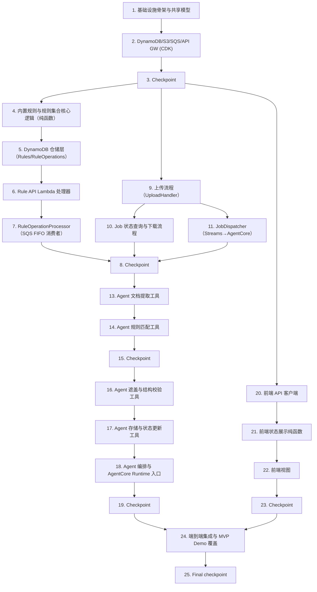

# Implementation Plan: PII Document Redaction POC

## Overview

实现路线遵循 design.md 的组件划分：后端基础设施与业务逻辑使用 Python（AWS CDK 定义基础设施，Lambda 与 AgentCore Redaction Agent 均为 Python，属性测试使用 Hypothesis）；前端使用 TypeScript + React SPA（属性测试使用 fast-check）。任务按以下顺序推进，每一步在前一步基础上可独立验证：

1. 基础设施骨架与共享数据模型
2. DynamoDB / S3 / SQS / API Gateway 基础设施
3. Redaction Rule 核心逻辑（内置规则、初始化、变更校验）与其 DynamoDB 仓储
4. Rule API Lambda 处理器与 RuleOperationProcessor（顺序化处理）
5. 文档上传流程（UploadHandler）
6. Job 状态查询与下载流程（含竞态校验）
7. JobDispatcher（DynamoDB Streams → AgentCore）
8. AgentCore Redaction Agent 各工具（提取、OCR、匹配、遮盖、结构校验、存储、状态更新）
9. Agent 固定顺序编排与 AgentCore Runtime 入口
10. 前端 API 客户端、状态展示逻辑与三个视图
11. 端到端集成与最低可行演示（MVP Demo）覆盖

design.md 中定义的 21 条 Correctness Properties 全部映射为标记 `*` 的可选属性测试子任务，紧邻其对应实现任务；无法用属性测试覆盖的条款（design.md「Non-Property-Based Test Coverage」表）以单元测试、集成测试或 IaC 断言测试覆盖。

## Tasks

- [x] 1. 搭建后端基础设施项目骨架与共享数据模型
  - [x] 1.1 初始化 CDK（Python）应用结构
    - 创建 `infra/`（CDK Stack 定义）、`lambdas/`（各 Lambda 处理器）、`agent/`（AgentCore Agent 与工具）、`shared/`（跨模块共享代码）目录
    - 前后端分别位于独立的可部署包（后端 CDK 应用与前端构建产物互不依赖）
    - _Requirements: 6.1, 6.6_
  - [x] 1.2 实现共享数据模型与校验函数
    - `shared/models.py`：`RedactionJob`、`RedactionRule`、`RuleOperation`、`MatchSpan`、`ExtractedTextUnit`、`ImageRegion` 数据类
    - 名称长度（1-100）与正则长度（1-500）校验函数
    - _Requirements: 2.5_
  - [ ]* 1.3 编写共享模型校验函数的单元测试
    - 边界示例：名称长度 0/1/100/101，正则长度 0/1/500/501
    - _Requirements: 2.5_

- [x] 2. 实现存储、队列与 API 网关基础设施（CDK）
  - [x] 2.1 定义 DynamoDB 表：`RedactionJobs`（开启 Streams，`NEW_IMAGE`）、`RedactionRules`、`RuleOperations`
    - _Requirements: 6.6_
  - [x] 2.2 定义 S3 源文档桶与已遮盖文档输出桶
    - _Requirements: 1.3, 6.6_
  - [x] 2.3 定义 SQS FIFO 队列 `RuleOperationsQueue`
    - _Requirements: 2.4, 6.6_
  - [x] 2.4 定义 API Gateway HTTP API（仅 HTTPS 端点，不创建自定义 HTTP 监听），并声明全部路由（Lambda 集成先以占位处理器接入）
    - _Requirements: 6.3, 6.4_
  - [ ]* 2.5 编写 CDK 断言测试，验证合成模板中的资源
    - 断言资源类型仅限 Lambda、DynamoDB Table、S3 Bucket、SQS Queue、ApiGatewayV2（均为托管无服务器服务）
    - 断言 API Gateway 未配置任何非 HTTPS（明文 HTTP）监听
    - _Requirements: 6.4, 6.6_

- [x] 3. Checkpoint - Ensure all tests pass
  - Ensure all tests pass, ask the user if questions arise.

- [x] 4. 实现内置规则与规则集合核心逻辑（纯函数，尚不依赖 DynamoDB）
  - [x] 4.1 实现内置规则正则常量及仅供测试使用的参考匹配函数
    - 身份证号模式 `^\d{17}[\dX]$`、大陆手机号模式 `^1[3-9]\d{9}$`
    - _Requirements: 2.1_
  - [ ]* 4.2 编写身份证号内置规则的属性测试
    - **Property 5: Built-in identity-card rule matches exactly valid 18-character numbers**
    - **Validates: Requirements 2.1**
  - [ ]* 4.3 编写手机号内置规则的属性测试
    - **Property 6: Built-in mobile-number rule matches exactly valid 11-digit numbers**
    - **Validates: Requirements 2.1**
  - [x] 4.4 实现幂等的规则集合初始化函数 `initialize_rule_collection`
    - 仅当某内置规则名称在集合中不存在时才写入默认值（`enabled=true`）；已存在的记录（任意启用状态）保持不变
    - _Requirements: 2.2, 2.3_
  - [ ]* 4.5 编写首次初始化的单元测试（空集合 → 两条内置规则均启用）
    - _Requirements: 2.2_
  - [ ]* 4.6 编写初始化幂等性的属性测试
    - **Property 7: Built-in rule stored state survives re-initialization**
    - **Validates: Requirements 2.3**
  - [x] 4.7 实现规则变更的纯校验/应用函数（作用于内存中的规则集合抽象，不依赖 DynamoDB）
    - `validate_create`（名称唯一性大小写敏感比较、正则可编译、长度约束）、`validate_enable_disable`、`validate_delete`（名称存在性、内置规则禁止删除）
    - _Requirements: 2.6, 2.7, 2.8, 2.9, 2.10, 2.11, 2.12_
  - [ ]* 4.8 编写合法规则变更的属性测试
    - **Property 9: Valid rule mutations are correctly reflected in the collection**
    - **Validates: Requirements 2.6, 2.9, 2.10, 2.13**
  - [ ]* 4.9 编写非法 Rule Operation 被拒绝的属性测试
    - **Property 10: Invalid Rule Operations are rejected without mutating the collection**
    - **Validates: Requirements 2.7, 2.8, 2.11, 2.12**

- [x] 5. 实现规则与规则操作的 DynamoDB 仓储层
  - [x] 5.1 实现 `RulesRepository`（get_all、get_by_name、put、update_enabled、delete），封装 `RedactionRules` 表
    - _Requirements: 2.13_
  - [x] 5.2 实现 `RuleOperationsRepository`（create、update_status、get_by_id），封装 `RuleOperations` 表
    - _Requirements: 2.4_
  - [ ]* 5.3 使用 mock DynamoDB（moto）为两个仓储编写集成测试
    - _Requirements: 2.13_
  - [x] 5.4 将任务 4.4 的 `initialize_rule_collection` 接入 `RulesRepository`，作为部署时执行一次的初始化 Lambda 或 CDK 自定义资源
    - _Requirements: 2.2, 2.3_

- [x] 6. 实现规则相关 API Lambda 处理器
  - [x] 6.1 实现 `RulesListHandler`（GET /rules）
    - _Requirements: 2.13_
  - [x] 6.2 实现 `RuleOperationSubmitHandler`（POST /rules、PATCH /rules/{ruleName}、DELETE /rules/{ruleName}）
    - 同步校验名称/正则长度（1-100 / 1-500），违反时直接返回 400，不进入队列
    - 写入 `RuleOperations` 记录（状态 `queued`），使用固定 `MessageGroupId` 与 `MessageDeduplicationId=operationId` 发送 SQS FIFO 消息，返回 202 + `operationId`
    - _Requirements: 2.4, 2.5_
  - [x] 6.3 实现 `RuleOperationStatusHandler`（GET /rule-operations/{operationId}）
    - _Requirements: 2.4_
  - [ ]* 6.4 编写处理器请求/响应映射与 HTTP 状态码（200/202/400/404）的单元测试
    - _Requirements: 2.5, 2.13_

- [x] 7. 实现 RuleOperationProcessor（SQS FIFO 消费者）
  - [x] 7.1 实现处理器 Lambda：读取操作、置为 `processing`，调用 `validate_create`/`validate_enable_disable`/`validate_delete` 结合 `RulesRepository` 执行变更，写回 Terminal Result（`applied`/`rejected` + `errorReason`）到 `RuleOperationsRepository`
    - _Requirements: 2.4, 2.6, 2.7, 2.8, 2.9, 2.10, 2.11, 2.12_
  - [ ]* 7.2 编写顺序化处理语义的属性测试
    - **Property 8: Rule Operations are processed one at a time in order**
    - **Validates: Requirements 2.4**
    - 模拟一段随机长度的操作序列，逐条串行调用处理器函数并共享同一个 mock 仓储，断言任一操作在前一操作到达 Terminal Result 之前不会开始处理，且各操作到达 Terminal Result 的顺序与提交顺序一致
  - [x] 7.3 在 CDK Stack 中为 SQS FIFO 队列配置事件源映射（`BatchSize=1`，单一 `MessageGroupId`）
    - _Requirements: 2.4_
  - [ ]* 7.4 编写集成测试，验证合成模板中事件源映射的批大小与队列引用配置
    - _Requirements: 2.4_

- [x] 8. Checkpoint - Ensure all tests pass
  - Ensure all tests pass, ask the user if questions arise.

- [x] 9. 实现文档上传流程
  - [x] 9.1 实现 `UploadHandler`：校验扩展名（仅 `.docx`/`.pdf`）、写入源文档到 S3、创建 `RedactionJobs` 记录（`processing`）；S3 写入失败时置为 `failed` 并返回失败响应
    - _Requirements: 1.1, 1.2, 1.3, 1.4_
  - [ ]* 9.2 编写「上传创建唯一 processing Job 并返回引用」的属性测试
    - **Property 1: Upload creates exactly one processing job with a reference**
    - **Validates: Requirements 1.1**
  - [ ]* 9.3 编写「不受支持扩展名被拒绝且不创建 Job」的属性测试
    - **Property 2: Unsupported files are rejected without creating a job**
    - **Validates: Requirements 1.2**
  - [ ]* 9.4 编写存储读写字节一致性的属性测试
    - **Property 3: Storage round-trip preserves document bytes**
    - **Validates: Requirements 1.3**
  - [ ]* 9.5 编写存储失败场景的属性测试
    - **Property 4: Storage failure marks the job failed**
    - **Validates: Requirements 1.4**
    - 通过 mock 使 S3 PutObject 抛出异常，断言 Job 状态变为 `failed`

- [x] 10. 实现 Job 状态查询与下载流程
  - [x] 10.1 实现 `JobStatusHandler`（GET /jobs/{jobId}）
    - _Requirements: 5.1_
  - [x] 10.2 实现 `DownloadHandler`（GET /jobs/{jobId}/download）：返回文件前重新读取一次当前 Job 状态，仅当此次读取为 `completed` 时才从输出桶取回文件
    - _Requirements: 5.4, 5.5, 5.6_
  - [ ]* 10.3 编写「下载成功当且仅当请求时刻 Job 处于 completed」的属性测试
    - **Property 20: Download succeeds if and only if the job is completed at request time**
    - **Validates: Requirements 5.4, 5.5, 5.6**

- [x] 11. 实现 JobDispatcher（DynamoDB Streams 触发）
  - [x] 11.1 实现 `JobDispatcher` Lambda：过滤出新增的 `processing` Job，调用 AgentCore `InvokeAgentRuntime` 传入 `jobId`，不等待 Agent 完成
    - _Requirements: 3.1_
  - [x] 11.2 在 CDK Stack 中为 `RedactionJobs` 表配置 DynamoDB Streams（`NEW_IMAGE`）触发
    - _Requirements: 3.1_
  - [ ]* 11.3 使用 mock AgentCore 客户端编写集成测试，验证每个新 `processing` Job 恰好触发一次带正确 payload 的 `InvokeAgentRuntime` 调用
    - _Requirements: 3.1_

- [x] 12. Checkpoint - Ensure all tests pass
  - Ensure all tests pass, ask the user if questions arise.

- [x] 13. 实现 Agent 文档提取工具
  - [x] 13.1 实现 `.docx` 的 `extract_document_content`（`python-docx` 遍历段落、表格、页眉页脚），产出 `ExtractedTextUnit[]` 与占位 `ImageRegion[]`
    - _Requirements: 4.6, 4.7_
  - [x] 13.2 实现 `.pdf` 的 `extract_document_content`（`PyMuPDF` 按页提取文本块与图像位置）
    - _Requirements: 4.6, 4.7_
  - [ ]* 13.3 使用代表性 `.docx`/`.pdf` 样例（正文/表格/页眉页脚文本、嵌入图片）编写提取逻辑单元测试
    - _Requirements: 4.6, 4.7_
  - [x] 13.4 实现 `recognize_image_text`，封装 Amazon Textract `DetectDocumentText`，仅当 `ImageRegion[]` 非空时调用
    - _Requirements: 4.7_
  - [ ]* 13.5 使用 mock Textract 客户端编写 `recognize_image_text` 的请求/响应映射集成测试
    - _Requirements: 4.7_

- [x] 14. 实现 Agent 规则匹配工具
  - [x] 14.1 实现 `match_rules`：对每条启用规则在所有文本单元与已识别图片文字上执行 `re.finditer`，并将同一文本单元内重叠/相邻的匹配区间合并为单一区间
    - _Requirements: 3.1, 3.3, 4.7_
  - [ ]* 14.2 编写「与直接应用正则的参考实现结果一致」的属性测试
    - **Property 11: Rule matching agrees with direct regex application**
    - **Validates: Requirements 3.1**
  - [ ]* 14.3 编写重叠/相邻匹配区间合并的属性测试
    - **Property 13: Overlapping matches merge into a single block**
    - **Validates: Requirements 3.3**
  - [ ]* 14.4 编写「OCR 识别文本与正文文本采用相同匹配逻辑」的属性测试
    - **Property 18: OCR-recognized text is matched identically to body text**
    - **Validates: Requirements 4.7**

- [x] 15. Checkpoint - Ensure all tests pass
  - Ensure all tests pass, ask the user if questions arise.

- [x] 16. 实现 Agent 遮盖与结构校验工具
  - [x] 16.1 实现 `.docx` 的 `redact_document`：仅修改包含匹配的 run/单元格节点，用实心图形覆盖并清空匹配文本，其余 XML 节点原样保留
    - _Requirements: 3.2, 3.4, 4.3, 4.4_
  - [x] 16.2 实现 `.pdf` 的 `redact_document`：使用 `add_redact_annot`/`apply_redactions` 永久擦除并填充黑色
    - _Requirements: 3.2, 3.4, 4.3, 4.4_
  - [ ]* 16.3 编写「遮盖匹配内容且保留其余全部内容」的属性测试
    - **Property 12: Redaction blocks matches and preserves everything else**
    - **Validates: Requirements 3.2, 3.4, 4.3, 4.6**
  - [ ]* 16.4 编写表格结构保持的属性测试
    - **Property 17: Table structure is preserved**
    - **Validates: Requirements 4.4**
  - [x] 16.5 实现 `verify_structure`：比较源文档与已遮盖文档的扩展名、页数、页序、每张表格行列数
    - _Requirements: 4.2, 4.4, 4.5_
  - [ ]* 16.6 编写扩展名保留的属性测试
    - **Property 15: Redacted Document retains the source file extension**
    - **Validates: Requirements 4.1**
  - [ ]* 16.7 编写页数与页序保持的属性测试
    - **Property 16: Page count and order are preserved**
    - **Validates: Requirements 4.2**

- [x] 17. 实现 Agent 存储与状态更新工具
  - [x] 17.1 实现 `store_redacted_document`（写入输出桶，键格式 `{jobId}/{fileName}`）
    - _Requirements: 3.2_
  - [x] 17.2 实现 `update_job_status`（更新 `RedactionJobs`：`completed`+`redactedKey` 或 `failed`+`errorMessage`）
    - _Requirements: 3.5, 3.6_
  - [ ]* 17.3 使用 mock S3/DynamoDB 为两个工具编写集成测试
    - _Requirements: 3.2, 3.5, 3.6_

- [x] 18. 实现 Agent 编排与 AgentCore Runtime 入口
  - [x] 18.1 实现固定顺序的编排函数 `handle_job`（extract → OCR（按需）→ match → redact → verify → store/update），顶层异常处理确保任一失败都将 Job 置为 `failed`
    - _Requirements: 3.5, 3.6, 4.5, 7.4_
  - [x] 18.2 使用 Strands Agents SDK 将编排注册为工具序列，实现接收 `InvokeAgentRuntime` 传入 `jobId` 的 AgentCore Runtime 入口
    - _Requirements: 6.2_
  - [ ]* 18.3 编写「Job 变为 completed 当且仅当处理与结构校验均成功」的属性测试
    - **Property 14: Job reaches completed if and only if processing and structure checks succeed**
    - **Validates: Requirements 3.5, 3.6, 4.5, 7.4**
    - 使用 mock 的各工具函数控制成功/失败组合
  - [ ]* 18.4 编写集成测试，确认 AgentCore Runtime 中存在对应 Agent 资源且可通过 `jobId` payload 调用
    - _Requirements: 6.2_

- [x] 19. Checkpoint - Ensure all tests pass
  - Ensure all tests pass, ask the user if questions arise.

- [x] 20. 实现前端 API 客户端
  - [x] 20.1 实现类型化的 HTTPS API 客户端（上传、查询 Job、下载、列出规则、提交 Rule Operation、查询 Rule Operation 状态），基址硬编码为 `https://`，不提供切换到 HTTP 的配置项
    - _Requirements: 6.3_
  - [x] 20.2 实现每请求 30 秒超时，超时回调仅展示失败提示，不修改上一次成功展示的 Job 状态
    - _Requirements: 6.5_
  - [ ]* 20.3 编写「超时保留此前展示状态」的属性测试
    - **Property 21: Frontend timeout preserves the previously displayed status**
    - **Validates: Requirements 6.5**
  - [x] 20.4 实现短轮询辅助函数（2 秒间隔），用于 Job 状态与 Rule Operation 状态直至到达终态
    - _Requirements: 5.1, 2.4_

- [x] 21. 实现前端状态展示纯函数
  - [x] 21.1 实现将 Redaction Job 状态映射为 `{ indicator, downloadVisible, showFailure }` 的纯函数
    - _Requirements: 5.1, 5.2, 5.3, 5.7_
  - [ ]* 21.2 编写状态到展示映射的属性测试
    - **Property 19: Displayed status and download visibility are a pure function of job status**
    - **Validates: Requirements 5.1, 5.2, 5.3, 5.7**

- [x] 22. 实现前端视图
  - [x] 22.1 实现上传视图：文件选择、扩展名前端预校验（仅 UX）、展示 Job 引用与轮询驱动的状态
    - _Requirements: 1.1, 1.2, 5.1_
  - [x] 22.2 实现规则管理视图：规则列表（名称/正则/启用状态/是否内置）、新建表单、启用/禁用开关、内置规则禁用删除按钮、Rule Operation 被拒绝时展示具体错误
    - _Requirements: 2.5, 2.7, 2.8, 2.11, 2.12, 2.13_
  - [x] 22.3 实现 Job 状态与下载视图，使用任务 21.1 的状态映射函数，下载按钮调用下载端点
    - _Requirements: 5.2, 5.3, 5.6, 5.7_
  - [ ]* 22.4 为三个视图编写组件级单元测试，覆盖各类 Job/Rule Operation 状态的渲染
    - _Requirements: 1.2, 2.7, 2.8, 2.11, 2.12, 5.2, 5.3, 5.7_

- [x] 23. Checkpoint - Ensure all tests pass
  - Ensure all tests pass, ask the user if questions arise.

- [x] 24. 端到端集成与最低可行演示覆盖
  - [x] 24.1 将前端构建配置接入已部署后端 API 基址（按环境区分配置，不提供非 HTTPS 回退），确认前后端可分别独立部署
    - _Requirements: 6.1, 6.3_
  - [ ]* 24.2 编写集成测试：提交包含内置规则匹配内容的示例 DOCX，走完整流程（上传→派发→Agent→completed），验证下载文档在匹配位置包含 Solid Redaction Block
    - _Requirements: 7.1, 7.3_
  - [ ]* 24.3 编写集成测试：提交包含内置规则匹配内容的文本型示例 PDF，走完整流程
    - _Requirements: 7.1, 7.3_
  - [ ]* 24.4 编写集成测试：创建启用的自定义 Redaction Rule 并提交匹配该规则的文档，验证已遮盖文档在自定义规则匹配处包含 Solid Redaction Block
    - _Requirements: 7.2_
  - [ ]* 24.5 编写集成测试：验证已部署 API Gateway 端点不存在非 HTTPS 监听，明文 HTTP 请求被拒绝
    - _Requirements: 6.3, 6.4_

- [x] 25. Final checkpoint - Ensure all tests pass
  - Ensure all tests pass, ask the user if questions arise.

## Task Dependency Graph



```json
{
  "waves": [
    { "wave": 1, "tasks": [1, 2] },
    { "wave": 2, "tasks": [3] },
    { "wave": 3, "tasks": [4, 9, 20] },
    { "wave": 4, "tasks": [5, 10, 11, 21] },
    { "wave": 5, "tasks": [6, 22] },
    { "wave": 6, "tasks": [7] },
    { "wave": 7, "tasks": [8, 23] },
    { "wave": 8, "tasks": [13] },
    { "wave": 9, "tasks": [14] },
    { "wave": 10, "tasks": [15] },
    { "wave": 11, "tasks": [16] },
    { "wave": 12, "tasks": [17] },
    { "wave": 13, "tasks": [18] },
    { "wave": 14, "tasks": [19] },
    { "wave": 15, "tasks": [24] },
    { "wave": 16, "tasks": [25] }
  ]
}
```

## Notes

- 标记 `*` 的子任务为可选（测试类任务），实现阶段不强制执行，可在需要更高置信度时补充；顶层任务不标记 `*`。
- 全部 21 条 design.md Correctness Properties 均已作为独立的属性测试子任务，紧邻对应实现任务：
  - Property 1→9.2、2→9.3、3→9.4、4→9.5、5→4.2、6→4.3、7→4.6、8→7.2、9→4.8、10→4.9、
    11→14.2、12→16.3、13→14.3、14→18.3、15→16.6、16→16.7、17→16.4、18→14.4、19→21.2、20→10.3、21→20.3。
- 属性测试使用 Hypothesis（Python，后端/Agent 逻辑）或 fast-check（TypeScript，前端逻辑），均配置最少 100 次迭代，并在测试注释/文档字符串中标注 `Feature: pii-document-redaction-poc, Property {number}: {property title}`。
- design.md「Non-Property-Based Test Coverage」表中的条款覆盖如下：2.2→任务 4.5（单元测试）；2.12→已并入 Property 10（任务 4.9）；6.1→任务 1.1/24.1；6.2→任务 18.4；6.3/6.4→任务 2.5/7.4/24.5；6.6→任务 2.5；7.1/7.2/7.3→任务 24.2/24.3/24.4。
- 涉及 Amazon Textract、S3、DynamoDB、SQS、AgentCore Runtime 的属性测试与单元测试均通过 mock/stub（如 moto）隔离外部依赖；真实服务调用仅由少量集成测试（标记 `*`）覆盖。
