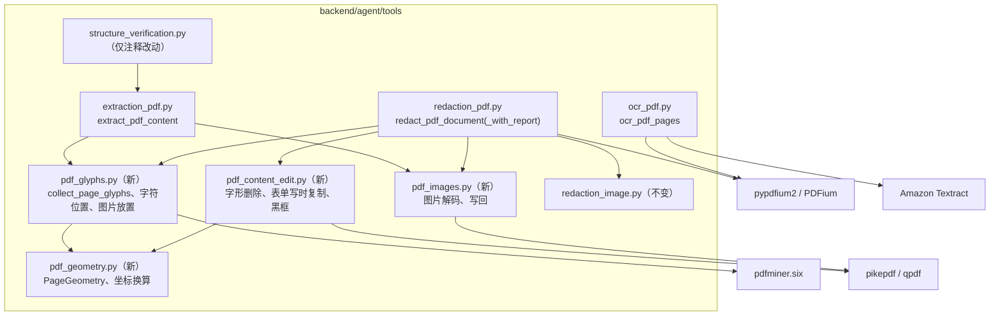
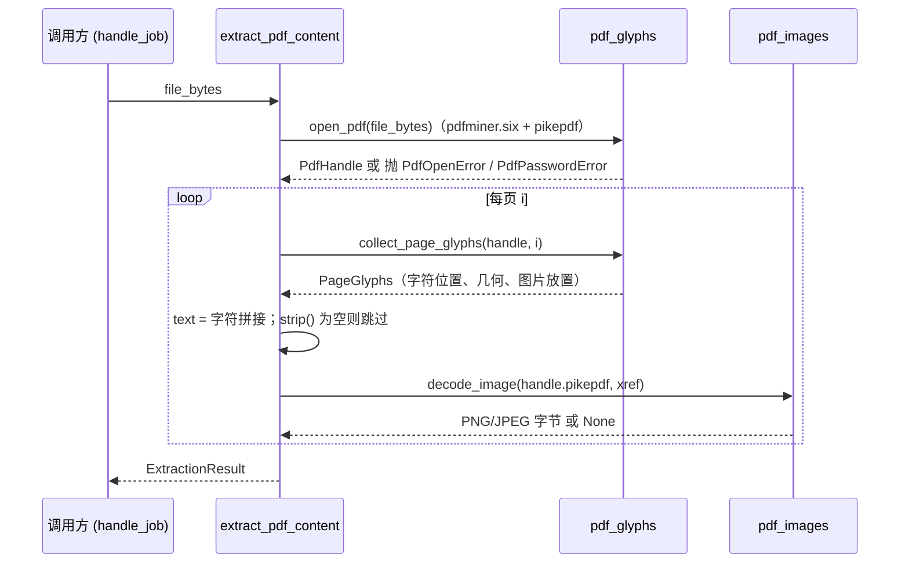
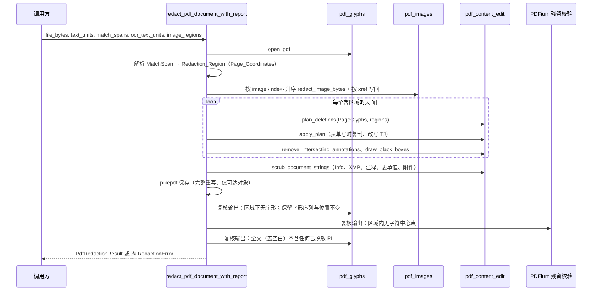

# Design Document

## Overview

本设计把后端三个 PDF 模块（`extraction_pdf.py`、`ocr_pdf.py`、`redaction_pdf.py`）从 PyMuPDF（AGPL-3.0 / Artifex 商业许可）迁移到以下组合，对外接口、报告字段与 DOCX / 前端行为保持不变：

| 职责 | 库 | 许可证（本项目采用） |
| --- | --- | --- |
| 字符遍历（提取侧与脱敏侧共用）、图片放置位置 | pdfminer.six 20260107 | MIT |
| 内容流字形删除、图片解码与写回、输出规范化（单一修订、无孤立对象） | pikepdf 10.17.0（内含 qpdf） | MPL-2.0（未修改的官方 wheel） |
| OCR 整页光栅化、脱敏后残留字符的第二引擎校验 | pypdfium2 5.14.0（内含 PDFium） | BSD-3-Clause（从 "Apache-2.0 OR BSD-3-Clause" 中选择） |
| 泄漏测试的 Independent_Text_Extractor、测试 PDF 构造（仅开发依赖） | pypdf 6.21.4 | BSD-3-Clause |

核心思路：

1. **一套字符遍历，两侧共用。** 新模块 `pdf_glyphs.py` 基于 pdfminer.six 的内容流解释器逐字形遍历页面（含 Form XObject、不可见渲染模式 3 的文本），为每个字形记录 Unicode、Page_Coordinates 矩形，以及它在内容流中的出处（所在流、操作符序号、TJ 数组元素序号、字节区间）。PDF_Extractor 用它拼接 Text_Unit 的 `text`，PDF_Redactor 用同一遍历把偏移映射回矩形，并用同一份出处信息定位要删除的字节。Character_Offset_Mapping 因而由构造保证。
2. **在内容流层面真删除。** `pdf_content_edit.py` 用 pikepdf 解析同一内容流，把与 Redaction_Region 相交的字形从 `Tj` / `TJ` / `'` / `"` 的字符串中切除，并在原位置插入等宽的 TJ 数值位移，使未删除字形的位置不变。被多处放置的 Form XObject 按放置位置做写时复制。最后在页面最上层绘制不透明黑框。
3. **失败即报错（fail-closed）。** 脱敏后用 pdfminer.six 重新遍历输出、再用 PDFium 独立检查涂黑区域下是否仍有字符；任一检查不通过就抛出 `RedactionError`，绝不返回"只盖黑框、底层文字仍在"的文件（需求 8.11）。
4. **OCR_Path 改用 pypdfium2 光栅化**，DPI、10 MB 回退、重试、页级错误语义不变。

研究与原型验证（均在 `/tmp` 中完成，未改动仓库任何源码、测试、依赖清单或脚本）：

- 许可证、版本与 wheel 可用性来自 PyPI JSON API（`https://pypi.org/pypi/<包名>/<版本>/json`）与实际下载的 Linux aarch64 wheel 内的许可证文件、SBOM 和 `readelf` 输出，核实日期 2026-11-01（pikepdf 的 `license_expression = MPL-2.0` 用户已于 2026-11-01 核实，同日复核一致）。
- 在 CPython 3.12 x86_64 虚拟环境中实现了方案 A 的原型：Latin 文本 `Tj`、带字距和 `Tc`/`Tw` 的 `TJ`、渲染模式 3、无空格跨行 SSN、Type0/Identity-H + ToUnicode 的 CJK 文本、两次放置的 Form XObject、`/Rotate 90` + 非零原点 CropBox，七类用例在 pdfminer.six、pypdf、PDFium 三个引擎下均无泄漏，未匹配文本均保留。
- 方案 C（仅用 PDFium 对象级删除）的原型显示：Form XObject 内的文本删除后重新生成内容不生效，保留文字需按 Unicode 重新编码，CJK 字符变成 U+0000。
- 坐标换算公式在 `/Rotate` 为 0、90、180、270 且 CropBox 原点为 (50, 50) 的页面上用 PDFium 渲染结果逐像素核对一致。
- 以 `--platform manylinux2014_aarch64 --platform manylinux_2_28_aarch64` 下载新依赖清单得到 56 个 wheel、0 个 sdist；`pip install --target` 后共 43 个 `.so`，全部为 aarch64，`.pyd` / `.dll` 为 0，无 `fitz` / `pymupdf` 目录。

本设计无法在当前主机核实的事项集中列在"未核实事项"一节。

## 方案评估与推荐

本节满足需求 11。候选方案：

- **方案 A（推荐）**：pdfminer.six 共用字符遍历 + pikepdf 内容流字形删除 + pypdfium2 光栅化与残留校验。
- **方案 A′**：与 A 相同，但用 pypdf 代替 pikepdf 做内容流改写与保存（全部依赖为 Permissive_License，不引入 MPL-2.0）。
- **方案 B**：整页光栅化重建。pypdfium2 渲染页面，Pillow 画黑框，再用 Pillow 的 PDF 写出器把位图重新封装为 PDF。img2pdf 的 PyPI 分类为 "GNU Lesser General Public License v3 (LGPLv3)"，按需求 2 第 8 条不可选用，所以 B 不用它。
- **方案 C**：仅用 pypdfium2 对象级 API。通过 `FPDFText_GetTextObject` 找到字符所属文本对象，`FPDFPage_RemoveObject` / `FPDFFormObj_RemoveObject` 删除，再用 `FPDFPageObj_CreateTextObj` + `FPDFText_SetText` 重建保留的字符，最后调用 `FPDFPage_GenerateContent`。
- **方案 D**：混合。先按方案 A 删除；若某页的删除无法被校验证明，就把该页整页光栅化（方案 B 的做法）而不是报错。

所有方案的每个直接依赖在 PyPI 上都有已发布版本（满足需求 11 第 1 条 (c)）。

### 对比表 11-1：依赖、版本、坐标与偏移、测试影响、风险

| 维度 | 方案 A（推荐） | 方案 A′ | 方案 B | 方案 C | 方案 D |
| --- | --- | --- | --- | --- | --- |
| (1) 直接依赖与捆绑原生库的许可证及归类 | pdfminer.six：MIT（Permissive）<br>pikepdf：MPL-2.0（Weak_Copyleft，未修改 wheel）；捆绑 qpdf：Apache-2.0（Permissive）；libjpeg-turbo：IJG AND BSD-3-Clause AND Zlib（Permissive，见"已确认的许可证归类"）<br>pypdfium2：Apache-2.0 OR BSD-3-Clause，采用 BSD-3-Clause（Permissive）；捆绑 PDFium 及其组件见表 D-3（均 Permissive）<br>pypdf（开发）：BSD-3-Clause（Permissive） | pdfminer.six：MIT<br>pypdf：BSD-3-Clause<br>pypdfium2：同 A<br>全部 Permissive；Independent_Text_Extractor 只能改用 pypdfium2（BSD-3-Clause），因此脱敏侧不能再用 PDFium 做残留校验 | pypdfium2：同 A（Permissive）<br>pikepdf：同 A（图片 xref 与字节仍需它；Weak_Copyleft）<br>Pillow 11.0.0：MIT-CMU（Permissive，已有依赖）<br>img2pdf 0.6.3：LGPLv3，标记不可选用，方案中不使用 | pypdfium2：同 A（Permissive）<br>pikepdf：同 A（Image_Handle 的 xref 与输出规范化需要；Weak_Copyleft） | 同方案 A |
| (2) 候选精确版本与 Linux aarch64 / cp312 wheel | pdfminer.six==20260107：`py3-none-any` ✔<br>pikepdf==10.17.0：`cp312-cp312-manylinux_2_26_aarch64.manylinux_2_28_aarch64` ✔<br>pypdfium2==5.14.0：`py3-none-manylinux_2_17_aarch64.manylinux2014_aarch64` ✔<br>pypdf==6.21.4：`py3-none-any` ✔ | pdfminer.six==20260107 ✔<br>pypdf==6.21.4 ✔<br>pypdfium2==5.14.0 ✔ | pypdfium2==5.14.0 ✔<br>pikepdf==10.17.0 ✔<br>Pillow==11.0.0：`cp312-cp312-manylinux_2_17_aarch64.manylinux2014_aarch64` ✔ | pypdfium2==5.14.0 ✔<br>pikepdf==10.17.0 ✔ | 同方案 A |
| (3) Page_Coordinates 与 Character_Offset_Mapping 的建立方式 | pdfminer.six 以单位 CTM 解释内容流，得到默认用户空间中的字形框；`pdf_geometry.py` 按 CropBox∩MediaBox 与 `/Rotate` 统一换算成 Page_Coordinates。提取与脱敏调用同一个 `collect_page_glyphs`，偏移 `i` 即第 `i` 个字符位置；同一份记录还携带内容流出处，供删除使用 | 同 A；改写侧用 pypdf 的 `ContentStream` 解析同一内容流并按操作符序号对齐 | 提取侧同 A（仍需字符遍历产出 Text_Unit）；脱敏侧只需把 Redaction_Region 换算成像素坐标 | PDFium 文本页（`FPDFText_*`，过滤 `FPDFText_IsGenerated` 插入的字符）给出字符与矩形；PDFium 原生坐标为左下原点，需换算。字符与文本对象经 `FPDFText_GetTextObject` 关联，但取不到原始字符编码 | 同方案 A |
| (5) 需改写的测试文件与对外接口影响 | 改写：`tests/conftest.py`、`test_extraction_pdf.py`、`test_redaction_pdf.py`、`test_structure_verification.py`、`test_patti_regression.py`、`test_llm_cjk_recall.py`、`test_regroup_and_merge.py`（仅桩模块名单）；新增见测试策略。<br>对外接口：零变化；报告字段：零变化；Text_Unit `boundingBox` 由 MediaBox 改为 Page_Coordinates 可见矩形（需求 4.4 已定义，未旋转且原点为 (0,0) 的页面数值不变） | 同 A | 同 A 的文件列表；此外 `test_non_matching_text_elsewhere_on_page_survives_redaction`、`test_ocr_referenced_span_is_redacted_and_counted`（断言 `"Contact"` 保留）、`test_text_redaction_unchanged_when_image_regions_present_but_no_image_span`（断言 `"details"` 保留）等无法通过，只能删除或放宽断言，违反需求 13.3。<br>对外接口不变，但输出 PDF 没有文本层，图片对象全部消失 | 同 A 的文件列表。<br>对外接口不变；输出中保留文本的编码、字距、内容顺序都会变化 | 同 A；另需新增"回退页"测试。<br>对外接口不变；报告需额外记录回退页（新增字段会改变 `PdfRedactionReport`，违反需求 10.3 的字段集合，除非只写日志） |
| (6) 主要风险与缓解 | 风险：pdfminer.six 与 PDFium 对少数畸形 PDF 的解释不同，导致某些字形 pdfminer.six 看不到。<br>缓解：脱敏后用 PDFium 独立检查每个 Redaction_Region 下是否还有字符，有则抛 `RedactionError`。<br>风险：pdfminer.six 为纯 Python，大文档较慢。<br>缓解：每页只遍历一次并缓存，只对含区域的页面做复核 | 风险：pypdf 对损坏 xref 的修复能力弱于 qpdf；被改写替换的旧对象（原内容流、原表单）是否会被 pypdf 写出未经验证，可能需要额外清理。<br>缓解：保存前调用 `compress_identical_objects(remove_orphans=True)` 并在测试中检查无孤立对象。<br>风险：失去第二引擎残留校验 | 风险：所有文字变为位图，文件变大、无法检索。<br>缓解：无，属于方案本质 | 风险：Form XObject 内文本无法删除（原型证实），保留文字重编码失真。<br>缓解：无可靠缓解 | 风险：回退页的未匹配文字全部丢失且不易察觉。<br>缓解：日志告警；但仍不满足需求 8.5 |

### 对比表 11-2：需求 8 第 1 至 9 条

| 条款 | 方案 A | 方案 A′ | 方案 B | 方案 C | 方案 D |
| --- | --- | --- | --- | --- | --- |
| 8.1 删除区域下的字符（含 Form XObject、渲染模式 3） | 满足（原型验证页面级、Form XObject、渲染模式 3） | 满足（设计层面，未做原型） | 满足（所有文本随整页光栅化消失） | 不满足：原型中 `FPDFFormObj_RemoveObject` 返回成功，但 `FPDFPage_GenerateContent` 后表单流未重写，文字仍可提取 | 满足 |
| 8.2 不透明纯黑填充矩形，位于最上层 | 满足 | 满足 | 满足（直接画在位图上） | 满足（PDFium 可追加矩形路径对象） | 满足 |
| 8.3 Independent_Text_Extractor 提取不到 PII | 满足（原型中 pypdf 无泄漏） | 满足（设计层面） | 满足 | 部分满足：Form XObject 内的 PII 仍可提取 | 满足 |
| 8.4 PDF_Extractor 提取不到 PII | 满足 | 满足 | 满足 | 部分满足：原因同上 | 满足 |
| 8.5 保留未相交字符，Unicode、顺序、位置不变 | 满足（以 TJ 数值位移保持后续字形位置，并在运行时复核） | 满足（设计层面） | 不满足：输出没有任何文本字符 | 不满足：保留字符经 `FPDFText_SetText` 重新编码，字距与位置改变；CJK 字符在原型中变为 U+0000；文本对象被移到内容末尾，顺序改变 | 部分满足：回退页上的未相交字符全部丢失 |
| 8.6 无区域时文本与 200 DPI 像素逐一相同 | 满足（无区域时不改写内容流，只经 qpdf 重新保存） | 满足 | 满足（无区域时可直接走规范化保存） | 满足 | 满足 |
| 8.7 页数、页序、可见矩形与 `/Rotate` 不变 | 满足 | 满足 | 满足（保留原页面框与 `/Rotate`，按未旋转方向渲染后放入） | 满足 | 满足 |
| 8.8 `text:` 与 `ocr:` 重叠区域各自处理 | 满足 | 满足 | 满足 | 满足 | 满足 |
| 8.9 文件任何对象中都不含 PII | 满足（qpdf 只写可达对象；另做文档级字符串扫描，见"文档级残留清理"） | 部分满足：未验证 pypdf 写出时是否丢弃被替换的旧内容流与表单对象（可能需 `compress_identical_objects(remove_orphans=True)` 清理），也未做原型；判为部分满足以示风险 | 满足（新文档只含位图） | 部分满足：原型证实 Form XObject 中的 PII 仍在；PDFium 保存是否写出被替换的旧对象未验证，需再经 qpdf 规范化 | 满足 |

### 可推荐性判定（需求 11 第 5 条）

| 方案 | 判定 | 触发标记的维度 |
| --- | --- | --- |
| A | 可推荐 | — |
| A′ | 不可推荐 | 维度 (4)：8.9 部分满足 |
| B | 不可推荐 | 维度 (4)：8.5 不满足 |
| C | 不可推荐 | 维度 (4)：8.1、8.5 不满足，8.3、8.4、8.9 部分满足 |
| D | 不可推荐 | 维度 (4)：8.5 部分满足 |

### 推荐：方案 A

理由（引用对比表维度）：

- 维度 (4)：只有 A 在 8.1 至 8.9 全部为"满足"且有原型证据。
- 维度 (3)：字符遍历与删除定位来自同一次 pdfminer.six 解释，需求 8.1 所说的"字形矩形"与 Character_Offset_Mapping 的矩形是同一个对象，删哪个字形不靠两个引擎之间的几何近似。
- 维度 (6)：PDFium 作为第二引擎只做"区域下是否还有字符"的检查，弥补 pdfminer.six 对畸形 PDF 的盲区，且不会因两引擎矩形定义不同而误报（只用字符中心点判断）。
- 维度 (1)：引入 MPL-2.0 的 pikepdf，需履行需求 2 第 9 至 12 条（未修改 wheel、THIRD-PARTY-LICENSES 收录全文与源码链接、README 说明）。用户已同意此前提。

与其余方案的取舍：

- **相对 A′**：A′ 不引入 MPL-2.0，许可证最干净；代价是 pypdf 写出孤立对象需要额外清理（8.9 风险），对损坏文件的修复能力弱于 qpdf，并且 pypdf 被改写侧占用后，Independent_Text_Extractor 只能换成 PDFium，脱敏侧就不能再用 PDFium 做残留校验。若后续合规要求完全排除 MPL-2.0，A′ 是最近的替代路线，字符遍历与删除算法可原样复用。
- **相对 B**：B 实现最简单、泄漏面最小，但牺牲需求 8.5 与需求 9，且会迫使改写或删除现有"非匹配文本保留"断言，违反需求 13.3。
- **相对 C**：C 依赖最少，但 PDFium 不提供读取文本对象原始字符编码的接口（`pypdfium2.raw` 中只有 `FPDFText_SetCharcodes`，没有对应的读取函数），无法无损重建保留字形；Form XObject 删除在原型中无效。
- **相对 D**：D 在 A 无法证明删除时仍能交付文件，可用性更高；但回退页静默丢失全部文字，违反 8.5。A 选择在这种情况下让任务失败并给出页号，与 OCR_Path 现有"大声失败"策略一致。若业务以后接受"回退页整页图片化"，可在 A 的基础上作为显式开关加入。

在用户明确批准本推荐（或指定其他方案）之前，不修改仓库中任何源码、测试、Dependency_Manifest 或脚本（需求 11.4）。

## Architecture

### 模块划分



新增模块放在 `backend/agent/tools/` 下，`sync_agent_bundle.py` 会把 `agent/` 下所有 `.py` 同步进 bundle，不需要改同步脚本。

### 提取流程



### 脱敏流程



图片写回在内容流改写之前完成，因为两者都在同一个 pikepdf 会话中操作，且写回依据的是源文件中的对象编号；qpdf 只在最终保存时重新编号。

### OCR 流程

OCR_Path 只依赖 pypdfium2：`PdfDocument(file_bytes)` 打开，按页 `render(scale=dpi/72)` 得到位图，转为 PNG 后调用 Textract。其余逻辑（DPI 解析、10 MB 回退、重试、Textract 响应解析）沿用现有实现，仅替换光栅化与打开文档的调用。

## Components and Interfaces

### pdf_geometry.py（新，纯函数）

```python
Rect = Tuple[float, float, float, float]   # (left, top, right, bottom)，Page_Coordinates

@dataclass(frozen=True)
class PageGeometry:
    page_index: int
    visible_box: Tuple[float, float, float, float]  # 用户空间 (x0, y0, x1, y1) = CropBox ∩ MediaBox，已规范化
    rotation: int                                   # 0 / 90 / 180 / 270
    width: float                                    # 可见矩形旋转后的宽（pt）
    height: float                                   # 可见矩形旋转后的高（pt）

def normalize_rotation(raw) -> int
def make_page_geometry(page_index, media_box, crop_box, rotate) -> PageGeometry
def user_to_page_point(geom, x, y) -> Tuple[float, float]
def page_to_user_point(geom, X, Y) -> Tuple[float, float]
def user_to_page_rect(geom, user_rect) -> Rect     # 四角换算后取外接矩形
def page_to_user_rect(geom, rect) -> Tuple[float, float, float, float]
def page_rect_as_bounding_box(geom) -> BoundingBox  # (0, 0, width, height)
def rects_intersect(a: Rect, b: Rect, eps: float = INTERSECT_EPS_PT) -> bool
def normalized_box_to_page_rect(geom_or_size, box: BoundingBox) -> Rect   # Textract [0,1] → pt
```

换算公式（`(vx0, vy0, vx1, vy1)` 为 `visible_box`，W₀ = vx1 − vx0，H₀ = vy1 − vy0）：

| `/Rotate` | 用户空间 (x, y) → Page_Coordinates (X, Y) | 逆变换 | 页面宽 × 高 |
| --- | --- | --- | --- |
| 0 | X = x − vx0，Y = vy1 − y | x = X + vx0，y = vy1 − Y | W₀ × H₀ |
| 90 | X = y − vy0，Y = x − vx0 | x = Y + vx0，y = X + vy0 | H₀ × W₀ |
| 180 | X = vx1 − x，Y = y − vy0 | x = vx1 − X，y = Y + vy0 | W₀ × H₀ |
| 270 | X = vy1 − y，Y = vx1 − x | x = vx1 − Y，y = vy1 − X | H₀ × W₀ |

设计决策：

- **可见矩形 = CropBox ∩ MediaBox**（CropBox 缺失或交集为空时用 MediaBox），与 PDFium 的页面框规则一致。原型中 PDFium 报告的页面尺寸（692 × 512）与公式结果一致。
- **`/Rotate` 规范化沿用 PDFium 规则**：取整数部分，向零截断除以 90 后对 4 取模，负数加 4。这样 OCR_Path（PDFium 光栅化）与提取 / 脱敏（本模块）对同一页面得到相同方向。
- **相交判定使用 `INTERSECT_EPS_PT = 1e-6`**：两矩形在 x、y 两个方向的重叠长度都大于该值才算"交集面积大于 0"。原型中相邻字形共享的边因浮点误差产生约 1e-13 pt 的伪重叠，导致相邻空格被误删；该阈值远小于需求中的 0.01 pt 容差，只用于吸收浮点噪声。
- 所有矩形都是轴对齐的，因为 `/Rotate` 只取 90 的倍数，换算是精确的仿射置换。

### pdf_glyphs.py（新，共用字符遍历）

```python
class PdfOpenError(Exception)        # 字节为空、无法解析
class PdfPasswordError(PdfOpenError) # 需要非空用户密码
class PageReadError(Exception)       # 已打开文档，但某页字符无法读取；携带 page_index

@dataclass
class PdfHandle:
    pdfminer_doc: "PDFDocument"
    pdfminer_pages: List["PDFPage"]
    pikepdf_doc: "pikepdf.Pdf"
    page_count: int

def open_pdf(file_bytes: bytes) -> PdfHandle
def collect_page_glyphs(handle: PdfHandle, page_index: int) -> PageGlyphs
def collect_glyphs_from_bytes(file_bytes: bytes) -> List[PageGlyphs]   # 复核用
```

`open_pdf` 的行为：

- 空字节、pdfminer.six 或 pikepdf 任一方打开失败 → `PdfOpenError`。
- 两者都以空用户密码尝试打开；pdfminer.six 抛 `PDFPasswordIncorrect` 或 pikepdf 抛 `PasswordError` → `PdfPasswordError`。原型核实：仅设置所有者密码的 AES-256 与 RC4 文档，pdfminer.six、pikepdf、PDFium 均可打开并提取；设置用户密码的文档三者均报密码错误。
- 两者的页数不同 → `PdfOpenError`（页树解析不一致，后续对齐无从谈起）。

遍历实现（`_GlyphInterpreter` 继承 `pdfminer.pdfinterp.PDFPageInterpreter`，`_GlyphDevice` 继承 `pdfminer.pdfdevice.PDFTextDevice`）：

1. **单位 CTM 起步**：不调用 `process_page`（它会按 MediaBox 和 `/Rotate` 预置 CTM），而是 `init_resources(page.resources)`、`init_state(单位矩阵)` 后 `execute(page.contents)`。字形框因此落在默认用户空间，再由 `pdf_geometry` 统一换算。
2. **操作符序号**：重写 `execute`，对每个关键字操作符（含未知操作符与内联图片结束符 `EI`）递增序号，并把 `(上下文路径, 序号, 操作符名)` 交给设备。上下文路径是从页面到当前流的 `((父流中 Do 的序号, Form XObject 对象编号), …)` 元组，页面级为空元组。
3. **Form XObject**：重写 `do_Do`，进入表单前把 `(当前序号, xobj.objid)` 压入上下文路径，表单矩阵与 `/Resources` 处理沿用 pdfminer.six 原逻辑。
4. **字符串拆码**：重写 `render_string_horizontal` / `render_string_vertical`，逐元素遍历 TJ 数组并记录元素序号；对字符串元素按字体拆出 `(cid, 字节起点, 字节终点)`：简单字体每字节一码；`IdentityCMap` 两字节；`IdentityCMapByte` 一字节；其他 CMap 沿 `code2cid` 前缀树逐字节匹配。
5. **字形记录**：在 `render_char` 中用 pdfminer.six 的 `LTChar` 计算字形框（与 pdfminer.six 自身的布局分析同一算法），并按 PDF 规范计算该字形的位移（见 pdf_content_edit）。`to_unichr` 失败（无 ToUnicode 且无法推断）时以单个 U+FFFD 作为该字形的文本，而不是 pdfminer.six 默认的 `(cid:N)` 多字符串，以免在 `text` 中插入原文没有的字符。
6. **图片放置**：`do_Do` 遇到 Image XObject 时，记录 `xobj.objid`、当前 CTM 下单位正方形的外接矩形、上下文路径与序号。内联图片没有对象编号，不记录。
7. **渲染模式**：遍历不区分文本渲染模式，渲染模式 3（不可见）的字形同样产出字符位置，与现有实现一致，也是需求 8.1 删除不可见文本的前提。

字符位置展开规则（Character_Offset_Mapping）：

- 一个字形的文本长度为 `n`，就产出 `n` 个连续字符位置，共用该字形的矩形（连字 "fi" 展开为 "f"、"i" 两个位置）；`n = 0` 时不产出字符位置，但字形仍保留在 `glyphs` 中，参与删除判定。
- 裁剪到可见矩形后宽或高不大于 0 的字形框记为 `rect = None`（"没有字形矩形的字符"），不参与 Redaction_Region 计算。
- `text = "".join(c.char for c in chars)`，不插入任何分隔符，不跳过任何字形。

行分组规则（需求 5.7 所说的"行"）：按遍历顺序比较相邻两个字形。设前一字形基线方向单位向量为 u（取渲染矩阵第一列），h 为前一字形框在垂直于 u 方向上的高度；满足下列任一条件即开始新行：上下文路径不同；书写方向（横 / 竖）不同；两字形原点之差在垂直于 u 方向上的距离大于 0.5 × h；两原点之差在 u 方向上的投影小于 −0.5 × h（回退到前面）。`line_id` 从 0 起单调递增。

### pdf_content_edit.py（新，pikepdf 改写）

```python
class ContentEditError(Exception)   # 由 redaction_pdf 转为 RedactionError

@dataclass
class GlyphDeletion:
    op_ordinal: int
    elem_index: int
    byte_start: int
    byte_end: int
    tj_adjust: float          # 替代该字形的 TJ 数值

def plan_deletions(page_glyphs: PageGlyphs, regions: List[Rect]) -> Dict[ContextPath, List[GlyphDeletion]]
def apply_page_plan(pdf: "pikepdf.Pdf", page_index: int, plan, page_glyphs: PageGlyphs) -> None
def remove_intersecting_annotations(pdf, page_index, geom, regions) -> int
def draw_black_boxes(pdf, page_index, geom, regions) -> None
def scrub_document_strings(pdf, pii_values: List[str]) -> None
```

**删除判定**：页面上每个字形（包括不产出字符位置的字形）只要其未裁剪的 Page_Coordinates 矩形 `raw_rect` 与任一 Redaction_Region 相交（`rects_intersect`），就进入删除计划。判定基于字形，不基于 MatchSpan，因此同一位置的重复字形（例如"假粗体"重复绘制）、`ocr:` 区域下的字形都会被删除。

**位移计算**：被删字形按 PDF 规范的位移为：横排 tx = (w₀ × Tfs + Tc + Tw′) × Th，竖排 ty = w₁ × Tfs + Tc + Tw′，其中 Tw′ 仅在该字形为单字节编码 32 时等于 Tw。替代它的 TJ 数值 n 满足"数值位移等于被删字形位移"：横排 n = −tx × 1000 / (Tfs × Th)，竖排 n = −ty × 1000 / Tfs。Tfs 或 Th 为 0 时无法构造等价位移，抛 `ContentEditError`。原型中删除 `TJ` 字符串中间的部分字形（`[(Name: Jo) -120 (hn Smi) 30 (th ok)]`，`1 Tc 2 Tw`）后，pdfminer.six、pypdf、PDFium 均提取到 `Name:  Smith ok`，保留字形位置未变。

**操作符改写**：

| 原操作符 | 改写 |
| --- | --- |
| `string Tj` | `[…] TJ` |
| `array TJ` | 只改写含被删字形的字符串元素：切成保留片段，片段之间插入 n |
| `string '` | `T*` + `[…] TJ` |
| `aw ac string "` | `aw Tw` + `ac Tc` + `T*` + `[…] TJ` |

同一个流中的所有改写在一次遍历中完成，序号以改写前的解析结果为准，避免插入指令导致后续序号漂移。

**序号对齐校验**：pikepdf 用 `parse_content_stream` 解析同一个流（页面 `/Contents` 为数组时按拼接后的整体解析，pdfminer.six 同样拼接）。对每个待改写序号，校验 pikepdf 指令的操作符名与 pdfminer.six 记录的相同，且字符串操作数的字节与记录的字节区间一致；任一不符抛 `ContentEditError`，不做猜测。原型中两者对页面流、Form XObject 流的序号完全一致（pdfminer.six 把内联图片计为一个 `EI` 操作符，pikepdf 把内联图片计为一条指令，数量相同）。

**Form XObject 写时复制**：上下文路径非空时，从最外层开始，对路径上的每个表单复制一份新流对象（复制字典项，写入改写后的内容），在父流的资源字典中以不冲突的新名称（`/RdxFm{n}`）登记，并把父流中对应序号的 `Do` 操作数改为新名称。这样只有发生删除的那一次放置被改动，同一表单的其他放置与其他页面不受影响。原型验证：表单在同页放置两次、只删除第一次放置中的 PII 时，第二次放置原样保留。保存前调用 `pdf.remove_unreferenced_resources()`，不再被使用的原表单随之从资源字典移除，qpdf 保存时不再写出。

**注释**：页面 `/Annots` 中 `/Rect`（换算为 Page_Coordinates）与任一 Redaction_Region 相交的注释从数组中移除；若为 Widget，同时从 `/AcroForm /Fields`（或其父字段的 `/Kids`）中移除。注释外观绘制在页面内容之上，不移除就会盖住黑框，也是需求 8.9 的泄漏面。

**黑框**：页面内容整体包裹为 `q … Q`，之后追加一个新内容流：

```
q /RdxGS gs 0 0 0 rg x₀ y₀ w h re f … Q
```

其中 `/RdxGS` 是新增的 ExtGState：`/ca 1 /CA 1 /SMask /None /BM /Normal`；矩形由 `page_to_user_rect` 换算到默认用户空间。黑框位于全部页面内容之后，因此在内嵌图片之上；不放入任何可选内容组。名称冲突时追加数字后缀。

**文档级残留清理（`scrub_document_strings`）**：`pii_values` 为全部被脱敏 MatchSpan 对应的 PII 字符串（去除空白后）。

- 遍历所有可达对象中的字符串对象（文档信息字典、书签标题、名称树、注释 `/Contents` / `/T` / `/TU`、表单字段 `/V` / `/DV`、JavaScript 等），解码（PDFDocEncoding / UTF-16BE）并去除空白后若包含任一 PII，替换为空字符串。
- XMP 元数据流（文档级与对象级 `/Metadata`）按 UTF-8 解码后若包含任一 PII，移除该 `/Metadata` 引用。
- 仍保留的注释，其 `/AP /N` 外观流按 Form XObject 交给 `pdf_glyphs` 遍历，文本包含任一 PII 则移除该注释。
- 嵌入文件流（`/EmbeddedFile`）按 latin-1、UTF-8、UTF-16 解码后若包含任一 PII，移除该附件。

### pdf_images.py（新）

```python
def iter_page_image_refs(handle, page_index, page_glyphs) -> List[ImageRef]
def decode_image(pdf: "pikepdf.Pdf", xref: int) -> Optional[bytes]
def write_back_image(pdf: "pikepdf.Pdf", xref: int, new_bytes: bytes) -> None   # 失败抛 ImageWriteBackError
```

**提取（`decode_image`）**：

- `pikepdf.PdfImage(obj)` 解码：
  - `/Filter` 恰为 `/DCTDecode`、色彩空间为 DeviceRGB 或 DeviceGray、无 `/SMask`、无 `/Decode` 时，直接返回原 JPEG 字节（与现有实现的 `extract_image` 行为相同，避免无谓转码）；
  - 其余情况转为 PNG：`as_pil_image()`，模式不是 RGB / L 的（CMYK、Indexed、Lab、ICC 等）先转 RGB；有 `/SMask` 时把软蒙版缩放到图片尺寸作为 alpha 通道，输出 RGBA PNG。
- 不转 CMYK 的原因：`redaction_image.redact_image_bytes` 以 `(0, 0, 0)` 填充，在 CMYK 模式下得到的是白色。
- 解码后的像素宽高等于 `/Width`、`/Height`（原型核实）。
- 任何异常、空结果都返回 `None`（需求 6.5），不影响其余图片与文本。

**图片列表（需求 6.1、6.2、6.7、6.8）**：

- 先按 `pdf_glyphs` 记录的图片放置（内容流绘制顺序，含经 Form XObject 的间接放置）去重：每个 xref 在本页只产出一个 `ImageRegion`，`boundingBox` 取首个放置位置的外接矩形（Page_Coordinates）。
- 再追加本页资源字典（含所用 Form XObject 的资源字典）中出现、但内容中没有放置的图片 XObject，按资源名排序，`boundingBox = None`。
- `sourceLocation = "page:{pageIndex}:xref:{xref}"`，其中 xref 是源文件的间接对象编号。原型核实 pdfminer.six 的 `objid` 与 pikepdf 的 `objgen[0]` 一致。

**写回（`write_back_image`）**：

- 用 Pillow 解码 `redact_image_bytes` 的输出。
- JPEG 输出直接作为 `/DCTDecode` 流写入。其余格式转为 RGB / L（RGBA 拆出 alpha）后编码为 PNG，取 IDAT 数据拼接为 FlateDecode 流，`/DecodeParms` 为 `<< /Predictor 15 /Colors n /BitsPerComponent 8 /Columns W >>`，体积与 PNG 相当，用于满足需求 9.5、9.8 的大小上限；隔行扫描 PNG 回退为不带预测器的 zlib 压缩。
- 更新 `/Width`、`/Height`、`/ColorSpace`（DeviceRGB / DeviceGray）、`/BitsPerComponent 8`，删除 `/Decode`、`/SMaskInData`、`/Mask`、`/Alternates`。
- 输出含 alpha 时写入新的 `/SMask` 流（涂黑区域在 `redact_image_bytes` 中为不透明黑，alpha = 255）；输出不含 alpha 而原图有 `/SMask` 时删除 `/SMask`，使涂黑区域必然不透明。
- `/ImageMask true` 的模板图片不支持写回，抛 `ImageWriteBackError`（转为 `RedactionError`）。
- 写回改的是同一个对象，页面上该对象的每个放置位置都会显示新图片（需求 9.2）；qpdf 完整重写文件，原图片数据与旧 `/SMask` 不会残留（需求 9.4）。原型核实写回后 PDFium 渲染该位置为 (0, 0, 0)。

### extraction_pdf.py（改写）

对外签名与 `ExtractionError`、`ExtractionResult` 不变。

```python
def extract_pdf_content(file_bytes: bytes) -> ExtractionResult
def _extract_image_bytes(pdf, xref: int) -> Optional[bytes]   # 内部函数，参数由 (fitz 文档, xref) 改为 (pikepdf.Pdf, xref)
```

- `open_pdf` 的 `PdfOpenError` / `PdfPasswordError`，以及任何替代库异常 → `ExtractionError`。
- 每页 `collect_page_glyphs`；`PageReadError` → `ExtractionError("Failed to extract text from page {i}: …")`，不返回部分结果。
- `text.strip() != ""` 时产出一个 Text_Unit：`zone="body"`、`position=TextPosition(index=0, pageIndex=i)`、`boundingBox=(0, 0, width, height)`。
- `pageCount = handle.page_count`，`pageOrder = list(range(pageCount))`。

### ocr_pdf.py（改写）

对外签名、`OcrPathError`、常量（`RASTER_DPI_ENV_VAR`、`DEFAULT_RASTER_DPI`、`FALLBACK_RASTER_DPI`、`MIN_RASTER_DPI`、`MAX_RASTER_DPI`、`TEXTRACT_MAX_SYNC_BYTES`、`MAX_ATTEMPTS`、`RETRY_BASE_DELAY_SECONDS`）与 Textract 响应解析函数不变。替换点：

| 现有调用 | 替换为 |
| --- | --- |
| 打开文档 | `pypdfium2.PdfDocument(file_bytes)`；`PdfiumError`（含需要用户密码）或空字节 → `OcrPathError(pageIndex=None)` |
| 加载第 i 页 | `document[i]`；异常 → `OcrPathError(pageIndex=i)` |
| 光栅化 | `page.render(scale=dpi / 72, draw_annots=True).to_pil()`，Pillow 编码 PNG；异常 → `OcrPathError(pageIndex=i)` |
| OCR_Unit `boundingBox` | `(0, 0, w, h)`，`(w, h) = page.get_size()`（PDFium 返回旋转后的可见矩形尺寸，原型核实） |

PDFium 渲染时自动应用页面 `/Rotate`，位图覆盖整个可见矩形；原型中 512 × 692 pt 页面在 200 DPI 下得到 1923 × 1423 像素，期望值 1922.2 × 1422.2，误差在 ±1 像素内。pypdfium2 对象在函数返回前显式 `close()`。

### redaction_pdf.py（改写）

对外签名、`RedactionError`、`PdfRedactionReport`、`PdfRedactionResult`、前缀常量不变。

1. `open_pdf`；任何打开失败 → `RedactionError`。
2. 逐个 MatchSpan 按前缀分派（规则同现状）：
   - `text:`：校验索引、`pageIndex`、`boundingBox`、页索引范围（需求 10.6）；取该页 `PageGlyphs`（按页缓存）；若字符位置可读且 `0 ≤ start < end ≤ len(chars)`，取 `chars[start:end]` 中 `rect` 非空者，按 `line_id` 分组，每组取最小外接矩形（需求 5.6、5.7）；否则按需求 5.8、5.9 生成一个按比例估算的区域。
   - `ocr:`：校验同现状；与 MatchSpan 区间重叠的每个 `OcrWord` 产出一个区域，`normalized_box_to_page_rect` 按 OCR 单元同页的 Page_Coordinates 尺寸缩放。
   - `image:`：解析索引，按区域分组。
   - 其他前缀：跳过。
3. 图片写回：按 `image:{index}` 升序，每个被引用区域调用一次 `redact_image_bytes`，再 `write_back_image`；失败原因按需求 9.6 转为说明 `image:{index}` 的 `RedactionError`。
4. 对每个有区域的页面：`plan_deletions` → `apply_page_plan` → `remove_intersecting_annotations` → `draw_black_boxes`。`text:` 与 `ocr:` 区域合并成同一列表处理，不去重（需求 8.8）。
5. 有任何区域时调用 `scrub_document_strings`。
6. 保存：`pdf.remove_unreferenced_resources()`，`pdf.save(buf, compress_streams=True, object_stream_mode=generate, encryption=False)`。qpdf 总是写出完整的新文件，只包含从尾部字典可达的对象，不含增量更新段（需求 8.10）。
7. 复核（仅当存在区域时）：
   - (a) pdfminer.six 遍历输出的含区域页面：无字形矩形与任何区域相交；保留字形序列（Unicode 与顺序）与源页面"不相交字形"序列完全相同，且每个矩形四边偏差不超过 0.01 pt（需求 8.1、8.5）。
   - (b) PDFium 打开输出：含区域页面上，任一非生成字符（`FPDFText_IsGenerated` 为假）的 `FPDFText_GetCharBox` 中心点落在某区域内（各边内缩 0.01 pt）即判为残留（需求 8.1）。
   - (c) pdfminer.six 遍历输出全部页面，拼接文本去除空白后不得包含任一被脱敏 PII（需求 8.4）。
   - 任一失败抛 `RedactionError`，不返回字节。
8. 报告：`textLayerRegions` / `ocrRegions` 为两类区域数量；`agreedRegions` 为与同页任一 `text:` 区域以 `rects_intersect` 判定相交的 `ocr:` 区域数（需求 10.3，仅边界相接不计）。

无任何区域且无图片写回时，跳过第 4、5、7 步，只做第 6 步的规范化保存：内容流原样保留，满足需求 8.6 的逐字符、逐像素一致。

### structure_verification.py

逻辑不变，仍调用 `extract_pdf_content`。仅把描述 PyMuPDF 文本块的注释改为描述 pdfminer.six 字符遍历。

### 依赖清单变更

`backend/requirements.txt` 与 `backend/agent-runtime-requirements.txt`：

```text
# 删除
PyMuPDF==1.28.0
# 新增（两个文件相同版本）
pdfminer.six==20260107
pikepdf==10.17.0
pypdfium2==5.14.0
# 保留
Pillow==11.0.0      # pikepdf 10.17.0 要求 Pillow>=10.0.1，满足
python-docx==1.1.2
```

`backend/requirements-dev.txt` 新增：

```text
pypdf==6.21.4       # 仅测试：Independent_Text_Extractor 与测试 PDF 构造
```

依赖清单中的注释同步改写，删除对 PyMuPDF wheel 与 abi3 的说明。

### Agent bundle 脚本变更（需求 3）

`build_agent_bundle.py` 的 `PLATFORMS` 改为：

```python
PLATFORMS = [
    # watchdog-6.0.0-py3-none-manylinux2014_aarch64.whl（strands-agents 的依赖）只带 manylinux2014 标签；
    # pypdfium2-5.14.0-py3-none-manylinux_2_17_aarch64.manylinux2014_aarch64.whl 也通过它匹配。
    "manylinux2014_aarch64",
    # pikepdf-10.17.0-cp312-cp312-manylinux_2_26_aarch64.manylinux_2_28_aarch64.whl 只带 2_26 / 2_28 标签。
    "manylinux_2_28_aarch64",
]
```

实测（pip 26.2.2，`--only-binary=:all: --python-version 312 --implementation cp`，2026-11-01）：

| `--platform` 组合 | 结果 |
| --- | --- |
| `manylinux2014_aarch64` + `manylinux_2_28_aarch64` | 退出码 0，56 个 wheel，0 个 sdist |
| 仅 `manylinux_2_28_aarch64` | 失败：`pypdfium2==5.14.0` 无匹配 |
| 仅 `manylinux2014_aarch64` | 失败：`pikepdf==10.17.0` 无匹配 |
| `manylinux_2_17_aarch64` + `manylinux_2_28_aarch64` | 失败：`watchdog<7.0.0,>=6.0.0` 无匹配 |

现有脚本中的 `manylinux_2_17_aarch64` 删除后下载结果不变，按需求 3.4 移除。该版本 pip 不会把 `manylinux_2_28` 自动向下扩展到 `manylinux2014`，所以两个取值都必须保留。

继续不传 `--abi`：`cryptography-50.0.2-cp311-abi3-manylinux2014_aarch64.manylinux_2_17_aarch64.whl` 是 abi3 wheel，`pypdfium2` 是 `py3-none`，显式 `--abi cp312` 会排除它们。脚本注释按需求 3.5 写明上述 wheel 文件名与 `--abi` 理由。

其他改动：

- `print_summary` 的关键 wheel 前缀与导入目录名单中，删除旧库条目，加入 `pdfminer_six-20260107`、`pikepdf-10.17.0`、`pypdfium2-5.14.0` 与 `pdfminer`、`pikepdf`、`pypdfium2`、`pypdfium2_raw`。
- 新增 `check_no_removed_library()`：在 `deps/` 与 `package_clean/` 中查找名称为 `fitz`、`pymupdf` 或以 `pymupdf` 开头（不区分大小写）的 wheel、顶层目录、模块文件或 `*.dist-info`，发现即以非零退出码失败（需求 1.3、1.4）。`package_clean/` 每次构建都会被 `_reset_dir` 清空重建，旧构建遗留条目不会保留，该检查作为防回归断言。
- 需求 1.5 的零匹配检索覆盖 `backend/` 下的脚本与测试，所以 `check_no_removed_library()` 以及 `test_removed_library_absent.py`、`test_dependency_compliance.py` 不能在源码中出现 Removed_Library_Identifier 字面量。实现时用拼接方式构造被检索的名称（例如 `"py" + "mu" + "pdf"`、`"fi" + "tz"`），并在注释中只写"已移除的 PDF 库"。
- `download_deps` 在 pip 失败时已抛 `RuntimeError` 并停止，后续阶段不会执行（需求 3.3）；保留。新增断言：`deps/` 中不得出现 `.tar.gz` / `.zip`。
- 构建仍须在 Linux 主机上运行（`mcp` 的 `pywin32` 环境标记问题不变）。

`sync_agent_bundle.py` 只改注释中列举的第三方包名。

### THIRD-PARTY-LICENSES（仓库根目录，新增）

结构：

1. **直接依赖总表**：Dependency_Manifest 三个文件中的每个直接依赖一行：名称、与清单相同的版本、SPDX 标识、所在清单文件。表 D-1 为内容草案。
2. **捆绑原生库表**：对 wheel 内捆绑原生库的直接依赖（pypdfium2、pikepdf、Pillow），逐一列出组件名与 SPDX 标识（表 D-2、D-3、D-4）。
3. **Weak_Copyleft_License 依赖专节**：pikepdf 10.17.0 与 hypothesis 6.112.1（现有开发依赖，PyPI 许可证为 MPL-2.0，也受需求 2 第 9 至 11 条约束）。每个依赖写明版权持有人、"以未修改的官方 PyPI wheel 形式使用"、MPL-2.0 许可证全文（含其中的版权声明与 Exhibit A 说明），以及与清单版本相同的源码链接：
   - pikepdf 10.17.0：版权持有人 James R. Barlow 及贡献者；sdist `https://files.pythonhosted.org/packages/b8/c3/8fc5695947a711263e17786c1d913b0cea660a1b174a9e0e944ad037732c/pikepdf-10.17.0.tar.gz`；仓库 tag `https://github.com/pikepdf/pikepdf/tree/v10.17.0`。
   - hypothesis 6.112.1：版权持有人 David R. MacIver 及 Hypothesis 贡献者；sdist `https://files.pythonhosted.org/packages/a3/cf/21929f0c6a73c0607e6230d8a4c0cbdbd11216c3be6579e7a0f8565ae232/hypothesis-6.112.1.tar.gz`；仓库 tag `https://github.com/HypothesisWorks/hypothesis/tree/hypothesis-python-6.112.1`。
4. **一致性说明**：每次增删直接依赖或改版本时，与清单在同一次变更中更新（需求 2.6）。测试 `tests/test_third_party_licenses.py` 解析三个清单与该文件，断言名称集合与版本完全一致（见测试策略）。

`constructs>=10.0.0,<11.0.0` 在清单中是范围而非精确版本，无法满足需求 2.5 "与清单相同的精确版本"。建议实施时固定为 `constructs==10.8.1`（PyPI 当前最新 10.x，Apache-2.0；仅 CDK 构建期使用）。该项属于对现有依赖的改动，需用户在批准设计时一并确认。

### README 变更

根目录 README 的依赖段落与 bundle 段落改写为：

- 列出 `pdfminer.six==20260107`（MIT）、`pikepdf==10.17.0`（MPL-2.0）、`pypdfium2==5.14.0`（BSD-3-Clause，PDFium 及捆绑组件见 THIRD-PARTY-LICENSES）、`Pillow==11.0.0`（MIT-CMU），开发依赖 `pypdf==6.21.4`（BSD-3-Clause）。
- MPL-2.0 说明：pikepdf 与 hypothesis 采用 MPL-2.0，以未经修改的官方 wheel 形式使用；许可证扫描工具若标记它们，可依据公司弱 copyleft 分发政策自行关闭工单（需求 2.11）。
- bundle 构建命令 `python scripts/build_agent_bundle.py`、目标平台 Linux ARM64 / CPython 3.12、必须在 Linux 主机上运行；删除"必须用 `--platform manylinux_2_28_aarch64` 且不能传 `--abi`，否则 abi3 wheel 匹配不上"的旧说明，换成新的平台取值理由。

### 其他文档与注释（需求 1.5、1.8、14）

需改写的位置（检索于 2026-11-01）：

| 范围 | 文件 |
| --- | --- |
| 三个 PDF 模块 | `extraction_pdf.py`、`ocr_pdf.py`、`redaction_pdf.py`（整体重写，注释按需求 14 处理） |
| 其他源码注释 | `agent/main.py`、`agent/tools/structure_verification.py`、`agent/tools/extraction_docx.py`、`agent/tools/redaction_docx.py`（仅注释）、`shared/models.py`、`lambdas/shared/models.py` |
| 测试 | `tests/conftest.py`、`test_extraction_pdf.py`、`test_redaction_pdf.py`、`test_structure_verification.py`、`test_patti_regression.py`、`test_llm_cjk_recall.py`、`test_regroup_and_merge.py`、`test_guardrails_pii_detect.py`、`test_llm_pii_detect.py`、`test_orchestration.py`、`test_redaction_image.py`（后五个仅注释） |
| 依赖与脚本 | `requirements.txt`、`agent-runtime-requirements.txt`、`scripts/build_agent_bundle.py`、`scripts/sync_agent_bundle.py` |
| README | 根目录 `README.md` |
| 其他规格（需求 1.8） | `agent-log-delivery`（design、tasks）、`in-image-redaction`（requirements、design、tasks）、`llm-cjk-pii-recall`（design、tasks）、`llm-image-ocr`（design、tasks）、`pdf-dual-path-pii-detection`（design、tasks）、`pii-document-redaction-poc`（design、tasks） |

其他规格文档中描述旧库 API 的段落改为描述实际调用的库与函数（例如"`pdf_glyphs.collect_page_glyphs`（pdfminer.six）遍历字符"、"`pypdfium2.PdfPage.render` 光栅化"、"`pdf_content_edit` 用 pikepdf 删除字形"），不保留旧 API 名称。

三个 PDF 模块的注释清理规则（需求 14）：

- 删除所有 "task N"、"Requirement(s) N" 形式的编号引用及因此变空的括号、分隔符，保留其余说明文字。
- 必须保留的设计理由（可改措辞）：(a) 提取与脱敏共用同一字符遍历；(b) OCR_Path 任一页失败抛 `OcrPathError`，消息含页索引；(c) 每页都产出一个 OCR 单元，使 `ocr:{index}` 等于页索引；(d) `ocr:` 匹配按整词包围框脱敏；(e) 两条检测路径的重叠区域都绘制、不去重；(f) Textract 每页最多 `MAX_ATTEMPTS` 次尝试，超过 10 MB 时以 150 DPI 重渲染一次。
- 注释中按名称引用的库函数必须是替换后实际导入或调用的名称，不出现旧库专有 API 名称。

## Data Models

`shared/models.py` 与 `lambdas/shared/models.py` 的数据类字段、默认值不变，只更新 docstring：`ExtractedTextUnit.boundingBox`、`TextPosition.pageIndex`、`ImageRegion.sourceLocation`、`OcrWord.boundingBox` 的说明改为以 Page_Coordinates 与 Image_Handle 描述，不再提旧库。

新增的内部数据类（不跨模块边界返回给编排层）：

```python
ContextPath = Tuple[Tuple[int, int], ...]     # ((父流中 Do 的序号, Form XObject 对象编号), …)

@dataclass(frozen=True)
class GlyphRecord:
    text: str                  # 该字形的 Unicode 文本，可为空或多字符
    raw_rect: Rect             # Page_Coordinates，未裁剪；删除判定使用它
    rect: Optional[Rect]       # raw_rect 裁剪到可见矩形后的结果；宽或高 ≤ 0（含完全在可见矩形外）时为 None
    origin: Tuple[float, float]           # 默认用户空间
    baseline_dir: Tuple[float, float]     # 渲染矩阵第一列的单位向量
    vertical: bool
    context: ContextPath
    op_ordinal: int
    op_name: str               # "Tj" / "TJ" / "'" / '"'
    elem_index: int            # TJ 数组元素序号；其他操作符为 0
    byte_start: int
    byte_end: int
    displacement: float        # 按 PDF 规范计算的位移（文本空间单位）
    font_size: float           # Tfs
    h_scaling: float           # Th（Tz / 100）
    render_mode: int

@dataclass(frozen=True)
class CharPosition:
    char: str                  # 恰为一个字符
    rect: Optional[Rect]
    line_id: int
    glyph_index: int           # 指向 PageGlyphs.glyphs

@dataclass(frozen=True)
class ImagePlacement:
    xref: int
    rect: Rect                 # 首个放置位置，Page_Coordinates
    context: ContextPath
    op_ordinal: int

@dataclass
class PageGlyphs:
    geometry: PageGeometry
    glyphs: List[GlyphRecord]
    chars: List[CharPosition]
    image_placements: List[ImagePlacement]   # 内容流顺序，未去重

    @property
    def text(self) -> str: ...               # "".join(c.char for c in chars)

@dataclass(frozen=True)
class RedactionRegion:
    page_index: int
    rect: Rect                 # Page_Coordinates
    source: str                # "text" 或 "ocr"
```

不变量：

- `len(page.text) == len(page.chars)`；对任意 `i`，`page.chars[i].char == page.text[i]`。
- 对任意字形 `g`，以 `g` 为 `glyph_index` 的字符位置恰有 `len(g.text)` 个，且连续出现、`rect` 都等于 `g.rect`。
- `line_id` 在 `chars` 中单调不减。
- 每个非空 `rect` 满足 `left ≤ right`、`top ≤ bottom`，且在 0.01 pt 误差内落在 `(0, 0, width, height)` 之内（需求 5.1）。
- 删除判定使用 `raw_rect`，因此部分超出可见矩形的字形不会因裁剪而漏删；Redaction_Region 计算使用 `rect`。

### 依赖与许可证明细

核实来源：PyPI JSON API `https://pypi.org/pypi/<包名>/<版本>/json` 的 `license_expression` / `license` / classifiers 字段，以及从 PyPI 下载的对应 Linux aarch64 wheel 内的许可证文件与 SBOM。核实日期均为 2026-11-01（pikepdf 的 `license_expression = MPL-2.0` 用户已于 2026-11-01 核实，同日复核一致）。

**表 D-1：直接依赖**

| 包 | 版本 | 清单 | 许可证（SPDX） | 归类 | 核实来源 |
| --- | --- | --- | --- | --- | --- |
| pdfminer.six | 20260107 | requirements、runtime | MIT | Permissive | https://pypi.org/pypi/pdfminer.six/20260107/json（`license_expression`）；wheel `licenses/LICENSE` |
| pikepdf | 10.17.0 | requirements、runtime | MPL-2.0 | Weak_Copyleft | https://pypi.org/pypi/pikepdf/10.17.0/json（`license_expression`）；wheel `licenses/LICENSE.txt`、`third-party-licenses/README.md` |
| pypdfium2 | 5.14.0 | requirements、runtime | Apache-2.0 OR BSD-3-Clause，采用 BSD-3-Clause | Permissive | https://pypi.org/pypi/pypdfium2/5.14.0/json（`license` 字段为 "BSD-3-Clause, Apache-2.0, dependency licenses"）；源码 SPDX 头 `Apache-2.0 OR BSD-3-Clause` |
| pypdf | 6.21.4 | dev | BSD-3-Clause | Permissive | https://pypi.org/pypi/pypdf/6.21.4/json（`license_expression`） |
| Pillow | 11.0.0 | requirements、runtime | MIT-CMU | Permissive（HPND 变体，见确认清单） | https://pypi.org/pypi/Pillow/11.0.0/json（`license`、classifier "CMU License (MIT-CMU)"） |
| python-docx | 1.1.2 | requirements、runtime | MIT | Permissive | https://pypi.org/pypi/python-docx/1.1.2/json |
| strands-agents | 1.50.2 | requirements、runtime | Apache-2.0 | Permissive | https://pypi.org/pypi/strands-agents/1.50.2/json |
| bedrock-agentcore | 1.20.0 | requirements、runtime | Apache-2.0 | Permissive | https://pypi.org/pypi/bedrock-agentcore/1.20.0/json |
| aws-cdk-lib | 2.263.0 | requirements | Apache-2.0 | Permissive | https://pypi.org/pypi/aws-cdk-lib/2.263.0/json |
| constructs | `>=10.0.0,<11.0.0`（建议固定 10.8.1） | requirements | Apache-2.0 | Permissive | https://pypi.org/pypi/constructs/json |
| pytest | 8.3.3 | dev | MIT | Permissive | https://pypi.org/pypi/pytest/8.3.3/json |
| hypothesis | 6.112.1 | dev | MPL-2.0 | Weak_Copyleft | https://pypi.org/pypi/hypothesis/6.112.1/json |
| moto | 5.0.13 | dev | Apache-2.0 | Permissive | https://pypi.org/pypi/moto/5.0.13/json |
| boto3 | 1.43.66 | dev | Apache-2.0 | Permissive | https://pypi.org/pypi/boto3/1.43.66/json |
| ~~PyMuPDF~~ | ~~1.28.0~~ | 删除 | AGPL-3.0 或 Artifex 商业许可 | 不可选用 | https://pypi.org/pypi/pymupdf/1.28.0/json |
| img2pdf | 0.6.3（方案 B 候选） | 不引入 | LGPL-3.0（classifier "LGPLv3"） | 不可选用（需求 2.8） | https://pypi.org/pypi/img2pdf/0.6.3/json |

**表 D-2：pikepdf 10.17.0 wheel（`cp312-cp312-manylinux_2_26_aarch64.manylinux_2_28_aarch64`）捆绑原生库**

| 组件 | 文件 | 许可证 | 来源 |
| --- | --- | --- | --- |
| qpdf 12.4.2（运行时 `pikepdf.__libqpdf_version__`） | `pikepdf.libs/libqpdf-*.so.30.4.2` | Apache-2.0 | wheel `third-party-licenses/qpdf.txt`、`README.md` |
| libjpeg-turbo 1.5.3（AlmaLinux 8 构建，见 wheel SBOM `sboms/auditwheel.cdx.json`） | `pikepdf.libs/libjpeg-*.so.62.2.0` | IJG AND BSD-3-Clause AND Zlib | wheel `third-party-licenses/libjpeg-turbo.txt`、`libjpeg-turbo-README.ijg.txt` |
| zlib、libstdc++、libgcc_s | 不在 wheel 内，`readelf` 显示依赖运行环境的系统库 | — | — |

pikepdf wheel 还附带 `GPL-3.0.txt` 与 `GCC-exception-3.1.txt`，按其 README 仅对应 musllinux wheel 中的 GCC 运行库；本项目使用的 manylinux aarch64 wheel 不含这些库。数据文件 `verapdf_rules.json`（CC-BY-4.0）、`sRGB.icc`（Zlib）、`_latin_enc.py`（MIT）为非编译数据，本项目不调用 PDF/A 功能。

**表 D-3：pypdfium2 5.14.0 wheel（`py3-none-manylinux_2_17_aarch64.manylinux2014_aarch64`）捆绑原生库**

`pypdfium2_raw/libpdfium.so` 为 pdfium-binaries 构建的 PDFium 156.0.8076.0，wheel 内 `licenses/data/linux_arm64/BUILD_LICENSES/` 列出的组件：

| 组件 | 许可证 |
| --- | --- |
| PDFium | BSD-3-Clause |
| pdfium-binaries（构建脚本） | MIT |
| abseil | Apache-2.0 |
| Anti-Grain Geometry 2.3 | LicenseRef-AGG-2.3（许可文本："Permission to copy, use, modify, sell and distribute…"） |
| fast_float | MIT（文件内容为 MIT 文本） |
| FreeType | FTL OR GPL-2.0-or-later，采用 FTL |
| ICU | Unicode-3.0 |
| Little CMS | MIT |
| libjpeg-turbo | IJG AND BSD-3-Clause AND Zlib |
| OpenJPEG | BSD-2-Clause |
| libpng | libpng-2.0 |
| LLVM libc | Apache-2.0 WITH LLVM-exception |
| simdutf | MIT |
| zlib | Zlib |

pypdfium2 的文档与示例为 CC-BY-4.0（wheel `LICENSES/CC-BY-4.0.txt`），不是可执行代码。

**表 D-4：Pillow 11.0.0 wheel（现有依赖）捆绑原生库**

依据 wheel 内 `.libs` 目录的 `.so` 列表与 `pillow-11.0.0.dist-info/LICENSE` 各节：brotli（MIT）、FreeType（FTL OR GPL-2.0-or-later，采用 FTL）、HarfBuzz（MIT）、Little CMS（MIT）、libjpeg-turbo（IJG AND BSD-3-Clause AND Zlib）、liblzma（0BSD）、libpng（libpng-2.0）、libtiff（libtiff）、libwebp / libwebpmux / libwebpdemux / libsharpyuv（BSD-3-Clause）、OpenJPEG（BSD-2-Clause）、libXau（MIT）、libxcb（X11）。各项 SPDX 标识由 LICENSE 各节文字推断，实施写入 THIRD-PARTY-LICENSES 时逐节核对。

**表 D-5：新增直接依赖引入的传递依赖（需求 2.7）**

以 `manylinux2014_aarch64` + `manylinux_2_28_aarch64` 解析新运行时清单（2026-11-01）。与旧清单解析结果对比，唯一全新的传递依赖是 charset-normalizer；其余在旧 bundle 中已存在，现在同时被新依赖需要：

| 传递依赖 | 解析版本 | 被谁需要 | 许可证 | 归类 |
| --- | --- | --- | --- | --- |
| charset-normalizer | 3.5.2 | pdfminer.six | MIT | Permissive |
| cryptography | 50.0.2 | pdfminer.six（`>=36.0.0`） | Apache-2.0 OR BSD-3-Clause，采用 BSD-3-Clause；wheel 静态链接 OpenSSL 4.0.3（Apache-2.0，见 wheel `sboms/sbom.json`） | Permissive |
| cffi | 2.1.1 | cryptography | MIT-0 | Permissive（见确认清单） |
| pycparser | 3.12 | cffi | BSD-3-Clause | Permissive |
| lxml | 6.1.3 | pikepdf（`>=4.8`），也被 python-docx 需要 | BSD-3-Clause（另含 PSF-2.0 部分） | Permissive |
| packaging | 26.3 | pikepdf | Apache-2.0 OR BSD-2-Clause | Permissive |
| Pillow | 11.0.0 | pikepdf（`>=10.0.1`），也是直接依赖 | MIT-CMU | Permissive |

传递依赖未在清单中固定版本，未来构建可能解析到新版本。缓解：`build_agent_bundle.py` 的摘要输出列出 `deps/` 中每个 wheel 的名称与版本，评审时与本表对比；如需完全可复现，可另行引入锁文件（超出本需求范围）。

**已确认的许可证归类（需求 2.4）**

以下许可证不在 Permissive_License 定义明确列举的名称中（MIT、BSD、Apache-2.0、ISC、PSF、HPND），也不是 MPL-2.0。它们都只要求保留版权与许可声明、不含 copyleft 条款，已确认归为 Permissive_License：

| 许可证 | 出现位置 | 归类理由 |
| --- | --- | --- |
| Zlib | PDFium、pikepdf 中的 libjpeg-turbo | 允许任意用途与再分发，仅要求不得冒充原作者、保留声明 |
| IJG | libjpeg-turbo | BSD 风格，要求随附 README 声明 |
| FTL | FreeType（双许可中选择 FTL） | BSD 风格，带致谢条款 |
| libpng-2.0 | libpng | zlib 风格 |
| Unicode-3.0 | ICU | 允许使用、复制、修改、再分发，保留声明 |
| LicenseRef-AGG-2.3 | Anti-Grain Geometry | 允许复制、使用、修改、销售、分发，保留声明 |
| Apache-2.0 WITH LLVM-exception | LLVM libc | Apache-2.0 加更宽松的例外 |
| MIT-0 | cffi | MIT 去掉署名要求 |
| MIT-CMU | Pillow | HPND 的变体 |
| 0BSD、libtiff、X11 | Pillow 捆绑库 | BSD / MIT 风格 |
| CC-BY-4.0 | pypdfium2 文档、pikepdf PDF/A 规则数据 | 署名许可，仅适用于文档与数据文件，非可执行代码 |

上述归类已由用户确认：按公司预批准名单，各项均归为 Permissive_License（需求 2.4）。

## Correctness Properties

*A property is a characteristic or behavior that should hold true across all valid executions of a system-essentially, a formal statement about what the system should do. Properties serve as the bridge between human-readable specifications and machine-verifiable correctness guarantees.*

属性来自 prework 分析，并做了去重合并：4.1/4.2/4.3/4.5/4.7/4.8 合并为属性 3；5.6/5.7 合并为属性 5；5.8/5.9 合并为属性 6；6.1/6.2/6.3/6.4/6.7 合并为属性 7；8.1 与 8.5 是同一划分的两面，合并为属性 8；8.3/8.4 合并为属性 9；8.7/8.10/9.5 合并为属性 11；9.1/9.4/9.7/9.8 合并为属性 13；10.3/10.4/10.5/8.8 合并为属性 14。配置检查、构建脚本、文档类条款不写成属性，见测试策略。

### Property 1: 坐标换算往返

*For any* 页面几何（MediaBox 原点与尺寸任意、CropBox 为其内部任意子矩形或缺失、`/Rotate` 取任意整数）以及任意落在可见矩形内的 Page_Coordinates 矩形，`user_to_page_rect(page_to_user_rect(r))` 与 `r` 的四条边误差都不超过 0.01 pt；并且对任意用户空间点，`user_to_page_point` 的结果落在 `(0, 0, width, height)` 内当且仅当该点落在可见矩形内。

**Validates: Requirements 5.4, 5.2**

### Property 2: 页面几何与 PDFium 一致

*For any* 页面几何与 `[72, 400]` 内的 DPI，`extract_pdf_content` 产出的 Text_Unit `boundingBox`、`ocr_pdf_pages` 产出的 OCR_Unit `boundingBox` 都等于 `(0, 0, width, height)`（误差 ≤ 0.01 pt），且与 PDFium 报告的页面尺寸一致；光栅化 PNG 的像素宽高等于 `width × DPI / 72`、`height × DPI / 72`（各 ±1 像素）。

**Validates: Requirements 4.4, 7.3, 7.4, 5.2**

### Property 3: 文本层单元结构与内容

*For any* 生成的多页 PDF（每页由若干段随机文本组成，文本含拉丁字符、空格、带 ToUnicode 的 CJK 字符，以 `Tj` / `TJ` / `'` / `"` 写出，可跨多行且换行处无空格字形，部分页面为空或只含空白字形），`extract_pdf_content` 满足：`pageCount` 等于页数、`pageOrder == [0, …, pageCount-1]`；恰好为每个"拼接文本 `strip()` 后非空"的页面产出一个 `zone="body"`、`position.index == 0`、`position.pageIndex` 等于该页索引的 Text_Unit，且按 `pageIndex` 严格升序；每个 Text_Unit 的 `text` 恰等于该页内容流中依次写出的字符串按字形拼接的结果，不含额外字符、不含 U+FFFD。

**Validates: Requirements 4.1, 4.2, 4.3, 4.5, 4.6, 4.7, 4.8**

### Property 4: 字符偏移映射不变量

*For any* 生成的页面（含一个字形映射为多个 Unicode 字符的 ToUnicode 条目，例如连字展开为 "fi"），提取侧 Text_Unit 的 `text` 与脱敏侧对同一页遍历得到的字符位置满足：`len(text)` 等于字符位置总数，对每个 `0 ≤ i < len(text)` 第 `i` 个字符位置的字符等于 `text[i]`，且同一字形展开出的字符位置连续并共用同一矩形。

**Validates: Requirements 5.5**

### Property 5: `text:` 区域按行精确覆盖

*For any* 生成的页面与任意满足 `0 ≤ start < end ≤ len(text)` 的 `text:` MatchSpan，解析出的 Redaction_Region 数量等于区间内带矩形字符所占的行数 N，按行出现顺序排列；第 k 个区域等于第 k 行中区间内字符矩形的最小外接矩形；区间内每个带矩形字符都被某个区域完全包含（误差 ≤ 0.01 pt）；区间外、位于这些行之间的字符矩形不被任何区域覆盖。

**Validates: Requirements 5.6, 5.7**

### Property 6: 比例估算回退

*For any* Text_Unit（`text` 长度任意，含 0）与任意整数偏移对，若该页字符位置不可读、区间内无带矩形字符，或偏移不满足 `0 ≤ start < end ≤ 字符位置总数`，则解析结果恰为一个区域：上下边等于 `boundingBox` 的上下边，左右边为 `left + clamp(start/len) × width` 与 `left + clamp(end/len) × width`（`len = 0` 时为整个 `boundingBox`），且不抛异常。

**Validates: Requirements 5.8, 5.9**

### Property 7: 图片区域契约

*For any* 生成的多页 PDF（若干不同图片 XObject，以随机 `cm` 矩阵在页面内容或 Form XObject 中放置 0 至多次，可跨页共享，含内联图片，页面 `/Rotate` 任意），`imageRegions` 满足：每页每个被放置的不同图片对象恰有一个 `zone="image"`、`recognizedText is None` 的区域，内联图片不产出区域；`sourceLocation == "page:{pageIndex}:xref:{xref}"`，同一对象在不同页上的 xref 相同；`boundingBox` 等于该页内容绘制顺序中首个放置位置的外接矩形（误差 ≤ 0.01 pt）；`imageBytes` 非空、Pillow 可完整加载、像素宽高等于 `/Width`、`/Height`；列表按 `pageIndex` 升序，对同一输入重复提取结果完全相同。

**Validates: Requirements 6.1, 6.2, 6.3, 6.4, 6.7**

### Property 8: 删除与保留的精确划分

*For any* 生成的页面（`Tj`、带随机字距与 `Tc` / `Tw` / `Tz` / `Ts` 的 `TJ`、`'`、`"`，渲染模式 0 至 3，同页或跨页多次放置的 Form XObject）与任意一组 Redaction_Region（由随机字符区间解析得到，或为随机矩形），脱敏输出中由共用字符遍历得到的字形序列，恰等于源页面中"矩形与所有区域都不相交"的字形序列：Unicode 与相对顺序相同，每个矩形四边偏差不超过 0.01 pt；输出中没有任何字形矩形与任一区域相交。

**Validates: Requirements 8.1, 8.5**

### Property 9: 独立工具提取不到被脱敏的 PII

*For any* 生成的文档（随机 PII 字符串，含拉丁、CJK、跨行无空格三类，散布在多页）与覆盖这些 PII 的 `text:` 和 / 或 `ocr:` MatchSpan，用 pypdf 与 `extract_pdf_content` 分别提取脱敏输出全文，删除全部空白后都不包含任何被脱敏 PII（同样删除空白后）作为子串。

**Validates: Requirements 8.3, 8.4**

### Property 10: 黑框覆盖且位于最上层

*For any* 页面几何（含 `/Rotate` 与非零原点 CropBox）、页面内容（含覆盖区域的内嵌图片）与任意 Redaction_Region，脱敏输出以 PDFium 在 200 DPI 渲染时，区域四边各内缩 1 像素后的全部像素均为 (0, 0, 0)；内容流中黑框操作位于所有原有页面内容之后，所用图形状态 `/ca`、`/CA` 为 1 且 `/SMask` 为 `/None`。

**Validates: Requirements 8.2, 5.3**

### Property 11: 结构保持与单一修订输出

*For any* 生成的文档（可包含增量更新段与未被引用的对象）与任意 MatchSpan 集合，脱敏输出的页数、页序、每页可见矩形与 `/Rotate` 与源文档相同，Structure_Verifier 返回 `ok=True`；输出文件只有一个 `%%EOF` 修订、所有间接对象都可从尾部字典到达、不含 `/Subtype /Redact` 注释；未写回任何图片时，输出字节数不超过源文档的 2 倍。

**Validates: Requirements 8.7, 8.10, 9.5**

### Property 12: 零区域时输出与源文档等价

*For any* 生成的文档，当 `match_spans` 解析后不产生任何 Redaction_Region 且无 `image:` 写回时，输出每页经 `extract_pdf_content` 得到的 Text_Unit `text` 与源文档逐字符相同，且每页 200 DPI 渲染像素与源文档逐一相同。

**Validates: Requirements 8.6**

### Property 13: 图片写回

*For any* 含若干内嵌图片（像素内容互不相同）的文档与引用其中任意子集的 `image:` MatchSpan 集合，`redact_image_bytes` 对每个被引用图片恰被调用一次、按 `image:{index}` 升序，输入为该区域的 `imageBytes` 与引用它的全部 MatchSpan；输出中该 xref 对应的图片解码后与 `redact_image_bytes` 的输出像素相同；输出中不存在解码后字节等于任一被写回图片原始数据流的对象；未被引用的图片解码后像素与源文档相同；输出字节数不超过源文档字节数的 2 倍加全部 `redact_image_bytes` 输出字节数之和。

**Validates: Requirements 9.1, 9.2, 9.4, 9.7, 9.8**

### Property 14: 报告计数

*For any* 由随机 `text:`、`ocr:`、`image:` 与未知前缀 MatchSpan 组成的集合，`PdfRedactionReport` 满足：`textLayerRegions` 等于由 `text:` MatchSpan 独立解析出的区域数，`ocrRegions` 等于由 `ocr:` MatchSpan 解析出的区域数，`agreedRegions` 等于与同页某个 `text:` 区域交集面积大于 0 的 `ocr:` 区域数且不超过 `ocrRegions`；加入或删除未知前缀与 `image:` MatchSpan 不改变三项计数与文本层输出；集合为空时三项均为 0。

**Validates: Requirements 10.3, 10.4, 10.5, 8.8**

### Property 15: 输入错误只以模块自有异常抛出

*For any* 非 PDF 字节串、截断或随机篡改字节后的 PDF，`extract_pdf_content` 要么成功、要么只抛 `ExtractionError`；`redact_pdf_document_with_report` 要么成功、要么只抛 `RedactionError`；`ocr_pdf_pages`（使用不会被调用的假 Textract 客户端）要么成功、要么只抛 `OcrPathError`；空字节串与完全无法解析的字节串一定抛出对应异常且不返回结果。

**Validates: Requirements 4.9, 10.7, 10.8**

### Property 16: 无效引用一律报错

*For any* `text:` / `ocr:` MatchSpan，其索引不是整数、为负、越界（含 `ocr_text_units` 为 `None` 或空），或所引用单元缺少必需字段、页索引越界；以及 *for any* `image:` MatchSpan，其索引无法解析、越界、对应区域 `imageBytes` 为空、`sourceLocation` 不符合 Image_Handle 格式或页索引越界，`redact_pdf_document_with_report` 都抛出 `RedactionError` 且不返回字节；`image:` 情形的错误消息包含该 `image:` 索引。

**Validates: Requirements 10.6, 9.6**

### Property 17: OCR 每页一个单元

*For any* 页数 N（0 至 5）的文档与返回随机 Textract 响应的假客户端，`ocr_pdf_pages` 返回恰好 N 个 `zone="ocr"` 单元，第 i 个的 `position.index` 与 `position.pageIndex` 都等于 i；假客户端的 `detect_document_text` 被成功调用恰好 N 次，每次的 `Document.Bytes` 是一张可被 Pillow 解码的 PNG。

**Validates: Requirements 7.1, 7.9**

### Property 18: DPI 配置解析

*For any* 字符串（或缺失）作为 `PDF_OCR_DPI`，解析结果在去除首尾空白后为 `[72, 400]` 内的整数时等于该整数，否则等于 200。

**Validates: Requirements 7.6**

### Property 19: Textract 响应拼接

*For any* 随机生成的 Textract 响应（LINE 与 WORD 块，含空文本词、缺失或非法几何的词、悬空子 Id），OCR_Unit 的 `text` 等于按 LINE 顺序与 CHILD 顺序拼接保留词的结果（行内一个空格、行间一个换行），每个保留词的 `[startOffset, endOffset)` 在 `text` 中截取结果等于该词文本，其 `boundingBox` 与响应中的归一化值完全相同。

**Validates: Requirements 7.12, 7.2**

## Error Handling

| 情形 | 组件 | 处理 | 需求 |
| --- | --- | --- | --- |
| 空字节、无法解析、pdfminer.six 与 pikepdf 页数不一致 | Extractor | `ExtractionError`，不返回部分结果 | 4.9 |
| 需要非空用户密码 | Extractor | `ExtractionError` | 4.10 |
| 仅设所有者密码 | Extractor / Redactor / OCR | 以空密码打开，照常处理 | 4.10、术语表 |
| 某页字符读取失败（pdfminer.six 解释异常） | Extractor | `ExtractionError`，消息含 0 起始页索引 | 4.11 |
| 单张图片解码失败或得到空字节 | Extractor | 该区域 `imageBytes=None`，其余照常 | 6.5 |
| 打开失败、需要用户密码、Textract 客户端创建失败 | OCR_Path | `OcrPathError(pageIndex=None)`，不调用 Textract | 7.8 |
| 页面加载或光栅化（当前 DPI 或 150 DPI）失败 | OCR_Path | `OcrPathError(pageIndex=i)` | 7.7 |
| Textract 限流或 5xx | OCR_Path | 最多 3 次，间隔 1 s、2 s | 7.10 |
| Textract 其他错误或重试耗尽 | OCR_Path | `OcrPathError(pageIndex=i)` | 7.11 |
| 打开失败 | Redactor | `RedactionError` | 10.7 |
| `text:` / `ocr:` 引用无效 | Redactor | `RedactionError` | 10.6 |
| `text:` 偏移无效或字符不可读 | Redactor | 比例估算区域，不报错 | 5.8、5.9 |
| `image:` 引用无效、`imageBytes` 为空、句柄格式错、`ImageRedactionError`、写回失败（含 `/ImageMask` 图片） | Redactor | `RedactionError`，消息含 `image:{index}` | 9.6 |
| 操作符序号对齐失败、Tfs 或 Th 为 0、字符串字节区间与记录不符 | Redactor | `RedactionError`（由 `ContentEditError` 转换） | 8.11 |
| 含区域的页面使用了内容流中有文本操作符的平铺图案（pdfminer.six 不解释图案单元） | Redactor | `RedactionError`，无法证明图案内文本已删除 | 8.11 |
| 复核 (a)：输出中仍有字形与区域相交，或保留字形序列 / 位置改变 | Redactor | `RedactionError` | 8.1、8.5、8.11 |
| 复核 (b)：PDFium 在区域内发现非生成字符 | Redactor | `RedactionError` | 8.1、8.11 |
| 复核 (c)：输出全文去空白后仍含某个被脱敏 PII | Redactor | `RedactionError` | 8.4、8.11 |
| 替代库自有异常（`PDFSyntaxError`、`PdfError`、`PasswordError`、`PdfiumError` 等） | 三个组件 | 在模块边界捕获，转为 `ExtractionError` / `OcrPathError` / `RedactionError`，以 `raise … from exc` 保留原因 | 10.8 |

错误消息不包含页面文本或 PII 值，只包含页索引、`unitRef`、对象编号与异常类型。对于 OCR_Path 中 Textract 错误的日志，继续使用 `describe_exception`，避免把页面图像字节写进日志。

`RedactionError` 由 `handle_job` 现有的顶层处理把任务置为 `failed`，不存储输出，与 OCR_Path 失败时的行为一致。

## Testing Strategy

### 双轨测试

- **属性测试**：上述 19 个属性，各用一个 Hypothesis 测试实现，`@settings(max_examples=100, deadline=None)`。每个测试函数上方注释标注 `# Feature: pymupdf-replacement, Property {N}: {属性标题}`。不自行实现属性测试框架，使用现有开发依赖 hypothesis 6.112.1。
- **单元 / 示例测试**：具体场景、错误分支、构建脚本逻辑、配置与文档检查。
- **集成 / 冒烟**：bundle 构建、aarch64 导入、Patti 与 CJK 召回回归（受环境变量保护）。

### 测试 PDF 构造

新增 `tests/pdf_fixtures.py`，只用 pypdf（BSD-3-Clause）的 `PdfWriter` 与 generic 对象拼装 PDF，满足需求 13.2。提供：

- 标准 14 字体（Helvetica，WinAnsiEncoding）文本页，可指定 `Tj` / `TJ`（含字距数组）/ `'` / `"`、`Tc` / `Tw` / `Tz` / `Ts` / `Tr`；
- Type0 / Identity-H CJK 字体，附自建 ToUnicode CMap（可加入一字形映射多字符的条目，用于连字测试）；
- Form XObject（可多次、跨页放置，可嵌套）；
- 图片 XObject：FlateDecode RGB / Gray、DCTDecode（Pillow 生成 JPEG）、带 `/SMask`、Indexed；内联图片；
- 页面 `/MediaBox` 非零原点、`/CropBox`、`/Rotate`；
- 注释（FreeText、Widget + AcroForm 字段值）、文档信息字典、XMP、增量更新（pypdf 增量写出）；
- 加密：仅所有者密码、需要用户密码。

Hypothesis 策略基于该构造器生成随机文档与区域。`tests/conftest.py` 的 `_build_pdf_bytes` 与各测试文件中的 `_build_single_page_pdf` / `_build_multi_page_pdf` / `_build_pdf_with_image` 改为调用它。

需要"在页面上定位某字符串的归一化框"的辅助函数（原 `_normalized_box_for`）改用 pypdfium2 文本页的 `search` 与 `FPDFText_GetCharBox` 实现；需要渲染的辅助函数（`_displayed_image_black_fraction`、Patti 测试的 `_render_page_png` 与 `_black_fraction`）改用 `pypdfium2.PdfPage.render`。

### 新增测试文件

| 文件 | 内容 |
| --- | --- |
| `tests/pdf_fixtures.py` | 构造器（非测试） |
| `tests/test_pdf_geometry.py` | 属性 1、2；四种 `/Rotate` × 非零 CropBox 的示例 |
| `tests/test_pdf_glyphs.py` | 属性 4；行分组示例；U+FFFD 替代 `(cid:N)` 示例；`PageReadError` 示例 |
| `tests/test_extraction_pdf_properties.py` | 属性 3、7、15（提取部分）；示例：跨行 SSN（需求 4.6）、仅所有者密码可提取、需要用户密码报错（4.10）、页级读取失败（4.11）、未放置图片 `boundingBox=None`（6.8） |
| `tests/test_redaction_pdf_properties.py` | 属性 5、6、8、10、11、12、13、14、15（脱敏部分）、16 |
| `tests/test_pdf_content_edit.py` | 示例：每种操作符改写；Form XObject 写时复制（同页两次放置、跨页放置、嵌套）；渲染模式 3；序号不符 / Tfs=0 / 平铺图案含文本时抛 `RedactionError`（8.11）；注释与 Widget 移除；`text:` 与 `ocr:` 重叠区域都进入删除计划（8.8） |
| `tests/test_pdf_leak.py` | 需求 12 泄漏测试（见下） |
| `tests/test_ocr_pdf.py` | 属性 17、18、19；示例：10 MB 回退恰重渲染一次、DPI 已为 150 时不重渲染（7.5）；无有效词的页（7.2）；页加载 / 光栅化失败（7.7）；打开失败、需要用户密码、客户端创建失败（7.8）；重试与耗尽（7.10、7.11） |
| `tests/test_build_agent_bundle.py` | `check_no_removed_library` 对植入旧库名称的目录树失败、对干净目录通过（1.3、1.4）；下载阶段返回非零时抛错且不调用安装阶段（3.3）；`PLATFORMS` 恰为两个取值（3.4） |
| `tests/test_dependency_compliance.py` | 清单无旧库条目（1.1）；新增直接依赖为 `==` 精确版本且跨文件一致（2.2）；THIRD-PARTY-LICENSES 与清单名称集合、版本完全一致（2.5、2.6）；无 AGPL / GPL / LGPL（2.8）；Weak_Copyleft 依赖无 URL / 路径 / VCS 安装方式（2.9）；MPL 专节含版本一致的源码链接（2.10）；README 含 MPL 说明、依赖版本与构建说明（2.11、3.8）；捆绑原生库已列出（2.14） |
| `tests/test_removed_library_absent.py` | 需求 1.2：已安装发行包中无 `pymupdf*` / `fitz`，`import fitz`、`import pymupdf` 抛 `ModuleNotFoundError`；需求 1.5、1.6：按范围不区分大小写检索，只豁免本规格三份文档；需求 14.1、14.4：三个 PDF 模块无编号引用、无旧库标识与旧 API 名称 |
| `tests/test_pdf_public_interface.py` | 需求 10.1、10.2：用 `inspect.signature` 比对四个对外函数的参数名、顺序、默认值；异常类定义位置与类名；`OcrPathError.pageIndex` |

### 泄漏测试（需求 12，`tests/test_pdf_leak.py`）

- 构造 2 页文档，4 个 PII：第 1 页 `John Smith`（拉丁，`text:` 覆盖）与 `张三丰`（CJK，带 ToUnicode，`text:` 覆盖）；第 1 页另有跨行 `123-45-` / `6789`（`text:` 覆盖）；第 2 页 `13800001111`（仅由 `ocr:` 覆盖，`ocrWords` 由测试按 pypdfium2 字符框预设，不调用 Textract、不需要网络或凭证）。
- 与 `John Smith` 同行放置非 PII 字符串 `Contact:`（≥ 4 字符）。
- 脱敏前：用 pypdf 提取源文档全文，断言 4 个 PII（去空白）都能找到（12.5）。
- 脱敏后：pypdf 提取全部页面全文，断言 4 个 PII 既不以原样子串出现，也不在删除空格、制表符、换行后出现（12.1）；`Contact:` 原样可提取（12.2）。
- 用 pypdf 遍历输出所有对象：解压全部页面与 Form XObject 内容流、注释（`/Contents` 与外观流）、AcroForm 字段值、文档信息字典、XMP，断言 PII 字节（UTF-8 / UTF-16BE / 字面字符串形式）均不出现（12.6，并覆盖需求 8.9 的文件级检查）。第二个子测试在源文档中额外植入：信息字典标题、XMP、FreeText 注释、表单字段值、一个增量更新修订（含 PII 的旧版本），断言输出中均不存在。
- Independent_Text_Extractor 为 pypdf 6.21.4（BSD-3-Clause），PDF_Redactor 读写所用的库是 pdfminer.six、pikepdf、pypdfium2，三者都不是 pypdf（12.4）。
- 在模块顶层直接 `import pypdf`，不使用 `pytest.importorskip`，导入失败时收集阶段报错，测试判为失败而非跳过（12.7）。

### 现有测试的改写

改写原则（需求 13.3）：保留每条断言或改为更严格的等价断言；不放大容差；不减少 PII 或页面数量；不引入 skip / xfail。

| 文件 | 改动 |
| --- | --- |
| `tests/conftest.py` | `_build_pdf_bytes` 改用 `pdf_fixtures` |
| `test_extraction_pdf.py` | 构造器改用 `pdf_fixtures`；`fitz.Pixmap` 解码改为 Pillow，并新增"像素宽高等于 `/Width` / `/Height`"断言；`monkeypatch` 的 `_extract_image_bytes` 替身签名改为 `(pdf, xref)`；`_FakeDocument` 改为模拟 `pikepdf.Pdf.get_object`；三个 `_extract_image_bytes` 单元测试改写（见映射表） |
| `test_redaction_pdf.py` | 构造器改用 `pdf_fixtures`；`mock.patch.object(fitz.Page, "replace_image")` 改为 `mock.patch.object(redaction_pdf, "write_back_image", wraps=…)`，原有 `call_count`、xref 参数、字节非空、像素断言全部保留；`_normalized_box_for` 与 `_displayed_image_black_fraction` 改用 pypdfium2；测试名不变 |
| `test_structure_verification.py` | `_build_multi_page_pdf` 改用 `pdf_fixtures`；测试名与断言不变 |
| `test_patti_regression.py` | 渲染改用 pypdfium2；`import fitz` 改为导入 `pypdfium2`；环境变量保护与跳过条件不变 |
| `test_llm_cjk_recall.py` | "缺库即收集失败"的导入改为 `import pypdfium2, pdfminer, pikepdf`；保护条件与参数化数量不变 |
| `test_regroup_and_merge.py` | 桩模块名单中把旧库名换成 `pdfminer`、`pikepdf`、`pypdfium2`（仅在不可导入时才桩替） |
| 其余仅注释改动的文件 | 删除旧库名称 |

### 等价改写映射表（需求 13.6）

以下为被重命名或改写参数的测试；其余现有测试名称不变。所有测试标识均位于 `tests/test_extraction_pdf.py`。

| 原测试标识 | 替代测试标识 | 说明 |
| --- | --- | --- |
| `test_extract_image_bytes_returns_bytes_when_present` | `test_extract_image_bytes_returns_decodable_bytes_for_real_image` | 原测试断言假文档返回的字节原样透传；新实现会解码并在必要时转 PNG，改为用真实图片对象断言返回非空且 Pillow 可解码、尺寸正确（更严格） |
| `test_extract_image_bytes_returns_none_for_empty_or_missing_stream[None]` | `test_extract_image_bytes_returns_none_for_unusable_image_object[missing_object]` | 对象不存在 ↔ 原"返回 None" |
| `test_extract_image_bytes_returns_none_for_empty_or_missing_stream[empty_result1]` | `test_extract_image_bytes_returns_none_for_unusable_image_object[not_an_image]` | 非图片对象 ↔ 原"返回空字典" |
| `test_extract_image_bytes_returns_none_for_empty_or_missing_stream[empty_result2]` | `test_extract_image_bytes_returns_none_for_unusable_image_object[empty_stream]` | 空数据流 ↔ 原 `{"image": b""}` |
| `test_extract_image_bytes_returns_none_for_empty_or_missing_stream[empty_result3]` | `test_extract_image_bytes_returns_none_for_unusable_image_object[undecodable_filter]` | 无法解码 ↔ 原"缺少 image 键" |
| `test_extract_image_bytes_returns_none_when_extract_raises` | `test_extract_image_bytes_returns_none_for_unusable_image_object[undecodable_filter]`、`test_extract_image_bytes_returns_none_for_unusable_image_object[missing_object]` | 原测试用抛异常的假文档断言返回 `None`；新实现下"解码失败 / 对象不存在"由真实 pikepdf 对象触发异常路径，两个参数化用例同样断言返回 `None`。原测试不再作为独立测试存在（已合并） |

已于 8.2、11.4、12.1、12.2 完成后对照 `git show HEAD:backend/tests/<文件>` 与 `pytest --collect-only` 核对：`test_extraction_pdf.py` 中原有 6 个测试标识（含 4 个参数化用例）现为 5 个；`test_redaction_pdf.py`、`test_structure_verification.py`、`test_patti_regression.py`、`test_llm_cjk_recall.py`、`test_regroup_and_merge.py` 的测试函数名与参数化标识均未变化。

被合并（不再作为独立测试存在）的原测试共 1 个（`test_extract_image_bytes_returns_none_when_extract_raises`），因此需求 13.1 中"被合并测试数量"为 1，期望 passed ≥ 397 + 新增测试数量 − 1。

### 需求 13.2 场景覆盖

| 场景 | 测试 |
| --- | --- |
| CJK 文本提取与脱敏 | 属性 3、9；`test_pdf_leak.py` |
| 图片区域提取与写回 | 属性 7、13；`test_redaction_pdf.py` 的图片测试 |
| OCR_Path | `test_ocr_pdf.py`（属性 17、18、19 与示例） |
| 页数与页序 | 属性 11；`test_structure_verification.py` |
| 跨行渲染的 PII | 属性 3；`test_extraction_pdf_properties.py` 示例；`test_pdf_leak.py` |
| 零匹配 | 属性 12；`test_zero_matches_produces_output_identical_extracted_text` |
| 越界引用 | 属性 16；`test_out_of_range_unit_ref_raises_redaction_error` |
| 损坏 PDF | 属性 15；`test_raises_extraction_error_for_corrupted_pdf_bytes`、`test_invalid_pdf_bytes_raise_redaction_error` |

### 运行命令与基线

- 后端：`backend` 目录下 `.venv/bin/python -m pytest tests -q -p no:cacheprovider`，期望 0 failed、0 errors、skipped ≤ 5 且只因环境变量保护而跳过。
- 前端：`frontend` 目录下 `npx tsc -b` 与 `npx vitest --run`，前端无源码改动，期望与基线一致（68 passed）。
- 受保护测试：`RUN_PATTI_REGRESSION`、`RUN_LLM_CJK_RECALL` 未设置时跳过数量与改写前相同。
- 集成（需 Linux 主机，手动或 CI）：`python scripts/build_agent_bundle.py`，检查退出码、`deps/` 无 sdist、`package_clean/` 无旧库条目与 `.pyd` / `.dll`。
- aarch64 冒烟（需 Linux aarch64 / CPython 3.12）：以 `package_clean/` 为唯一第三方路径导入三个 PDF 模块（需求 3.7）。

## Risks

| 编号 | 风险 | 缓解 |
| --- | --- | --- |
| R1 | pdfminer.six 与 PDFium 对畸形 PDF 的解释不一致，pdfminer.six 漏看的字形不会被删除 | 复核 (b) 用 PDFium 检查区域内字符中心点；发现残留即失败 |
| R2 | 复核过严导致合法文档也失败（例如 pdfminer.six 对单字节编码多字节字体中 `Tw` 的处理与规范不同，复核 (a) 判定位置偏移） | 失败信息带页索引与原因类别，便于定位；如需要，可在后续需求中放宽为"偏移只影响同一操作符内后续字形"等更细规则 |
| R3 | pdfminer.six 为纯 Python，大文档变慢；脱敏时含区域页面要遍历两次 | 每页结果缓存；复核 (a) 只针对含区域页面；未做性能测量，实施后用典型文档测量 |
| R4 | 平铺图案、Type3 字形过程、注释外观中的文字不在页面字符遍历内 | 平铺图案含文本 → 失败；与区域相交的注释直接移除；保留的注释外观按 PII 扫描后移除 |
| R5 | 删除渲染模式 4 至 7（裁剪）的字形会改变裁剪路径 | 改变只发生在被删字形所在位置，该位置已被黑框覆盖；在测试中加一个示例记录行为 |
| R6 | 图片写回改变编码（JPEG 之外统一为 Flate）、移除 `/Mask`、在无 alpha 输出时移除 `/SMask` | 仅影响被引用的图片；`/ImageMask` 图片报错而非错误写回 |
| R7 | pikepdf 依赖运行环境的 `libz.so.1` 与 `libstdc++.so.6`（`readelf` 结果） | 部署后的导入冒烟测试；部署需用户另行同意 |
| R8 | 传递依赖未固定版本，未来构建解析到新版本，许可证或 wheel 标签可能变化 | 构建摘要列出版本；评审时对比表 D-5 |
| R9 | MPL-2.0 合规义务（pikepdf、hypothesis）遗漏 | `test_dependency_compliance.py` 自动检查 THIRD-PARTY-LICENSES 与 README |
| R10 | PDFium 非线程安全 | 编排层按任务顺序调用；PDF 模块不在线程池中使用 pypdfium2 |
| R11 | 输出不再保留源文件的加密（`encryption=False`），源文件的所有者密码限制在输出中消失 | 已确认输出不加密；若日后需保留，可改为 `encryption=True`（pikepdf 保留原加密参数）并补测试 |
| R12 | pdfminer.six 字形框高度等于字号，行距小于字号时上下行字形框重叠，一行的区域可能删去相邻行的重叠字形 | 按需求 8.1 的定义这是正确行为；属性 8 会覆盖紧密行距的生成用例，结果写入测试说明 |

## 未核实事项

- **需求 3.7**：当前主机为 x86_64，未能在 Linux aarch64 / CPython 3.12 上以 `package_clean/` 导入三个模块。只核实了 wheel 内 `.so` 均为 aarch64 ELF。
- **完整构建**：只在 `/tmp` 中执行了 `pip download` 与 `pip install --target`，未运行仓库内的 `build_agent_bundle.py`（会写入 `backend/agent_bundle/`，且脚本本身尚未修改）。
- **测试基线**：工作区没有 `backend/.venv`，未复跑 397 passed / 5 skipped 基线，也未确认现有 5 个跳过测试是否都因环境变量保护而跳过；实施第一步应先复跑基线并记录跳过原因。
- **原型覆盖范围**：竖排文字、Type3 字体、平铺图案、注释与 AcroForm 移除、XMP / 信息字典清理、增量更新输入、带 `/SMask` 或 Indexed 的图片写回均未做原型，只在设计层面给出处理方式。
- **方案 A′** 未做原型。
- **Pillow 11.0.0 捆绑库的 SPDX 标识**由其 LICENSE 文件各节文字推断，未逐项与上游许可证核对。
- **性能**与 **PDFium 残留校验在真实文档上的误报率**未测量。
- **Patti.pdf 回归**需要真实 Textract / Guardrails 与另一台机器上的文件，未运行。该文件 ToUnicode 损坏，pdfminer.six 会按损坏的映射输出字符，预期与旧实现一样只靠 OCR_Path 检出。

### Linux ARM64 手动验证（待用户执行）

状态：pending - to be run by the user on a Linux ARM64 host。当前主机为 x86_64，未执行下列步骤，也未写入 `backend/agent_bundle/`。覆盖需求 3.2、3.6、3.7。

前置：主机为 Linux aarch64，CPython 3.12，可访问 PyPI。

```bash
uname -m                      # 预期: aarch64
python3.12 --version          # 预期: Python 3.12.x
cd backend
python3.12 scripts/build_agent_bundle.py
echo "exit=$?"                # 预期: exit=0

# deps/ 中无 sdist（预期无输出）
find agent_bundle/deps \( -name '*.tar.gz' -o -name '*.zip' \)

# package_clean/ 中无已移除 PDF 库的条目：wheel、顶层目录、模块文件、*.dist-info（预期无输出）
# 把 <removed-lib> 替换为 the removed PDF library 的小写名称及其别名
find agent_bundle/deps agent_bundle/package_clean -iname '*<removed-lib>*'

# package_clean/ 中无 Windows 二进制（预期无输出）
find agent_bundle/package_clean \( -name '*.pyd' -o -name '*.dll' \)

# 以 package_clean/ 为唯一第三方路径导入三个 PDF 模块（预期: 无输出、退出码 0，零 ImportError）
PYTHONPATH=agent_bundle/package_clean python3.12 -c "import agent.tools.extraction_pdf, agent.tools.ocr_pdf, agent.tools.redaction_pdf"
echo "exit=$?"                # 预期: exit=0
```

若 `agent` 包不在 `package_clean/` 中，把 `PYTHONPATH` 设为 `agent_bundle/package_clean:.`（`.` 为 `backend/`），其中第三方依赖仍只来自 `package_clean/`，请在虚拟环境之外执行以免混入其他 site-packages。

预期结果：构建退出码 0；`deps/` 无 sdist；`package_clean/` 无已移除库条目、无 `.pyd` / `.dll`；三个模块导入无 `ImportError`。

实施中发现的已知事项：

1. 属性测试带 `# Feature: <spec-name>, Property N` 标签，标签含 spec 名称；已移除库检索测试会先剔除该精确的 spec 名称词元再匹配。
2. 独立读取器校验（PDFium）会拒绝同时使用非 100% 文本水平缩放（Tz）和 Form XObject 的页面，因为 PDFium 不把 Tz 继承进表单。这是关闭式失败的误拒，不会泄漏。
3. CropBox 完全落在 MediaBox 之外时，PDFium 报告 0x0 页面，而 `pdf_geometry` 回退到 MediaBox。此类页面的 OCR 光栅化会以 `OcrPathError` 失败；提取与脱敏使用 MediaBox。**待用户决定**处理方式。
4. 本地已有的 `agent_bundle` 构建产物早于依赖变更，仍含已移除的库，直到在 Linux 上重新运行 `build_agent_bundle.py`。`test_redaction_stack` 用它做 CDK synth。
5. pip 的 `--platform` 取值为 `manylinux2014_aarch64` 与 `manylinux_2_28_aarch64`，不传 `--abi`（cryptography 是 abi3 wheel，pypdfium2 是 `py3-none`）；已删除 `manylinux_2_17_aarch64`。
6. `redaction_image` 现在处理单通道（L / 1）图像，黑色填充值为 0。

## 已确认的决定

以下决定均已由用户确认（核实日期 2026-11-01）：

1. 批准方案 A（含使用 MPL-2.0 的 pikepdf）。
2. "已确认的许可证归类"表中的各项（Zlib、IJG、FTL、libpng-2.0、Unicode-3.0、LicenseRef-AGG-2.3、Apache-2.0 WITH LLVM-exception、MIT-0、MIT-CMU、0BSD、libtiff、X11、CC-BY-4.0 等）按公司预批准名单归为 Permissive_License。
3. hypothesis 与 pikepdf 同样按公司预批准名单处理（MPL-2.0 为 Weak_Copyleft，未修改 wheel，履行 MPL-2.0 合规义务，见风险 R9）。
4. `constructs` 固定为 `constructs==10.8.1`，以满足需求 2.5 的精确版本要求。
5. 需求 7.8 中"PDF 已加密"按"需要非空用户密码才能打开"解释，与需求 4.10 一致（仅所有者密码的文档照常 OCR）。
6. 脱敏输出不加密（风险 R11）。
7. 需求 9.4 按"被写回图片的原始数据流"理解：若文档中另有一张像素完全相同但独立的图片对象且未被引用，它会被保留；测试使用像素互不相同的图片。
8. 无法证明删除时让任务失败（方案 A），而不是整页光栅化回退（方案 D）。

## 需求追踪

| 需求 | 设计位置 |
| --- | --- |
| 1 | 依赖清单变更；Agent bundle 脚本变更；其他文档与注释；`test_removed_library_absent.py` |
| 2 | 表 D-1 至 D-5；已确认的许可证归类；THIRD-PARTY-LICENSES；README 变更 |
| 3 | Agent bundle 脚本变更；表 D-2、D-3；未核实事项 |
| 4 | pdf_glyphs.py；extraction_pdf.py；属性 2、3、15 |
| 5 | pdf_geometry.py；pdf_glyphs.py；redaction_pdf.py 第 2 步；属性 1、4、5、6、10 |
| 6 | pdf_images.py；属性 7 |
| 7 | ocr_pdf.py；属性 2、17、18、19 |
| 8 | pdf_content_edit.py；redaction_pdf.py 第 4 至 7 步；属性 8 至 12；泄漏测试 |
| 9 | pdf_images.py 写回；redaction_pdf.py 第 3 步；属性 13、16 |
| 10 | 各组件"对外签名不变"；Error Handling；属性 14、15、16；`test_pdf_public_interface.py` |
| 11 | 方案评估与推荐 |
| 12 | 泄漏测试 |
| 13 | 测试策略；等价改写映射表 |
| 14 | 其他文档与注释；`test_removed_library_absent.py` |

## 实施基线

在任何依赖或代码改动之前记录（任务 1.2，需求 13.1、13.4、13.7）。命令：`cd backend && .venv/bin/python -m pytest tests -q -p no:cacheprovider -rs`。

结果：**397 passed, 5 skipped**（5 个 skipped 为 4 个测试模块中的用例，均为需显式开启的真实 AWS 调用测试）。

| 跳过的测试 | 原因 |
|---|---|
| `tests/test_image_ocr_recall.py`（1 个） | 调用真实 Bedrock（Converse）；需设置 `RUN_IMAGE_OCR_RECALL=1` |
| `tests/test_in_image_redaction_e2e.py`（1 个） | 调用真实 Bedrock（Converse），会产生模型调用费用；需设置 `RUN_IN_IMAGE_REDACTION=1` |
| `tests/test_llm_cjk_recall.py`（2 个） | 调用真实 Bedrock（Converse + Guardrails）；需设置 `RUN_LLM_CJK_RECALL=1` |
| `tests/test_patti_regression.py`（1 个） | 调用真实 Textract + Bedrock Guardrails；需设置 `RUN_PATTI_REGRESSION=1` |

说明：
- 首次运行时 `tests/test_redaction_stack.py` 有 9 个 error，原因是 `backend/agent_bundle/package_clean` 不存在。随后在本 Linux 主机上执行 `.venv/bin/python scripts/build_agent_bundle.py` 构建了该目录，再重新运行得到上述结果。
- 该 bundle 是在**旧依赖列表**（仍含 PyMuPDF）下构建的，因此基线反映的是替换之前的状态。
- `agent_bundle/package_clean/` 是构建产物，已被 `backend/.gitignore` 忽略（第 11 行），不会进入提交；`agent_bundle` 其余目录未被忽略，构建后 `git status` 无新增改动。
- 依赖替换后需要重新构建 bundle，再运行测试。

### 前端检查基线

在任何依赖或代码改动之前记录（任务 1.3，需求 13.5、10.9）。命令均在 `frontend` 下运行。

| 命令 | 结果 |
|---|---|
| `npm ci --engine-strict=false` | 退出码 0 |
| `npx tsc -b` | 退出码 **0** |
| `npx vitest --run` | **68 passed**（8 个测试文件全部通过，0 失败） |

说明：
- 直接运行 `npm ci` 失败（EBADENGINE）：`frontend/.npmrc` 设置了 `engine-strict=true`，`package.json` 要求 node `^22.22.2 || ^24.15.0 || >=26.0.0`，而本机为 node v24.14.0。因此改用 `--engine-strict=false` 安装，未修改 `.npmrc` 或 `package.json`；tsc 与 vitest 在该 node 版本下均正常运行。
- `frontend` 下未改动任何源码（`git status --short frontend` 无输出）。
